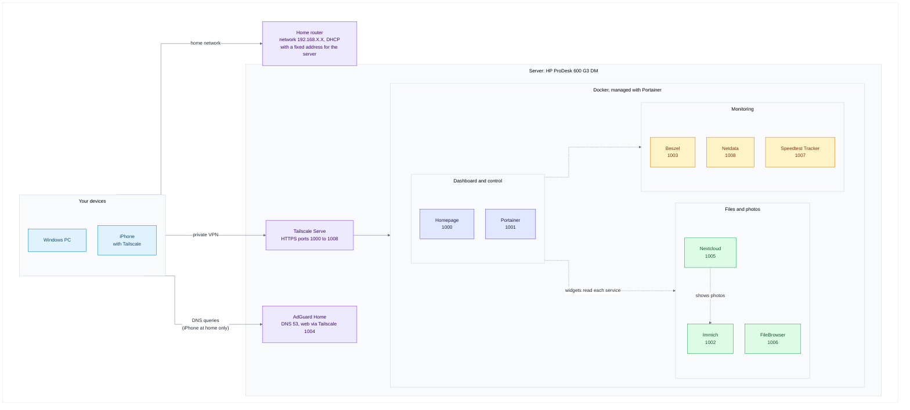
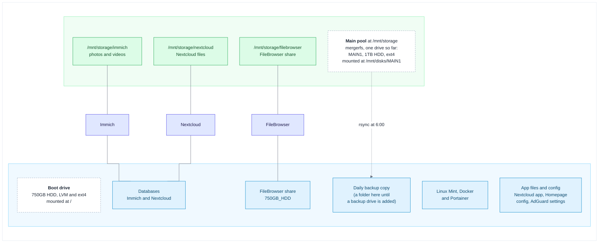

# My Home Lab

A self-hosted home lab running on a small HP mini PC: network-wide ad blocking, container management, system monitoring, file storage, photo backup, a personal cloud and a single dashboard that ties it all together. Everything is reachable from anywhere through a private Tailscale network, and nothing is exposed to the public internet.

> **About the placeholders.** Every address and name in this file is a placeholder: `your-username` (the Linux user), `192.168.X.X` (the server's address on your home network) and `your-tailnet.ts.net` (your Tailscale network name). Passwords, keys and tokens are written as `your-own-key`. Replace them with your own values and keep the real ones out of Git. The companion file [TROUBLESHOOTING.md](TROUBLESHOOTING.md) has the real values from my build, every problem I hit and how I fixed it, and the full migration from my previous server.


## Highlights

- **DNS-level ad and tracker blocking** for every device on the network, with AdGuard Home and 12 blocklists.
- **Nine services in Docker,** each deployed as a Portainer stack, so the whole setup can be rebuilt from text files.
- **Private remote access.** Tailscale gives every service its own trusted HTTPS address. There is no port forwarding and no public exposure.
- **A storage layout built to survive mistakes.** The data drives are joined into a pool with mergerfs and mounted by UUID, the empty mount points are locked so a missing drive can't fill the boot drive, Docker waits for the pool at boot, and one recovery command restores everything after a disconnect. A menu script connects, disconnects and moves drives, and undoes its own changes if a mount fails.
- **A daily backup with a 30-day undo.** `rsync` copies the data and the boot drive's config files every morning at 6:00. Files I delete or replace are kept in dated folders for 30 days, and the Nextcloud database is dumped every day.
- **Photo backup and a personal cloud.** Immich backs up phone photos, Nextcloud stores files, and Nextcloud can show the Immich library.
- **Live monitoring.** Beszel, Netdata and Speedtest Tracker feed widgets on the Homepage dashboard.
- **A custom-built dashboard** with frosted-glass cards, status dots, live widgets and a layout that adapts from phones to large monitors.

## What this project demonstrates

| Skill | What I did |
| :--- | :--- |
| **Linux administration** | Installed and configured Linux Mint on LVM, managed services with `systemd`, wrote `fstab` entries, `cron` jobs and `bash` scripts, set up SSH and unattended remote desktop. |
| **Networking and DNS** | Ran a network-wide DNS filter, reserved a fixed address in the router, freed port 53 from `systemd-resolved`, pointed devices at the DNS server by hand when the router would not allow it, and tested resolution with `nslookup`. |
| **Containers** | Deployed nine services as Docker Compose stacks through Portainer, used bind mounts and named volumes, host networking, health checks, restart policies and environment variables for secrets. |
| **Storage reliability** | Pooled drives with mergerfs, mounted ext4 drives by UUID with `nofail`, locked the empty mount points with `chattr +i`, ordered Docker after the mount with a `systemd` drop-in, tuned drive power management with `hdparm`, checked drive health with SMART, wrote a `bash` menu tool and recovery command that snapshot and roll back `fstab`, and scheduled a daily `rsync` backup that keeps deleted files for 30 days. |
| **Secure remote access** | Used a private mesh VPN with HTTPS certificates instead of opening ports, kept secrets out of files and out of Git, used separate least-privilege API keys, and handled a brute-force lockout correctly. |
| **Monitoring** | Combined Beszel, Netdata and Speedtest Tracker with live Homepage widgets, and used drive and container checks to prove each fix worked. |
| **Troubleshooting** | Diagnosed and fixed 63 real problems (drive paths, filesystem permissions, registry throttling, reverse-proxy settings, API errors) and wrote each one up as symptom, cause, fix and verification. |
| **Hardware** | Built a mini PC server: SATA boot drive, USB data drive, BIOS and Secure Boot changes, power adapter diagnosis, and a display emulator for headless remote desktop. |
| **Documentation and migration** | Planned and carried out a full server migration with a written runbook, and kept the documentation accurate by checking every step against the running system. |
| **Front-end customization** | Wrote the Homepage stylesheet: frosted-glass cards, per-service accent colors, responsive scaling for different screen widths. |

## Architecture

How devices reach the services:



Where the data lives:



## Hardware

| Part | Details |
| :--- | :--- |
| Computer | HP ProDesk 600 G3 Desktop Mini, Intel Core i5-7500T (4 cores) |
| Memory | 8GB DDR4-2400 (one SO-DIMM, one slot free) |
| Boot drive | 750GB 2.5-inch 5400 rpm hard drive in the internal bay (SATA) |
| Data drive | 1TB 2.5-inch 5400 rpm hard drive on a generic SATA to USB 3.0 adapter. It is `MAIN1`, the first drive of the main pool |
| Power | Genuine HP 65W adapter |
| Display | DisplayPort dummy plug (EDID emulator), so the headless machine behaves as if a monitor is attached |
| Network | Wired Ethernet, with a fixed address reserved in the router |
| Operating system | Linux Mint 22.3 XFCE on LVM, no disk encryption |

## Services

| Service | What it does | Local port | Tailscale address |
| :--- | :--- | :--- | :--- |
| Homepage | The dashboard that links to everything | 3001 | `https://pc.your-tailnet.ts.net:1000` |
| Portainer | Manages Docker containers and stacks | 9000 (HTTP), 9443 | `https://pc.your-tailnet.ts.net:1001` |
| Immich | Photo and video backup | 2283 | `https://pc.your-tailnet.ts.net:1002` |
| Beszel | Server health and resource graphs | 8090 | `https://pc.your-tailnet.ts.net:1003` |
| AdGuard Home | DNS filtering | 3000 (web), 53 (DNS) | `https://pc.your-tailnet.ts.net:1004` |
| Nextcloud | Personal cloud and file sync | 8082 | `https://pc.your-tailnet.ts.net:1005` |
| FileBrowser | Browser-based file manager | 8081 | `https://pc.your-tailnet.ts.net:1006` |
| Speedtest Tracker | Internet speed history | 8088 | `https://pc.your-tailnet.ts.net:1007` |
| Netdata | Live system metrics | 19999 | `https://pc.your-tailnet.ts.net:1008` |

Tested with: Linux Mint 22.3, mergerfs 2.33.5, Docker 29.9, Tailscale 1.104, Homepage 2.6, Immich 3.3, Nextcloud 35.0, Speedtest Tracker 1.15, FileBrowser 2.63, Beszel 0.21 and AdGuard Home 0.107.79.

## Table of Contents

1. [Hardware, BIOS and operating system](#1-hardware-bios-and-operating-system)
1. [Base system and remote access](#2-base-system-and-remote-access)
1. [Storage: drive pools and backups](#3-storage-drive-pools-and-backups)
1. [Docker](#4-docker)
1. [Portainer](#5-portainer)
1. [Tailscale](#6-tailscale)
1. [AdGuard Home](#7-adguard-home)
1. [Beszel](#8-beszel)
1. [Netdata](#9-netdata)
1. [FileBrowser](#10-filebrowser)
1. [Immich](#11-immich)
1. [Nextcloud](#12-nextcloud)
1. [Nextcloud and Immich integration](#13-nextcloud-and-immich-integration)
   - [13A. Nextcloud: sync your devices automatically](#13a-nextcloud-sync-your-devices-automatically)
1. [Speedtest Tracker](#14-speedtest-tracker)
1. [Homepage dashboard](#15-homepage-dashboard)
1. [Maintenance](#16-maintenance)
1. [Roadmap](#17-roadmap)
1. [Security and credentials](#18-security-and-credentials)
1. [Appendix: the scripts](#19-appendix-the-scripts)

---

## 1. Hardware, BIOS and operating system

### 1.1 Put the hardware together

1. Install the 750GB drive in the mini PC's internal 2.5-inch bay and connect it by SATA. This will be the boot drive.
1. Plug the genuine HP 65W power adapter into the mini PC. A third-party adapter with a converter tip did not work on this model (see [TROUBLESHOOTING.md](TROUBLESHOOTING.md)).
1. Connect the network cable to the router.
1. Keep the 1TB data drive disconnected until the operating system is installed, so the installer can't pick the wrong disk.
1. For the install, connect a monitor, keyboard and mouse. Afterwards the machine runs headless.

### 1.2 Make the installer USB stick

I used [Ventoy](https://www.ventoy.net/), which lets you copy ISO files onto a stick and choose which one to boot.

1. On a Windows PC, download Ventoy and run `Ventoy2Disk.exe`.
1. Select the USB stick and click **Install**. This erases the stick.
1. Copy the Linux Mint 22.3 XFCE ISO file onto the stick like any other file.

### 1.3 BIOS setting and booting the stick

1. Plug in the USB stick and power the mini PC on.
1. Press **F10** repeatedly at the HP logo to open the BIOS setup.
1. Turn **Secure Boot** off in the BIOS security settings. This was the only BIOS change I made.
1. Open **Boot Options** and choose the USB stick.
1. Ventoy loads. Select the Linux Mint XFCE ISO and choose to boot it in normal mode.

### 1.4 Install Linux Mint

From the live desktop, double-click **Install Linux Mint** and follow the installer:

1. Choose your language and keyboard layout.
1. Choose **Erase disk and install Linux Mint**, and pick the **750GB drive**. This erases that drive.
1. Open **Advanced features** and select **LVM**. Leave encryption off.
1. Set your time zone.
1. Enter your name, set the computer name to `pc`, choose a username (this guide uses `your-username`) and a strong password.
1. Let the install finish, then restart and remove the USB stick when asked.

### 1.5 First boot

Update the system and confirm the version:

```bash
sudo apt update && sudo apt upgrade -y
cat /etc/os-release | head -3
```

You should see `Linux Mint 22.3`. Then plug in the DisplayPort dummy plug if you want the machine to run without a monitor. It makes the graphics card believe a display is connected, which keeps the remote desktop smooth and lets the integrated graphics work.

**Verify:** `lsblk -f` shows the 750GB drive with an LVM partition and a `/` root, and `ip -br addr` shows your wired connection with an address.

---

## 2. Base system and remote access

### 2.1 Reserve a fixed address for the server

Every other setting in this guide depends on the server keeping the same address. Find the wired adapter's hardware (MAC) address:

```bash
ip -br link show
```

Look at the line for your wired adapter (mine is `eno1`) and note the `xx:xx:xx:xx:xx:xx` value. Then, in your router's settings, find the DHCP or address reservation page and reserve `192.168.X.X` for that hardware address. Restart the server or renew its address, and confirm:

```bash
ip -br addr
```

### 2.2 SSH server

SSH lets you control the server from another computer's terminal.

```bash
sudo apt update
sudo apt install openssh-server -y
sudo systemctl enable ssh
sudo systemctl start ssh
```

Connect from another machine:

```bash
ssh your-username@192.168.X.X
```

**Verify:** `sudo systemctl status ssh` shows `active (running)`, and the `ssh` command from your PC asks for your password.

### 2.3 Auto-login

So the desktop session starts without anyone sitting at the machine (needed for the remote desktop later), edit the login manager settings:

```bash
sudo nano /etc/lightdm/lightdm.conf
```

Under `[Seat:*]`, set:

```ini
[Seat:*]
autologin-guest=false
autologin-user=your-username
autologin-user-timeout=0
```

Save with `Ctrl+O`, `Enter`, `Ctrl+X`. The change applies at the next boot.

### 2.4 VS Code with Remote-SSH

For editing config files on the server from a Windows desktop, with proper syntax highlighting:

1. Install [VS Code](https://code.visualstudio.com/) on the Windows PC.
1. Install the **Remote - SSH** extension.
1. Press `Ctrl+Shift+P`, choose **Remote-SSH: Connect to Host**, and enter `your-username@192.168.X.X`.
1. Enter your password when asked.
1. Open a folder from the integrated terminal:

```bash
code -a ~/homepage-config/
```

> **Tip.** Files inside a Docker named volume (`/var/lib/docker/volumes/...`) are owned by root, so VS Code can't save them. The working approach is a bind mount, a normal folder in your home directory shared into the container. [Section 15](#15-homepage-dashboard) does this for Homepage's config.

### 2.5 AnyDesk (remote desktop)

AnyDesk gives full remote desktop access to the headless server, like a self-hosted TeamViewer.

```bash
sudo apt install gnupg2 -y
wget -qO - https://keys.anydesk.com/repos/DEB-GPG-KEY | sudo apt-key add -
echo "deb http://deb.anydesk.com/ all main" | sudo tee /etc/apt/sources.list.d/anydesk-stable.list
sudo apt update
sudo apt install anydesk -y
```

Get the ID you will connect to:

```bash
anydesk --get-id
```

Set a password for unattended access, so a connection doesn't need someone to click Accept on the server:

```bash
sudo anydesk --set-password
```

Start the service at boot:

```bash
sudo systemctl enable anydesk
sudo systemctl start anydesk
```

Start the AnyDesk window automatically after login (auto-login from section 2.3 makes this happen at boot):

```bash
mkdir -p ~/.config/autostart
cp /usr/share/applications/anydesk.desktop ~/.config/autostart/
```

From another device, install AnyDesk and connect with the ID and password. The DisplayPort dummy plug from section 1.5 keeps the screen resolution stable and the picture smooth.

**Verify:** `sudo systemctl is-active anydesk` prints `active`, and you can connect from your PC.

---

## 3. Storage: drive pools and backups

The big files live on hard drives that are grouped into **pools**. The Immich photos, the Nextcloud files and the FileBrowser share live in the **main pool**, which appears as the folder `/mnt/storage`. A second pool, `/mnt/backup`, holds the daily backup. Three small tools manage all of it, so connecting, removing, moving or recovering a drive is a menu choice instead of a pile of `fstab` edits.

| Command | What it does |
| :--- | :--- |
| `sudo drives` | A menu to see drive health, connect a new drive, disconnect a drive, move a drive between the main and backup pools, and recover after an unplug. |
| `sudo hdd-recover` | Run it after an unplug or a power cut. It finds the containers that use the storage, stops them, remounts every drive and pool, re-applies the power settings and starts the containers again. |
| `sudo homelab-backup` | Copies the main pool and the boot drive's config files to the backup. It runs by itself from `cron` at 6:00 every day. |

**How the storage is organised**

- Every real drive is an ordinary ext4 drive, mounted by its UUID under `/mnt/disks/` with a label: `MAIN1`, `MAIN2`, `BACKUP1` and so on. Any Linux computer can read one of them on its own.
- A pool joins all the drives of one role into a single folder using **mergerfs**. `/mnt/storage` is the main pool and `/mnt/backup` is the backup pool. The paths in the Docker stacks (`/mnt/storage/...`) never change, so adding a drive needs no edits in Immich, Nextcloud, FileBrowser or Homepage.
- New files go to the drive with the most free space, so two drives fill evenly. Files already on a drive stay where they are.
- **A pool is not RAID and it is not a backup.** If a drive dies, only the files stored on that drive disappear from the pool. That is why the backup is a separate pool on separate drives.
- **It fails closed.** If a drive is missing, the pool does not mount at all, instead of mounting half-empty. The empty mount point is locked, so the services stop with an error and can't quietly write to the boot drive. After you reconnect the drive, `sudo hdd-recover` fixes it.

**Why ext4:** it's a Linux filesystem, so Docker and databases get proper file permissions, and it isn't locked as "dirty" when the drive is unplugged the way NTFS can be.

### 3.1 Install the tools

```bash
timedatectl | grep "Time zone"
uname -r
sudo apt update && sudo apt install -y mergerfs rsync parted hdparm smartmontools
mergerfs --version | head -1
```

The time zone should be yours, because the 6:00 backup runs on the server's clock. Kernel 6.6 or newer is best. On an older kernel the script switches one mergerfs cache option by itself. `mergerfs` prints its version (2.33.5 from Ubuntu 24.04's repository on my machine).

### 3.2 Install the scripts

The three scripts are in the [`scripts/`](scripts/) folder of this repository, and their full source is in the [appendix](#19-appendix-the-scripts) at the end of this file. Clone the repository on the server, check the files, and install two of them (the third comes in 3.8):

```bash
sudo apt install -y git
git clone https://github.com/IbrandonrtI/My-Home-Lab-.git ~/My-Home-Lab-
cd ~/My-Home-Lab-/scripts
sha256sum -c SHA256SUMS
sudo install -m 755 drives /usr/local/sbin/drives
sudo install -m 755 homelab-backup /usr/local/sbin/homelab-backup
sudo drives version
sudo drives status
```

Every line of the checksum check should end in `OK`. If you copy the files from a Windows PC instead, run `grep -c $'\r' drives hdd-recover homelab-backup` as well. All three numbers must be `0`, because Windows line endings stop a script from running.

On a server with no pools yet, `status` looks like this:

```
=== Pools ===
main     /mnt/storage   NOT MOUNTED
backup   /mnt/backup    NOT MOUNTED

=== Pool drives ===
LABEL     ROLE     DEVICE       SIZE      USED      SMART     STATE
(no drives in a pool yet)

=== Other drives ===
/dev/sdb  698.6G  Hitachi HTS547575A9E384  [sata]   boot/system drive (never touched)

=== Last backup ===
no backup has run yet
```

> The scripts use the user name `brandon` in two places: the owner of a new main drive (`DRIVES_OWNER` at the top of `drives`) and the folders the backup copies (`CONFIG_PATHS` in `homelab-backup`). If your user name is different, run `sudo DRIVES_OWNER=your-username drives`, and put your own `CONFIG_PATHS` list in the settings file from 3.9. The settings file is read after the defaults, so it overrides them. The copy of the scripts in the appendix already shows `your-username`.

### 3.3 Practice with fake drives

Test mode uses disk-image files and its own folders (`/mnt/test-main`, `/mnt/test-backup`, `/mnt/test-disks`) and its own test `fstab`. Your real drives, `/etc/fstab` and containers are not touched, so you can learn the menu safely.

```bash
sudo DRIVES_TEST=1 drives test-setup 3 1G
sudo DRIVES_TEST=1 drives
```

`test-setup 3 1G` creates three 1 GB image files and attaches them as fake drives. In the menu:

1. Choose **2** (Connect a new drive), pick the first fake drive and choose **Main storage**. The script asks you to type the drive name, then `ERASE`. Nothing is erased until both match.
2. Connect a second fake drive as **Main storage** and a third as **Backup storage**.
3. Choose **1** to see the status: two main drives and one backup drive.
4. Choose **3** and try to remove a drive. With two main drives, it offers to copy that drive's files to the other one first, then checks that every file arrived before it lets go of the drive. With only one main drive, it refuses: removing the last one would take the storage away from your services.
5. Choose **0** to quit, then remove the test setup:

```bash
sudo DRIVES_TEST=1 drives test-cleanup
sudo drives status
```

**Do not skip `test-cleanup`.** If you do, the practice pool stays mounted. The last command should look exactly like it did in 3.2.

Here is what a good result looks like. I put two 200 MB files of random data in a practice pool of two fake drives (one file landed on each). I disconnected `TMAIN1`, which held one of them, and chose to copy its files first. The script printed `Verified: every file from TMAIN1 is also on TMAIN2.`, and `sha256sum` gave identical checksums for both files before and after.

You can repeat the practice with a real, spare USB stick (**it will be erased**). Test mode lists only unused drives, and the boot drive and your data drive never appear in the list.

### 3.4 Add the first main drive

There are two cases. Use the first for a new or blank drive, and the second if you already have an ext4 data drive mounted at `/mnt/storage`, as I did.

**A. A new drive.** Connect it and open the menu:

```bash
lsblk -o NAME,SIZE,MODEL,TRAN,MOUNTPOINTS
sudo drives
```

Choose **2** (Connect a new drive), pick the drive, check the size and model on screen, choose **Main storage**, then type the drive name and `ERASE`. **This erases the whole drive.** The script then:

1. wipes the drive and creates one GPT partition, formatted as ext4 with the label `MAIN1` and no 5% reserve (`mkfs.ext4 -m 0`);
2. creates `/mnt/disks/MAIN1` and `/mnt/storage`, and locks both empty folders with `chattr +i`, so nothing can write into them while no drive is mounted;
3. saves a copy of `/etc/fstab` (as `/etc/fstab.bak-drives-<date>`) and adds the lines below;
4. mounts the drive, mounts the pool, gives your user the top folder of the new drive and applies the power settings (3.7).

If the pool doesn't mount, the script restores `/etc/fstab` by itself and says so.

**B. A drive that is already mounted at `/mnt/storage`.** This keeps every file in place:

```bash
sudo drives adopt
```

The script shows what will change and asks `Continue? [y/N]`. Answer `y`. It stops the containers that use the storage, unmounts the drive, relabels it `MAIN1`, mounts it at `/mnt/disks/MAIN1`, builds the pool at `/mnt/storage` and starts the containers again. No file is moved or copied. If the pool shows a different number of items than the drive did, it rolls everything back.

**The `/etc/fstab` lines it writes** (the UUID is your drive's own):

```
UUID=<uuid-of-the-drive>  /mnt/disks/MAIN1  ext4  defaults,noatime,nofail,x-systemd.device-timeout=10  0  2
/mnt/disks/MAIN1 /mnt/storage fuse.mergerfs allow_other,cache.files=off,category.create=mfs,moveonenospc=true,dropcacheonclose=true,nofail,fsname=mergerfs-main,x-systemd.requires-mounts-for=/mnt/disks/MAIN1 0 0
```

| Pool option | Meaning |
| :--- | :--- |
| `allow_other` | Docker and the other users on the server can use the pool, not only root. |
| `cache.files=off` | No kernel file cache, so containers see changes straight away. (Kernels older than 6.6 use `auto-full` instead.) |
| `category.create=mfs` | New files go to the drive with the most free space. |
| `moveonenospc=true` | If a drive fills up while a file is being written, the file moves to a drive with room. |
| `dropcacheonclose=true` | Frees cached data when a file is closed. |
| `nofail` | The server still boots if the pool can't mount. |
| `fsname=mergerfs-main` | The name that `df` and `findmnt` show for the pool. |
| `x-systemd.requires-mounts-for=...` | One entry per drive. `systemd` mounts the pool only after all its drives are mounted. |

The type must be `fuse.mergerfs`, not `mergerfs`. In my testing, the plain `mergerfs` type rejected the `nofail` option.

**Check it worked.** Run the two `findmnt` commands one at a time, because `findmnt` prints nothing when it gets two paths:

```bash
findmnt /mnt/storage
findmnt /mnt/disks/MAIN1
sudo drives status
```

`/mnt/storage` should show the source `mergerfs-main` with the type `fuse.mergerfs`, and `/mnt/disks/MAIN1` should show your drive (`/dev/sda1` on my machine) as `ext4`. `status` should list `MAIN1` as `connected` with SMART `PASSED`:

```
=== Pools ===
main     /mnt/storage   mounted (fuse.mergerfs)  61GB used of 916GB
backup   /mnt/backup    NOT MOUNTED

=== Pool drives ===
LABEL     ROLE     DEVICE       SIZE      USED      SMART     STATE
MAIN1     main     /dev/sda1    916GB     61GB      PASSED    connected
```

Once the services exist (sections 10 to 12 and 15), each container should see the pool, not the boot drive:

```bash
docker exec immich_server df -h /data
docker exec nextcloud df -h /data
docker exec filebrowser-filebrowser-1 df -h /srv/hdd
docker exec homepage df -h /mnt/storage
```

Every line should show the filesystem `mergerfs-main` at about 916G. On my machine the same four commands worked unchanged after the conversion, which shows the stacks didn't need any edit.

### 3.5 Create a folder for each service

```bash
sudo mkdir -p /mnt/storage/immich /mnt/storage/filebrowser
sudo chown -R your-username:your-username /mnt/storage
sudo mkdir -p /mnt/storage/nextcloud
sudo chown -R 33:33 /mnt/storage/nextcloud
mkdir -p /home/your-username/nextcloud/html /home/your-username/nextcloud/db
mkdir -p /home/your-username/immich/postgres
mkdir -p /home/your-username/homepage-config
mkdir -p /home/your-username/750GB_HDD
sudo mkdir -p /opt/adguard-docker/conf /opt/adguard-docker/work
```

UID 33 is the user Nextcloud runs as inside its container (it shows as `www-data` in `ls -la`). The databases and app files stay on the boot drive. Only the photos and files go in the pool.

| Folder | Used by | Where |
| :--- | :--- | :--- |
| `/mnt/storage/immich` | Immich photos and videos | Main pool |
| `/mnt/storage/nextcloud` | Nextcloud files | Main pool |
| `/mnt/storage/filebrowser` | FileBrowser share | Main pool |
| `/home/your-username/immich/postgres` | Immich database | Boot |
| `/home/your-username/nextcloud/db` and `html` | Nextcloud database and app files | Boot |
| `/home/your-username/750GB_HDD` | FileBrowser share on the boot drive | Boot |
| `/home/your-username/homepage-config` | Homepage config files | Boot |
| `/opt/adguard-docker` | AdGuard Home settings | Boot |

### 3.6 Make Docker wait for the pool

```bash
sudo mkdir -p /etc/systemd/system/docker.service.d
printf '[Unit]\nWants=mnt-storage.mount\nAfter=mnt-storage.mount\n' | sudo tee /etc/systemd/system/docker.service.d/wait-for-hdd.conf
sudo systemctl daemon-reload
```

`/mnt/storage` is still a mount point that `systemd` knows as `mnt-storage.mount`, now with the pool on it. So this file is the same one I used with a single drive, and it needs no change. (Docker is installed in [section 4](#4-docker). If it isn't installed yet, create this file after installing it.)

### 3.7 Drive power settings

Laptop-style drives park their heads aggressively at the default power setting, which wears them out when a server never sleeps. One command sets safer levels on every pool drive:

```bash
sudo drives power
```

- **Main drives:** `hdparm -B 254 -S 0`. The first value is the least aggressive head parking. The second means the drive never spins down, which suits drives that Immich and Nextcloud use all day.
- **Backup drives:** `hdparm -B 254 -S 120`. The same head setting, and the drive spins down after 10 minutes without use (`120 x 5 seconds`), since it is only busy once a day.

The settings reset at every reboot, so add these two lines to root's crontab. The first re-applies the settings to every pool drive 60 seconds after boot. The second sets the boot drive, which it finds by the partition mounted at `/boot/efi`:

```bash
sudo crontab -e
```

```cron
@reboot sleep 60 && /usr/local/sbin/drives power >/dev/null 2>&1
@reboot sleep 60 && /usr/sbin/hdparm -B 254 "/dev/$(lsblk -no pkname "$(findmnt -no SOURCE /boot/efi)")"
```

Don't type a drive letter such as `/dev/sdb` into cron lines. If the letters swap after a reboot, the setting would land on the wrong drive. Both lines look the drive up instead.

Optional: log the head-parking count every morning so you can watch it:

```cron
0 6 * * * echo "$(date +\%F) $(smartctl -A -d sat /dev/disk/by-label/MAIN1 | awk '/Load_Cycle/ {print $10}')" >> /var/log/loadcycles.log
```

Check a drive (replace `sda` with its letter from `lsblk`):

```bash
sudo hdparm -B /dev/sda
sudo hdparm -C /dev/sda
```

The first should print `APM_level = 254`. The second prints the drive state, which is `active/idle` for a main drive. Some USB adapters ignore these commands and print `SG_IO: bad/missing sense data`. That message is harmless. The backup drives' sleep setting is the one part I haven't been able to test yet, because I don't have a backup drive. After you add one, wait 15 idle minutes and run `sudo hdparm -C` on it. It should say `standby`.

### 3.8 The recovery command

Containers keep the view of the drive they had when they started. If a drive is unplugged and plugged back in, the containers need a restart. `hdd-recover` is a one-line command that calls `drives recover`, which does the whole job:

```bash
cd ~/My-Home-Lab-/scripts
sudo install -m 755 hdd-recover /usr/local/bin/hdd-recover
sudo hdd-recover
```

It looks at what each container has mounted under `/mnt/storage`, `/mnt/backup` and `/mnt/disks`. That means a new service that uses the pool is picked up automatically, with no list of container names to maintain. Then it stops those containers, unmounts the pools and drives, mounts them again from `/etc/fstab`, re-applies the power settings and starts the containers. On my server it printed:

```
Stopping containers that use this storage: filebrowser-filebrowser-1 homepage immich_server nextcloud nextcloud_cron
Starting containers: filebrowser-filebrowser-1 homepage immich_server nextcloud nextcloud_cron
Recovered.
```

If a main drive isn't found, it prints `Drive not found. Check the cable.` with the drive's label and leaves the containers stopped on purpose, so nothing writes to the wrong place. A missing backup drive only produces a warning.

### 3.9 The daily backup

`homelab-backup` runs these steps in order:

1. dumps the Nextcloud database (the database lives on the boot drive, so a copy of the pool alone wouldn't contain it);
2. copies the main pool to the backup with `rsync`. A file you delete or replace is moved into a dated folder, `_deleted/<date>/`, and not destroyed;
3. copies the boot drive's config files: the Homepage config, the Nextcloud app files, AdGuard Home's settings, the Portainer, Beszel and FileBrowser data, `/etc/fstab`, the Docker wait file, the three scripts and root's crontab;
4. removes dumps and `_deleted` folders older than 30 days.

Immich also writes its own database backups into `/mnt/storage/immich/backups`, so they are included in the copy of the pool.

**Where it writes.** The target is the backup pool, `/mnt/backup`. Until you have a backup drive, point it at a folder on the boot drive. That protects you if the data drive fails, but not if the boot drive fails or the machine is lost. Create the settings file:

```bash
sudo tee /etc/homelab-backup.conf >/dev/null <<'EOF'
DEST_FALLBACK="/home/your-username/750GB_HDD/backup-interim"
EOF
cat /etc/homelab-backup.conf
```

Check there is room first (`df -h / /mnt/storage`). The first backup needs about as much space as the pool uses. Then run the first one in the background and watch the log (press `Ctrl+C` to stop watching; the backup keeps running):

```bash
sudo nohup /usr/local/sbin/homelab-backup >/dev/null 2>&1 &
sudo tail -f /var/log/homelab-backup.log
```

My first run copied 61 GB over the USB adapter in 1420 seconds (about 24 minutes) and ended with these lines:

```
2026-10-22 19:04:46 start
2026-10-22 19:04:46 backup pool not mounted, using the fallback folder /home/your-username/750GB_HDD/backup-interim
2026-10-22 19:04:53 database dump saved: /home/your-username/750GB_HDD/backup-interim/db-dumps/nextcloud-2026-10-22.sql.gz
2026-10-22 19:27:04 main storage copied
2026-10-22 19:28:26 configs copied
2026-10-22 19:28:26 finished: OK in 1420s
```

To check whether it is still running, use `pgrep -af homelab-backup`. The `f` matters, because the script runs under the name `bash`. When the log says `finished: OK`, check the result and compare the sizes:

```bash
sudo drives status
sudo du -sh /mnt/storage /home/your-username/750GB_HDD/backup-interim/main
```

The status should show `result: OK` with the destination, and the two sizes should be close (mine were both 61G). Then schedule it for 6:00 every day:

```bash
sudo crontab -e
```

```cron
0 6 * * * /usr/local/sbin/homelab-backup
```

**What the backup folder contains**

| Folder | What is in it |
| :--- | :--- |
| `main/` | A copy of the main pool |
| `boot-configs/` | The boot drive's config files listed above, plus `root-crontab.txt` |
| `db-dumps/` | One Nextcloud database dump per day (30 days kept) |
| `_deleted/<date>/` | Files you deleted or replaced that day (30 days kept, then removed) |

**Safety rules built in.** The backup refuses to run, and logs why, if main storage isn't mounted, if main storage looks empty (so a missing drive can never empty the backup), if the backup target isn't mounted and no fallback is set, or if the target has too little free space (less than 20 GB, or less than the pool's size plus 20 GB for the first run). `drives status` shows the result of the last run, and the log is `/var/log/homelab-backup.log`.

**Restore a file or folder.** Copy it out of the backup, and don't edit it there, because the next backup overwrites a changed file. Replace the backup path with your fallback folder while you still use one:

```bash
ls /mnt/backup/_deleted/
sudo cp -a /mnt/backup/_deleted/2026-10-22/main/immich/some-file.jpg /mnt/storage/immich/
sudo cp -a /mnt/backup/main/nextcloud/some-folder /mnt/storage/nextcloud/
```

The first line lists one folder per day. The second restores something you deleted or replaced that day. The third restores a file that is still in the latest copy. If you restore Nextcloud files this way, run `docker exec -u www-data nextcloud php occ files:scan --all` afterwards so Nextcloud notices them.

### 3.10 Verify the storage setup

Run the four `docker exec ... df` checks from 3.4. Then run two tests:

- **Reboot:** run `sudo reboot`. After about three minutes, run these one at a time, and the pool and drive should be mounted and the containers up with no help from you:

```bash
findmnt /mnt/storage
findmnt /mnt/disks/MAIN1
docker ps --format "table {{.Names}}\t{{.Status}}"
sudo drives status
```

- **Unplug:** with the stacks running, unplug the drive for ten seconds, plug it in, and run `sudo hdd-recover`. You should see `Recovered.` I tested this with fake drives, including the cases of a missing drive and a drive plugged back in. I haven't repeated it on my real drive since converting it to a pool, so treat your first run as the real test.

> The weekly health check for the drives is in [section 16](#16-maintenance).

### 3.11 Everyday use

| What you want | Command |
| :--- | :--- |
| See pools, drives, SMART health and the last backup | `sudo drives status` |
| Connect, disconnect or move a drive | `sudo drives` |
| After an unplug or a power cut | `sudo hdd-recover` |
| Run the backup now | `sudo homelab-backup` |
| Read the backup log | `sudo tail -50 /var/log/homelab-backup.log` |
| Read the drives log | `sudo tail -50 /var/log/homelab-drives.log` |

**Before you unplug a drive on purpose,** open `sudo drives` and choose **3** (Disconnect a drive), then unplug when it says it is safe. Don't just pull the cable.

**Adding a second main drive:** choose **2** and **Main storage**. The new drive is labelled `MAIN2`. New files go to whichever drive has more free space, and existing files stay where they are.

**Moving a drive between the pools:** choose **4**. The script offers to copy the drive's files to another drive of the same pool and verifies them. Then it erases the drive (after the same device-name and `ERASE` checks) and adds it to the other pool.

What the script refuses or double-checks:

- The boot drive and anything with a filesystem mounted outside the desktop's `/media` folder are never offered and never erased.
- Erasing needs the exact device name and then the word `ERASE`.
- It will not remove the last main drive. Removing the last backup drive needs the word `REMOVE`.
- Before removing a drive that holds files, it offers to copy them to another drive of the same pool first, and it checks that every file arrived.
- Every change snapshots `/etc/fstab` first and puts it back if a mount fails. If something goes wrong half way, the containers it stopped stay stopped, and it tells you to run `sudo hdd-recover`.

### 3.12 Adding the backup drive

I haven't done this on my own server yet, because I don't have the drive. I tested it with fake drives and a USB stick. Connect the drive, then:

```bash
sudo drives
```

Choose **2** (Connect a new drive), pick the drive and choose **Backup storage**. It becomes `BACKUP1`, mounted at `/mnt/disks/BACKUP1`, and `/mnt/backup` becomes the backup pool. A second backup drive becomes `BACKUP2` and joins the same pool.

Then delete the `DEST_FALLBACK` line from `/etc/homelab-backup.conf` and run `sudo homelab-backup`. `sudo drives status` should now show the destination `/mnt/backup`. After one good run on the new drive, free the space on the boot drive by deleting the interim folder (`sudo rm -rf /home/your-username/750GB_HDD/backup-interim`). Check the path before you press Enter.

To browse the backup from FileBrowser, add `- /mnt/backup:/srv/backup` to the volumes in its stack. The container name stays the same, so `hdd-recover` finds it by itself.

### 3.13 When a drive goes missing

- **A main drive is unplugged or dead:** the main pool does not mount, the empty locked `/mnt/storage` makes Immich, Nextcloud and FileBrowser fail with errors, and `sudo drives status` shows the drive as `MISSING`. Reconnect it and run `sudo hdd-recover`. I tested this with fake drives, not on my real hardware.
- **A backup drive is missing:** the main pool and the services are not affected, and the backup run fails and says why. `drives status` shows `FAILED` in the last-backup line.
- **A drive is gone for good:** the files that were stored on it are in the backup, up to a day old. A guided "replace a dead drive" option for the main and backup pools is planned (see [section 17](#17-roadmap)). Until then, don't improvise on the live pool.

---

## 4. Docker

Installed from Docker's official apt repository. Linux Mint doesn't have its own entry in Docker's repository list, so use Mint's Ubuntu base name instead. For Mint 22 that is `noble` (Ubuntu 24.04). Using the wrong name makes the install fail with a "held broken packages" error.

```bash
sudo install -m 0755 -d /etc/apt/keyrings
sudo curl -fsSL https://download.docker.com/linux/ubuntu/gpg -o /etc/apt/keyrings/docker.asc
sudo chmod a+r /etc/apt/keyrings/docker.asc

echo "deb [arch=$(dpkg --print-architecture) signed-by=/etc/apt/keyrings/docker.asc] https://download.docker.com/linux/ubuntu noble stable" | sudo tee /etc/apt/sources.list.d/docker.list > /dev/null

sudo apt-get update
sudo apt-get install -y docker-ce docker-ce-cli containerd.io docker-compose-plugin docker-ce-rootless-extras docker-buildx-plugin
```

Allow running `docker` without `sudo`, then reboot so the group change applies:

```bash
sudo usermod -aG docker $USER
sudo reboot
```

**Verify:**

```bash
docker --version
docker run hello-world
```

`hello-world` should print `Hello from Docker!`. If you created the storage pool in [section 3](#3-storage-drive-pools-and-backups) before installing Docker, add the wait rule from section 3.6 now.

---

## 5. Portainer

Portainer is a web dashboard for managing Docker. From here on, every service is deployed as a **stack** in Portainer: a Compose file pasted into a web page, which is easy to edit, redeploy and back up.

```bash
docker volume create portainer_data

docker run -d \
  -p 9443:9443 \
  -p 9000:9000 \
  --name portainer \
  --restart=always \
  -v /var/run/docker.sock:/var/run/docker.sock \
  -v portainer_data:/data \
  portainer/portainer-ce:latest
```

Open `http://192.168.X.X:9000` and create an admin account. Portainer closes its first-time setup after about five minutes. If the page says setup timed out, restart it and reload:

```bash
docker restart portainer
```

If it asks for a setup token, read it from the logs with `docker logs portainer`.

**How to deploy any stack below:**

1. In Portainer, go to **Stacks**, then **Add stack**.
1. Enter the stack name given in the section. The names matter, because container names are built from them.
1. Paste the YAML into the web editor.
1. If the section lists environment variables, open **Environment variables**, switch to advanced mode and paste them in, with your own values.
1. Click **Deploy the stack**.

Port 9000 is plain HTTP and is the one Tailscale will forward to. Portainer's own HTTPS port (9443) uses a self-signed certificate that Tailscale won't proxy.

**Verify:** `docker ps` lists `portainer`, and you can log in.


---

## 6. Tailscale

Tailscale builds a private network between your devices. Combined with Tailscale Serve, every service gets a trusted HTTPS address that only your devices can reach, with no port forwarding and no public exposure.

Install it on the server:

```bash
curl -fsSL https://tailscale.com/install.sh | sh
sudo tailscale up
```

Open the sign-in link it prints, in a browser that is signed in to your Tailscale account. The machine appears in the [admin console](https://login.tailscale.com/admin/machines) under its hostname (`pc`). Also install the Tailscale app on your PC and phone, and sign in to the same account.

**Publish each service over HTTPS** with Tailscale Serve. Each `--https` number becomes the port in the address. The address after it is where the service runs on the server. The numbers follow the order the services are listed in this guide:

```bash
sudo tailscale serve reset
sudo tailscale serve --bg --https=1000 http://192.168.X.X:3001
sudo tailscale serve --bg --https=1001 http://192.168.X.X:9000
sudo tailscale serve --bg --https=1002 http://192.168.X.X:2283
sudo tailscale serve --bg --https=1003 http://192.168.X.X:8090
sudo tailscale serve --bg --https=1004 http://192.168.X.X:3000
sudo tailscale serve --bg --https=1005 http://192.168.X.X:8082
sudo tailscale serve --bg --https=1006 http://192.168.X.X:8081
sudo tailscale serve --bg --https=1007 http://192.168.X.X:8088
sudo tailscale serve --bg --https=1008 http://192.168.X.X:19999
tailscale serve status
```

If the first command asks you to enable HTTPS certificates for your tailnet, follow the link it prints and enable them, then run the command again. Entries for services that aren't running yet show an error until those services are deployed.

| Service | Address |
| :--- | :--- |
| Homepage | `https://pc.your-tailnet.ts.net:1000` |
| Portainer | `https://pc.your-tailnet.ts.net:1001` |
| Immich | `https://pc.your-tailnet.ts.net:1002` |
| Beszel | `https://pc.your-tailnet.ts.net:1003` |
| AdGuard Home | `https://pc.your-tailnet.ts.net:1004` |
| Nextcloud | `https://pc.your-tailnet.ts.net:1005` |
| FileBrowser | `https://pc.your-tailnet.ts.net:1006` |
| Speedtest Tracker | `https://pc.your-tailnet.ts.net:1007` |
| Netdata | `https://pc.your-tailnet.ts.net:1008` |

To remove one entry: `sudo tailscale serve --https=1008 off`.

**Verify:** `tailscale serve status` lists nine entries, and `https://pc.your-tailnet.ts.net:1001` shows Portainer from a device that has Tailscale turned on.


---

## 7. AdGuard Home

Network-wide DNS filtering. It runs in Docker with host networking, so it answers DNS on the server's own port 53.

### 7.1 Free port 53

`systemd-resolved` listens on port 53 by default, which conflicts with AdGuard Home. Turn it off and let Tailscale manage `/etc/resolv.conf`. Do this over SSH on the **local network address** (`ssh your-username@192.168.X.X`), not the Tailscale one, because the last command restarts Tailscale and would cut off a session that goes through it. Download the AdGuard image first, while DNS still works:

```bash
docker pull adguard/adguardhome:v0.107.79

sudo systemctl disable systemd-resolved
sudo systemctl stop systemd-resolved
sudo rm /etc/resolv.conf
echo "nameserver 192.168.X.1" | sudo tee /etc/resolv.conf
sudo systemctl restart tailscaled
```

Replace `192.168.X.1` with your router's address. It keeps the server resolving names until AdGuard is running.

**Verify:**

```bash
sudo ss -tulpn | grep :53
cat /etc/resolv.conf
nslookup google.com
```

The first command should not list `systemd-resolve` on port 53. `resolv.conf` should either show your one line or a Tailscale header with `nameserver 100.100.100.100`, and the lookup should return an address.

### 7.2 Deploy the stack

Create a stack named `adguard`:

```yaml
services:
  adguard:
    image: adguard/adguardhome:v0.107.79
    container_name: adguardhome
    restart: unless-stopped
    network_mode: host
    volumes:
      - /opt/adguard-docker/work:/opt/adguardhome/work
      - /opt/adguard-docker/conf:/opt/adguardhome/conf
```

### 7.3 Setup wizard

Open `http://192.168.X.X:3000` and go through the wizard:

1. Set the admin web interface to listen on all interfaces, on port **3000**. The wizard proposes port 80, so change it. Everything else in this guide expects 3000.
1. Set the DNS server to listen on all interfaces, on port **53**.
1. Create an admin username and password.
1. Finish the wizard and log in.

My upstream servers are DNS-over-HTTPS from Quad9, Cloudflare and Google, with DNSSEC on. I enabled twelve blocklists: AdGuard DNS filter, AdAway Default Blocklist, AdGuard DNS Popup Hosts, HaGeZi's Pro, OISD Big, Peter Lowe's, Steven Black's, Dandelion Sprout's Game Console Adblock, HaGeZi's Allowlist Referral, HaGeZi's Apple Tracker, ShadowWhisperer's Dating List and Dandelion Sprout's Anti-Malware list. If a list ever blocks your upstream DNS providers, the fix is in [TROUBLESHOOTING.md](TROUBLESHOOTING.md).

**Verify:**

```bash
docker ps | grep adguard
sudo ss -tulpn | grep ':53 '
nslookup google.com 192.168.X.X
```

The container should be running, AdGuardHome should own port 53, and the lookup should answer.

### 7.4 Point your devices at it

My router wouldn't let me change its DNS setting, so I set the DNS server on each device by hand. Devices you don't change aren't filtered.

**Windows 11 (Ethernet):**

1. Open **Settings**, then **Network and internet**, then **Ethernet**.
1. Next to **DNS server assignment**, click **Edit**.
1. Choose **Manual**, switch **IPv4** on, and enter `192.168.X.X` as the preferred DNS and `8.8.8.8` as the alternate.
1. Click **Save**, then check with `nslookup google.com` in a terminal. The server shown should be `192.168.X.X`.

**iPhone (Wi-Fi):**

1. Open **Settings**, then **Wi-Fi**, then tap the **i** next to your network.
1. Tap **Configure DNS**, then **Manual**.
1. Remove any existing servers, then add `192.168.X.X` and `8.8.8.8`, and tap **Save**.

> The alternate DNS server `8.8.8.8` keeps the internet working if the server is off, but a device can use it at any time and skip AdGuard's filtering. Leave the alternate blank if you prefer strict filtering and don't mind losing internet when the server is down.

**Verify:** in AdGuard's dashboard, the **Top clients** list shows your devices' addresses, and the query count rises as you browse.


---

## 8. Beszel

Real-time CPU, memory, disk and network graphs. It has two parts: a **hub** (the dashboard) and an **agent** (which reports the stats).

### 8.1 Hub

Create a stack named `beszel`:

```yaml
services:
  beszel:
    image: henrygd/beszel:latest
    container_name: beszel
    restart: unless-stopped
    ports:
      - 8090:8090
    volumes:
      - beszel_data:/beszel_data

volumes:
  beszel_data:
```

Open `http://192.168.X.X:8090` and create an admin account.

### 8.2 Agent

1. In the hub, click **Add System** at the top right.
1. Enter a name (I used `ProDesk`) and the host `192.168.X.X`. Leave the port at `45876`.
1. Stay on the **Docker** tab. The window shows an agent file with your public key and a token already filled in. Keep this window open.
1. Click **Copy docker compose**.
1. In Portainer, create a stack named `beszel-agent` and paste what you copied. Check that `network_mode: host` is there and that `HUB_URL` is `http://192.168.X.X:8090`. It should look like this:

```yaml
services:
  beszel-agent:
    image: henrygd/beszel-agent
    container_name: beszel-agent
    restart: unless-stopped
    network_mode: host
    volumes:
      - /var/run/docker.sock:/var/run/docker.sock:ro
      - ./beszel_agent_data:/var/lib/beszel-agent
    environment:
      LISTEN: 45876
      KEY: 'your-own-key'
      TOKEN: your-own-key
      HUB_URL: http://192.168.X.X:8090
```

6. Deploy the stack, then go back to the hub window and click **Add system** at the bottom to finish.

**Verify:**

```bash
docker logs beszel-agent | tail -n 10
```

Look for a line like `WebSocket connected host=192.168.X.X:8090`. In the hub, the system turns green and starts showing graphs.

For the Homepage widget, Beszel needs a **superuser** login that is separate from your hub login. You will set it in [section 15](#15-homepage-dashboard).


---

## 9. Netdata

Live, second-by-second metrics for the whole system. Create a stack named `netdata`:

```yaml
version: '3'
services:
  netdata:
    image: netdata/netdata
    restart: always
    ports:
      - "19999:19999"
    cap_add:
      - SYS_PTRACE
    security_opt:
      - apparmor:unconfined
    volumes:
      - netdataconfig:/etc/netdata
      - netdatalib:/var/lib/netdata
      - netdatacache:/var/cache/netdata
      - /etc/passwd:/host/etc/passwd:ro
      - /etc/group:/host/etc/group:ro
      - /proc:/host/proc:ro
      - /sys:/host/sys:ro
      - /etc/os-release:/host/etc/os-release:ro

volumes:
  netdataconfig:
  netdatalib:
  netdatacache:
```

Open `http://192.168.X.X:19999`. The dashboard may offer to connect to Netdata Cloud. If it asks for a session ID, read it from the container (its name is built from the stack name, so it is `netdata-netdata-1`, not `netdata`):

```bash
docker exec netdata-netdata-1 cat /var/lib/netdata/netdata_random_session_id
```

If the page offers a way to continue without signing in, you can use the local dashboard as it is.

**Verify:** `docker ps` shows `netdata-netdata-1` as `healthy`, and the dashboard shows live charts.


---

## 10. FileBrowser

A web-based file manager for drag-and-drop access to the server's storage. It shares two folders: one on the boot drive and one on the data drive. The folders were created in [section 3.5](#35-create-a-folder-for-each-service).

Create a stack named `filebrowser`. The stack and service must both be named `filebrowser`, because the recovery script expects the container name `filebrowser-filebrowser-1`:

```yaml
version: '3'
services:
  filebrowser:
    image: filebrowser/filebrowser
    restart: always
    ports:
      - "8081:80"
    volumes:
      - "/home/your-username/750GB_HDD:/srv/750GB_HDD"
      - "/mnt/storage/filebrowser:/srv/hdd"
      - filebrowser_data:/database

volumes:
  filebrowser_data:
```

**First login.** This version creates the `admin` user with a random password the first time it starts, so `admin` / `admin` won't work. Read the password from the logs:

```bash
docker logs filebrowser-filebrowser-1 | grep -i password
```

Open `http://192.168.X.X:8081`, log in as `admin` with that password, and change it right away in your profile settings.

**Verify:**

```bash
docker ps
docker exec filebrowser-filebrowser-1 df -h /srv/hdd /srv/750GB_HDD
```

The container should be `healthy`. `/srv/hdd` should show the data drive (`/dev/sda1`, about 916G), and `/srv/750GB_HDD` should show the boot drive's `vgmint-root`.


---

## 11. Immich

Self-hosted photo and video backup with a phone app, albums, face grouping and search. The photos live on the data drive. The database stays on the boot drive, which is faster for a database than the USB-attached data drive.

> Immich changes often. Before you deploy, compare the file below with the `docker-compose.yml` in [Immich's current release](https://docs.immich.app/install/docker-compose), and use any newer image versions it pins.

### 11.1 Download the images first

Immich's images are on GitHub's container registry, which throttles many parallel downloads with a `toomanyrequests` error. Downloading them one at a time first avoids it:

```bash
docker pull ghcr.io/immich-app/immich-server:release
docker pull ghcr.io/immich-app/immich-machine-learning:release
docker pull ghcr.io/immich-app/postgres:14-vectorchord0.4.3-pgvectors0.2.0@sha256:bcf63357191b76a916ae5eb93464d65c07511da41e3bf7a8416db519b40b1c23
docker pull docker.io/valkey/valkey:9@sha256:c123e3715db63d06d4ad6964884037aa0d5d4d703939b9929954112889708e1d
```

If one prints `toomanyrequests`, wait a minute and run that line again.

### 11.2 Deploy the stack

Create a stack named `immich`:

```yaml
name: immich

services:
  immich-server:
    container_name: immich_server
    image: ghcr.io/immich-app/immich-server:${IMMICH_VERSION:-release}
    volumes:
      - ${UPLOAD_LOCATION}:/data
      - /etc/localtime:/etc/localtime:ro
    env_file:
      - stack.env
    ports:
      - '2283:2283'
    depends_on:
      - redis
      - database
    restart: always
    healthcheck:
      disable: false

  immich-machine-learning:
    container_name: immich_machine_learning
    image: ghcr.io/immich-app/immich-machine-learning:${IMMICH_VERSION:-release}
    volumes:
      - model-cache:/cache
    env_file:
      - stack.env
    restart: always
    healthcheck:
      disable: false

  redis:
    container_name: immich_redis
    image: docker.io/valkey/valkey:9@sha256:c123e3715db63d06d4ad6964884037aa0d5d4d703939b9929954112889708e1d
    healthcheck:
      test: redis-cli ping | grep -q PONG || exit 1
    restart: always

  database:
    container_name: immich_postgres
    image: ghcr.io/immich-app/postgres:14-vectorchord0.4.3-pgvectors0.2.0@sha256:bcf63357191b76a916ae5eb93464d65c07511da41e3bf7a8416db519b40b1c23
    environment:
      POSTGRES_PASSWORD: ${DB_PASSWORD}
      POSTGRES_USER: ${DB_USERNAME}
      POSTGRES_DB: ${DB_DATABASE_NAME}
      POSTGRES_INITDB_ARGS: '--data-checksums'
      DB_STORAGE_TYPE: 'HDD'
    volumes:
      - ${DB_DATA_LOCATION}:/var/lib/postgresql/data
    shm_size: 128mb
    restart: always
    healthcheck:
      disable: false

volumes:
  model-cache:
```

`DB_STORAGE_TYPE: 'HDD'` is Immich's own setting for a database that isn't on an SSD, which is the case here because the boot drive is a hard drive.

In **Environment variables**, paste these in advanced mode. Use letters and numbers only for the password, and use your own time zone:

```
UPLOAD_LOCATION=/mnt/storage/immich
DB_DATA_LOCATION=/home/your-username/immich/postgres
TZ=America/New_York
IMMICH_VERSION=release
DB_PASSWORD=your-own-key
DB_USERNAME=postgres
DB_DATABASE_NAME=immich
```

Deploy it. The first start takes a few minutes. On a hard-drive boot disk, wait for it to settle before deploying anything heavy, because Immich and Nextcloud starting together can overload the machine.


### 11.3 Verify and create your account

```bash
docker ps --format "table {{.Names}}\t{{.Status}}"
docker exec immich_server df -h /data
ls -a /mnt/storage/immich
```

All four Immich containers should be `healthy` or `Up`. `/data` should show the data drive (`/dev/sda1`, about 916G). After a minute, the folder should list `backups encoded-video library profile thumbs upload`. Open `http://192.168.X.X:2283` and create the admin account. The first account you create becomes the admin.

### 11.4 Phone app

1. Install the **Immich** app from the App Store or Google Play.
1. Enter the server address. At home use `http://192.168.X.X:2283`. Away from home, turn on the Tailscale app on the phone and use `https://pc.your-tailnet.ts.net:1002`.
1. Log in, then open the backup settings, choose which albums to back up, and turn backup on.

The first backup of a large library can take a long time and a lot of data, so start it on home Wi-Fi.

---

## 12. Nextcloud

A personal cloud: file sync, sharing, calendar and contacts. It runs as four containers: the app, a PostgreSQL database, Redis (file locking and caching) and a cron container for background jobs. The files live on the data drive. The database and app files stay on the boot drive.

### 12.1 Choose your passwords

You need three values. Use letters and numbers only, because symbols can break Portainer's parsing:

- `NC_ADMIN_USER`: the login name you will use in Nextcloud.
- `NC_ADMIN_PASSWORD`: the admin password. Make it strong.
- `NC_DB_PASSWORD`: a password that only Nextcloud and its database use to talk to each other. You never type it anywhere.

Nextcloud reads these once, at the first start. Changing them in Portainer afterwards does nothing, so choose them before you deploy and keep them somewhere safe.

### 12.2 Deploy the stack

Create a stack named `nextcloud`. The two addresses with `1005` must match the Tailscale port you gave Nextcloud in [section 6](#6-tailscale):

```yaml
services:
  db:
    image: postgres:16-alpine
    container_name: nextcloud_db
    restart: always
    environment:
      POSTGRES_DB: nextcloud
      POSTGRES_USER: nextcloud
      POSTGRES_PASSWORD: ${NC_DB_PASSWORD}
    volumes:
      - /home/your-username/nextcloud/db:/var/lib/postgresql/data

  redis:
    image: redis:alpine
    container_name: nextcloud_redis
    restart: always

  app:
    image: nextcloud:apache
    container_name: nextcloud
    restart: always
    depends_on:
      - db
      - redis
    ports:
      - "8082:80"
    environment:
      POSTGRES_HOST: db
      POSTGRES_DB: nextcloud
      POSTGRES_USER: nextcloud
      POSTGRES_PASSWORD: ${NC_DB_PASSWORD}
      REDIS_HOST: redis
      NEXTCLOUD_ADMIN_USER: ${NC_ADMIN_USER}
      NEXTCLOUD_ADMIN_PASSWORD: ${NC_ADMIN_PASSWORD}
      NEXTCLOUD_DATA_DIR: /data
      NEXTCLOUD_TRUSTED_DOMAINS: "192.168.X.X pc.your-tailnet.ts.net"
      OVERWRITEPROTOCOL: https
      OVERWRITEHOST: pc.your-tailnet.ts.net:1005
      OVERWRITECLIURL: https://pc.your-tailnet.ts.net:1005
      TRUSTED_PROXIES: "172.16.0.0/12 192.168.X.X"
      PHP_UPLOAD_LIMIT: 10G
    volumes:
      - /home/your-username/nextcloud/html:/var/www/html
      - /mnt/storage/nextcloud:/data

  cron:
    image: nextcloud:apache
    container_name: nextcloud_cron
    restart: always
    entrypoint: /cron.sh
    depends_on:
      - db
      - redis
    volumes:
      - /home/your-username/nextcloud/html:/var/www/html
      - /mnt/storage/nextcloud:/data
```

Environment variables:

```
NC_ADMIN_USER=your-admin-name
NC_ADMIN_PASSWORD=your-own-key
NC_DB_PASSWORD=your-own-key
```

What the settings do:

- `NEXTCLOUD_DATA_DIR: /data` puts the user files on the data drive. It can't be changed after the first install.
- `OVERWRITEHOST`, `OVERWRITEPROTOCOL` and `OVERWRITECLIURL` tell Nextcloud that it sits behind Tailscale's HTTPS address, so every link it builds is correct. Because of them, log in through the Tailscale address. The local address redirects to it.
- `TRUSTED_PROXIES` lets Nextcloud trust the forwarded requests from Docker's networks and the server itself.

### 12.3 Verify

The first start takes 2 to 10 minutes, longer on a hard-drive boot disk. Watch it, and press `Ctrl+C` when Apache is ready (that only stops the log view):

```bash
docker logs -f nextcloud
```

Then check the data folder. Nextcloud makes it private, so it needs `sudo`:

```bash
docker exec nextcloud df -h /data
sudo ls -a /mnt/storage/nextcloud
```

`/data` should show the data drive, and the folder should contain `.ncdata`, an `appdata_...` folder and a folder named for your login. Open `https://pc.your-tailnet.ts.net:1005` from a device with Tailscale on, and log in with your admin name and password. After you're in, change the admin password to one you haven't used anywhere else (your profile, then **Security**).


---

## 13. Nextcloud and Immich integration

The `integration_immich` app (version 1.5.1 in my setup) connects Nextcloud to Immich so that your Immich photos show through Nextcloud. It talks to Immich with an API key, so you never share your Immich login with Nextcloud.

### 13.1 Create an Immich API key

1. Open Immich at `http://192.168.X.X:2283` and log in.
1. Click your profile picture at the top right, then **Account Settings**, then **API Keys**, then **New API Key**.
1. Name it `nextcloud`, so you can recognize and revoke it later. For permissions, choose **All** for the first test. You can narrow them later using the app's documentation.
1. Copy the key when it appears. It's shown only once, so don't lose it and never paste it into a chat or a file in Git.

### 13.2 Let Nextcloud talk to a private address

Nextcloud blocks connections to local network addresses by default, which protects against a server being tricked into probing your network. Because Immich runs on the same machine, allow it:

```bash
docker exec -u www-data nextcloud php occ config:system:set allow_local_remote_servers --value=true --type=boolean
docker exec -u www-data nextcloud php occ config:system:get allow_local_remote_servers
```

The second command should print `true`.

### 13.3 Check that Nextcloud can reach Immich

Do this before involving the app, so a problem is easy to place. It uses PHP, which is always inside the Nextcloud container:

```bash
docker exec -u www-data nextcloud php -r 'echo file_get_contents("http://192.168.X.X:2283/api/server/ping");'
```

It should print `{"res":"pong"}`. If it doesn't, check that Immich is running (`docker ps`) and that the address is right before going on.

### 13.4 Install the app

1. In Nextcloud, click your avatar at the top right, then **Apps**.
1. Search for `Immich` and click **Download and enable** on the Immich integration.
1. Confirm it installed:

```bash
docker exec -u www-data nextcloud php occ app:list | grep -i immich
```

You should see `integration_immich` and its version. The app store only lists apps that work with your Nextcloud version. If nothing appears in the search, that is the usual reason.

### 13.5 Connect it

1. Click your avatar, then **Personal settings**, and open **Immich Integration** in the left menu.
1. For **Immich server URL**, enter `http://192.168.X.X:2283`. Use the local address, with no `/photos` and no `/api` on the end. Don't use the Tailscale name or `http://immich_server:2283`: Nextcloud and Immich are on different Docker networks, and a container can't reliably reach the server's own Tailscale address.
1. For **API key**, paste the key from step 13.1.
1. Click **Test connection**, then **Save**.

**Verify:** the test reports a successful connection, and your Immich photos show up through Nextcloud.

**If the test fails:**

- `local IP blocked` means step 13.2 wasn't applied.
- An authentication error means the key was pasted wrongly or lacks permissions. Create a new key and try again.
- A timeout or "could not connect" means step 13.3 should have failed. Fix that first.

To disconnect Nextcloud from Immich at any time, delete the `nextcloud` key in Immich's API Keys page.

---

## 13A. Nextcloud: sync your devices automatically

Nextcloud is only useful once your devices talk to it. This section installs the Nextcloud app on each kind of device, signs it in to the server from [section 12](#12-nextcloud), and sets up a folder that syncs by itself. On a computer, that folder is Documents. On a phone, it is a way to send files to the server. Photos and videos from phones are handled by Immich ([section 11](#11-immich)), so I leave photo upload off in the Nextcloud app.

### 13A.1 Before you begin

1. **Turn on Tailscale on the device.** The server has no public address. A device can only reach `https://pc.your-tailnet.ts.net:1005` while Tailscale is installed, signed in to the same account and connected (see [section 6](#6-tailscale)). If an app can't connect, this is the first thing to check.
1. **Know your server address and login.** The address is `https://pc.your-tailnet.ts.net:1005`. Use `https://`, keep the `:1005`, and add nothing after it. The login is the name and password from [section 12.1](#121-choose-your-passwords), or the password you changed it to.
1. **Sync is not a backup.** A synced folder is one set of files kept identical in several places. If you delete a file on one device, the deletion is copied to every other device. Right now the server holds one copy of its data on the data drive. The weekly backup to a second drive is still on the [roadmap](#17-roadmap), so keep another copy of anything you can't replace.

How much of each platform I tested:

| Platform | Status |
| :--- | :--- |
| Windows | Tested on my setup |
| iPhone | Install, sign-in and browsing tested. Uploading files follows Nextcloud's official instructions, not tested on my setup |
| Linux (Linux Mint and Ubuntu) | Follows Nextcloud's official instructions, not tested on my setup |
| macOS | Follows Nextcloud's official instructions, not tested on my setup |
| Android | Follows Nextcloud's official instructions, not tested on my setup |

Download links and system requirements come from [nextcloud.com/install](https://nextcloud.com/install/), checked on 20 October 2026. They change, so check that page if a version below doesn't match.

### 13A.2 Windows

**Requirements:** Windows 10 version 1809 or later, 64-bit. The installer is a `.msi` file.

**Step 1: check where your Documents folder really is.** On many Windows PCs, Documents is stored inside OneDrive, which means OneDrive is already syncing it. Two sync tools on one folder can fight each other and create duplicate or conflicting files.

1. Open File Explorer. In the left panel, right-click **Documents** and choose **Properties**.
1. Open the **Location** tab and read the path.
   - `C:\Users\your-windows-username\Documents` means it is a normal folder.
   - A path with `OneDrive` in it, such as `C:\Users\your-windows-username\OneDrive\Documents`, means OneDrive manages it.

If OneDrive manages it, choose one of these before you go on: turn off OneDrive's backup of Documents (in OneDrive's settings, under **Sync and backup**, then **Manage backup**, though the wording changes between versions), or sync a different folder with Nextcloud. My Documents folder was inside OneDrive and Nextcloud's sync worked with both turned on, but I did not test for long-term problems, and I don't know whether Nextcloud supports that combination.

**Step 2: download and install.**

1. On a device with a browser, open [nextcloud.com/install](https://nextcloud.com/install/) and download the Windows desktop client (the `.msi` file).
1. Double-click the file, accept the prompts and click **Yes** if Windows asks for permission. Finish the installer.
1. Start **Nextcloud** from the Start menu.

**Step 3: sign in.**

1. Enter the server address `https://pc.your-tailnet.ts.net:1005` and click **Next** (or **Log in**).
1. Your browser opens the Nextcloud login page. Log in, then click **Grant access**.
1. Return to the Nextcloud window. It shows the account and asks how to set up the local folder.

**Step 4: the first-run screen.** The screen offers **Virtual files**, **Synchronize everything** and **Choose what to sync**, and shows a local folder (`C:\Users\your-windows-username\Nextcloud` by default). I chose **Synchronize everything**, kept the default folder and clicked **Done**.


> **Heads up.** This first connection downloads the whole server into the `Nextcloud` folder. Any folder you add in step 5 will also appear there, which gives you a second copy of the same files. The note at the end of this subsection explains how to avoid or remove it. A cleaner order, which I haven't tested, is to click **Set up later** here and add only the folder you want in step 5.

**Step 5: add your Documents folder.**

1. Find the Nextcloud icon in the system tray at the bottom right of the screen. If you don't see it, click the small arrow to show hidden icons.
1. Click the icon, click your account name or avatar, then click **Settings**.
1. On your account's tab, click **Add Folder Sync Connection**.
1. Choose the local folder: your Documents folder, as shown by the Location tab in step 1. Click **Next**.
1. Choose the server folder. Create a new folder on the server and name it `Document sync`. Select it and continue.
1. The last screen has an option for **virtual files**. I left it on. With virtual files, your files show up in File Explorer but are only downloaded when you open them, which saves disk space. If you want every file stored on the PC at all times, turn it off. You can also right-click a file or folder and use **Always keep on this device**.
1. Click **Finish**.


**Step 6: start it with Windows.** In the same Settings window, open the **General** tab and look for the option to launch Nextcloud on system startup. Turn it on, so sync continues after a restart.

**Verify:** in the Settings window, the connection shows a green check and the words "Synchronizing" followed by your Documents folder. Open `https://pc.your-tailnet.ts.net:1005` in a browser. The **Files** page should list the `Document sync` folder with your files in it. For a live test, create a text file named `sync-test.txt` in Documents. Within a minute it should appear in the browser. Delete the test file afterwards.

**If you end up with a second copy.** Open `C:\Users\your-windows-username\Nextcloud`. If it contains a `Document sync` folder with files, you have two local copies of the same server folder. This was my situation.

- **Never delete the extra copy in File Explorer.** Both folders are the same server folder, so deleting files in one place sends the deletion to the server and then to your real Documents folder.
- To remove it safely, first confirm the files are visible on the server in your browser. Then open the Settings window, expand the main `Nextcloud` connection, untick `Document sync` and click **Apply**. The window warns that unchecked folders are removed from your local file system. Only the local copy in the `Nextcloud` folder is removed. The server and your real Documents folder stay as they are. I have not run this step on my setup yet.

### 13A.3 Linux (Linux Mint and Ubuntu)

**Not tested on my setup. This follows Nextcloud's official instructions.** There are two ways to install it. The AppImage is the one on Nextcloud's download page, so use it first. The Flatpak is a second option.

#### Option 1: the AppImage (from Nextcloud's download page)

An AppImage is a single program file. You don't install it with the package manager. You make it executable and run it.

1. Open [nextcloud.com/install](https://nextcloud.com/install/) and download the Linux desktop client. The file ends in `.AppImage` and goes to your `Downloads` folder.
1. Open a terminal and make the file executable. The `*` stands for the version in the file name:

   ```bash
   cd ~/Downloads
   chmod +x Nextcloud-*.AppImage
   ```

1. Run it:

   ```bash
   ./Nextcloud-*.AppImage
   ```

1. If it fails with an error that mentions FUSE, install the library AppImages need, then run it again. This is from my own knowledge, not from Nextcloud's page. On Linux Mint 22 and Ubuntu 24.04 the package is named `libfuse2t64`. On older releases (Linux Mint 21, Ubuntu 22.04) it is `libfuse2`:

   ```bash
   sudo apt install libfuse2t64
   ```

1. Move the file somewhere permanent, so you don't lose it in Downloads:

   ```bash
   mkdir -p ~/Applications
   mv ~/Downloads/Nextcloud-*.AppImage ~/Applications/
   ```

1. To start it at login, open **Startup Applications** (Linux Mint) or **Startup Applications Preferences** (Ubuntu), add a new entry and give it the full path to the file in `~/Applications`.

#### Option 2: the Flatpak (from Flathub)

Nextcloud GmbH publishes this client on Flathub as `com.nextcloud.desktopclient.nextcloud`. Nextcloud's own download page does not offer it for this client, so this is a second choice. Linux Mint comes with Flatpak and Flathub. On Ubuntu, install Flatpak and add the Flathub repository first (see [flathub.org/setup](https://flathub.org/setup)).

```bash
flatpak install flathub com.nextcloud.desktopclient.nextcloud
flatpak run com.nextcloud.desktopclient.nextcloud
```

Flatpak apps run in a sandbox, so the client may not be allowed to see your Documents folder. Check what it can access:

```bash
flatpak info --show-permissions com.nextcloud.desktopclient.nextcloud
```

If your Documents folder isn't covered, use a tool such as Flatseal to grant it, or use the AppImage.

#### Sign in and set up the sync (both options)

1. In the first window, enter `https://pc.your-tailnet.ts.net:1005` and continue. Log in in the browser and click **Grant access**.
1. On the local folder screen, keep the default (`~/Nextcloud`) and finish. The same second-copy warning from [13A.2](#13a2-windows) applies. If the screen lets you choose what to sync, untick everything. I haven't tested that.
1. Open the Nextcloud icon in the system tray, then **Settings**, then click **Add Folder Sync Connection**.
1. Choose your Documents folder (`~/Documents`), then create a server folder named `Document sync` and finish.
1. The client needs a password keyring (GNOME Keyring or KWallet) to remember your login. Most desktops include one. If it asks you to create or unlock a keyring, use your normal login password.

**Verify:** the connection shows a green check, and `https://pc.your-tailnet.ts.net:1005` lists the `Document sync` folder with your files.

### 13A.4 macOS

**Not tested on my setup. This follows Nextcloud's official instructions.**

**Requirements:** macOS 13 or later. The download page also lists an older build for macOS 11. The installer is a `.pkg` file.

1. Open [nextcloud.com/install](https://nextcloud.com/install/) and download the macOS desktop client.
1. Double-click the `.pkg` file, click **Continue** and **Install**, enter your Mac's password when asked, then click **Close**.
1. Open **Nextcloud** from the Applications folder or Launchpad.
1. Enter `https://pc.your-tailnet.ts.net:1005`, continue, log in in the browser and click **Grant access**.
1. On the local folder screen, keep the default folder and finish. The second-copy warning from [13A.2](#13a2-windows) applies here too.
1. Click the Nextcloud icon in the menu bar, then **Settings**, then **Add Folder Sync Connection**.
1. Choose your Documents folder. If macOS asks whether Nextcloud may access files in the Documents folder, click **Allow**.
1. Create a server folder named `Document sync` and finish.
1. In **General** settings, look for the option to launch Nextcloud at login, and turn it on.

**Check for iCloud first.** If iCloud Drive is set to store your Desktop and Documents folders (in System Settings, under your Apple Account, then iCloud, though the wording changes between macOS versions), Apple is already syncing Documents. Don't sync the same folder with two tools. This is the same problem as OneDrive on Windows.

**A note on virtual files.** Nextcloud publishes a macOS build with virtual files, which shows a **Nextcloud** location in Finder's sidebar under Locations. I didn't use it. The steps above use the classic sync folders, which still work in that build but have no Finder icons.

**Verify:** the connection shows a green check, and `https://pc.your-tailnet.ts.net:1005` lists the `Document sync` folder with your files.

### 13A.5 iPhone

**Install, sign-in and browsing are tested on my setup. Uploading files follows Nextcloud's official instructions, not tested on my setup.**

**Requirements:** iOS 17.0 or later.

1. Open the App Store, search for **Nextcloud** and install the app published by Nextcloud GmbH.
1. Turn on Tailscale on the iPhone and check that it is connected.
1. Open Nextcloud and enter the server address `https://pc.your-tailnet.ts.net:1005`.
1. Log in with your Nextcloud name and password, and allow access when the app asks.
1. The **Files** tab opens.

**Verify:** the **Files** tab lists the `Document sync` folder from your PC, with its size and when it last changed.


**Sending files from the phone.** Tap the **+** button at the bottom right of the Files tab and choose the option to upload files. Pick a file and it is sent to the folder you have open. I didn't test this, and I didn't write out the menu names, because I haven't seen them on my phone.

**Limits.** As far as I could check, the iPhone app does not keep a phone folder in sync with the server the way the desktop app does. Treat the phone as a way to browse files, open them and upload them by hand. Photos and videos go to Immich. If the Nextcloud app shows photo auto upload settings, leave them off so you don't store every photo twice.

### 13A.6 Android

**Not tested on my setup. This follows Nextcloud's official instructions.**

1. Install the Nextcloud app from Google Play (`com.nextcloud.client`), from F-Droid, or by downloading the APK from [nextcloud.com/install](https://nextcloud.com/install/).
1. Turn on Tailscale on the phone and check that it is connected.
1. Open the app, enter `https://pc.your-tailnet.ts.net:1005` and tap **Log in**. Log in in the browser and grant access.

**Verify:** the file list shows the `Document sync` folder from your PC.

**Sending files by hand.** Tap the **+** button and choose the option to upload files, then pick the files. The exact wording of the menu can differ between versions.

**Sending a folder automatically (auto upload).** The Android app can upload a folder from the phone on its own. The path below comes from a Nextcloud community forum thread, not from the official manual:

1. Open the app's **Settings**, then **Auto upload**.
1. Tap the three-dot menu and choose **Set up a custom folder**.
1. Pick the folder on the phone and the destination folder on the server.

Limits: it is one-way upload only. Files that change on the server are not copied back to the phone. It may only see photos and videos on some phones, because Android restricts which files an app may read. One user reported this on Android 14. If background uploads stop, check the phone's battery settings, since they can pause apps. I leave the camera folder out, because Immich backs up photos and videos.

### 13A.7 If it doesn't connect

- **The app says it can't reach the server.** Tailscale is off or disconnected on that device. Open Tailscale, connect, and try again.
- **The address is rejected.** It must start with `https://`, end with `:1005` and have nothing after it. Use the Tailscale address and not the local `192.168.X.X` one. The local address only redirects to it (see [section 12.2](#122-deploy-the-stack)).
- **The login fails several times.** Nextcloud blocks an address after repeated failed logins (see [section 18](#18-security-and-credentials)). Wait a few minutes before you try again.
- **Files don't appear in the browser.** In the desktop app, open Settings and look for an error message under the connection. It names the file or the problem.
- **A folder won't sync because of an overlap.** Nextcloud's documentation says a server folder can only sync to one local folder, and that the client can refuse a folder inside one that already syncs. In my setup the client accepted `Document sync` next to the main connection, but that is what produced the second copy described in [13A.2](#13a2-windows). Look at the connections list for the overlap and remove the connection you don't need, using **Remove folder sync connection** from the three-dot menu. That stops syncing that folder.

Remember that sync is not a backup. Deleting a file in a synced folder deletes it everywhere.

---

## 14. Speedtest Tracker

Runs internet speed tests on a schedule and keeps the history. The Homepage widget reads its results.

**1. Generate its app key.** The app uses this key to encrypt its data. The `base64:` at the start is part of the key and must stay:

```bash
echo "base64:$(openssl rand -base64 32 2>/dev/null)"
```

Copy the whole output.

**2. Download the image.** It comes from the same registry that throttles Immich's downloads:

```bash
docker pull lscr.io/linuxserver/speedtest-tracker:latest
```

**3. Deploy the stack.** Create a stack named `speedtest-tracker`, and replace the `APP_KEY` value with your key, quotes included:

```yaml
services:
  speedtest-tracker:
    image: lscr.io/linuxserver/speedtest-tracker:latest
    container_name: speedtest-tracker
    restart: unless-stopped
    ports:
      - "8088:80"
    environment:
      PUID: "1000"
      PGID: "1000"
      APP_KEY: "base64:your-own-key"
      APP_DEBUG: "false"
      APP_URL: "http://192.168.X.X:8088"
      DB_CONNECTION: sqlite
```

**4. Log in and change the default login.** Open `http://192.168.X.X:8088`. The default login is `admin@example.com` with the password `password`. Change both in your profile settings straight away.

**5. Create an API token for the Homepage widget.** Open `http://192.168.X.X:8088/admin/api-tokens`, create a token and give it the **Read Results** ability. Copy it, because it's shown once. Then run one speed test from the dashboard so there is a result for the widget to read.

**Verify:**

```bash
curl -s -H "Accept: application/json" -H "Authorization: Bearer your-own-key" http://192.168.X.X:8088/api/v1/results/latest | head -c 300
```

Put your real token in place of `your-own-key`. You should see JSON with your download and upload speeds. `Unauthenticated` means the token is wrong or lacks the Read Results ability.


---

## 15. Homepage dashboard

A single landing page that links to every service, with live widgets for system resources, container counts, DNS statistics and more. The configuration lives in the [`homepage-config/`](homepage-config/) folder of this repository.

| File | What it does |
| :--- | :--- |
| `services.yaml` | The service cards, their links, status dots and widgets |
| `widgets.yaml` | The top bar: CPU, memory and temperature, drives, date and time, weather, search |
| `settings.yaml` | Title, theme, background image and layout |
| `bookmarks.yaml` | A short generic example of bookmarks |
| `custom.css` | The frosted-glass look, per-service accent colors and responsive scaling |

### 15.1 Download the image and get the config

The image comes from GitHub's registry, so download it first:

```bash
docker pull ghcr.io/gethomepage/homepage:latest
```

Copy the config from this repository into the folder you created in section 3.5. Do this before Homepage's first start. If you already cloned the repository in section 3.2, skip the `git clone` line:

```bash
sudo apt install git -y
git clone https://github.com/IbrandonrtI/My-Home-Lab-.git ~/My-Home-Lab-
cp ~/My-Home-Lab-/homepage-config/* ~/homepage-config/
```

The files use placeholders for addresses. Replace them with your real ones (change `192.168.1.50` and `your-real-name.ts.net` to your own values):

```bash
cd ~/homepage-config
sed -i 's/192\.168\.X\.X/192.168.1.50/g; s/your-tailnet\.ts\.net/your-real-name.ts.net/g' services.yaml
```

### 15.2 Deploy the stack

Create a stack named `homepage`. Replace the two placeholders in `HOMEPAGE_ALLOWED_HOSTS` with your real address and Tailscale name. Homepage refuses requests from addresses that aren't on this list:

```yaml
services:
  homepage:
    image: ghcr.io/gethomepage/homepage:latest
    container_name: homepage
    restart: unless-stopped
    ports:
      - 3001:3000
    environment:
      HOMEPAGE_ALLOWED_HOSTS: 192.168.X.X:3001,pc.your-tailnet.ts.net:1000,localhost:3001
    volumes:
      - /home/your-username/homepage-config:/app/config
      - /var/run/docker.sock:/var/run/docker.sock:ro
      - /:/host:ro
      - /mnt/storage:/mnt/storage:ro
```

The config folder is a **bind mount** (a normal folder), so you can edit it from VS Code without permission errors. The last line shares the data drive so the drive widget can read its free space.

Open `http://192.168.X.X:3001`. You should see the cards and the styling. Cards with widgets show errors until you fill in their keys, which is expected.

### 15.3 Fill in the widget keys

Every `your-own-key` in `services.yaml` needs a real value. **Stop Homepage while you edit, then start it again.** A widget with a wrong login retries every few seconds, and Nextcloud treats that as an attack and blocks the address for a while:

```bash
docker stop homepage
nano ~/homepage-config/services.yaml
docker start homepage
```

| Card | What to put in and where to get it |
| :--- | :--- |
| AdGuard Home | `username` and `password`: the login you made in the AdGuard wizard |
| Tailscale | `deviceid`: your machine's ID in the admin console (open the machine, copy the ID that ends in `CNTRL`). `key`: an API access token from the admin console under **Settings**, then **Keys**. Copy the whole `tskey-api-...` text when it is shown |
| Beszel | `username` and `password`: the superuser login. Set it with `docker exec beszel /beszel superuser upsert your-email@example.com your-own-key`, then use the same email and password |
| Speedtest Tracker | `key`: the token from section 14, step 5 |
| Portainer | `key`: an access token from your Portainer profile (your name, then **My account**, then **Access tokens**). `env`: the environment number in Portainer's address bar when you click the local environment (it appears as `#!/<number>/` or `#!/endpoints/<number>`) |
| FileBrowser | `username` and `password`: `admin` and the password you set |
| Immich | `key`: an API key from Immich's account settings. Make a separate one for Homepage |
| Nextcloud | `key`: a token you create with the commands below |

For Nextcloud, generate a random token, store it in Nextcloud, and print it so you can paste it into `services.yaml`. Don't change the word `TOKEN` in these commands:

```bash
TOKEN=$(openssl rand -hex 24)
docker exec -u www-data nextcloud php occ config:app:set serverinfo token --value=$TOKEN
echo $TOKEN
```

### 15.4 What the config looks like

A card with a widget (the secret is replaced):

```yaml
- Network & DNS:
    - AdGuard Home:
        id: adguard-card
        href: https://pc.your-tailnet.ts.net:1004
        siteMonitor: http://192.168.X.X:3000
        icon: adguard-home.svg
        description: DNS ad blocking
        widget:
          type: adguard
          url: http://192.168.X.X:3000
          username: your-own-key
          password: your-own-key
```

The `id` (`adguard-card`) is what `custom.css` uses to give each card its own accent color. The top bar:

```yaml
- resources:
    label: ProDesk
    cpu: true
    memory: true
    cputemp: true
    uptime: true

- resources:
    label: Drives
    disk:
      - /
      - /mnt/storage
    network: true
```

`/` is the boot drive and `/mnt/storage` is the data drive, which is why Homepage needed the extra volume line above.

**Verify:**

```bash
docker logs homepage --tail 30
docker exec homepage df -h /mnt/storage
```

The cards should show green status dots and live widgets. The second command should show the data drive (about 916G). The Netdata card may leave a `Parse Error` line in the log even though the card is green. That is harmless, and the explanation is in [TROUBLESHOOTING.md](TROUBLESHOOTING.md).

---

## 16. Maintenance

### Quick health check

```bash
docker ps --format "table {{.Names}}\t{{.Status}}"
df -h / /mnt/storage
free -h
uptime
sudo drives status
```

Every container should be `Up` or `healthy`, neither the boot drive nor the pool should be near full, and the load average should be low when the machine is idle. `drives status` lists every pool drive with its SMART health and shows the result of the last backup. After 6:00 it should say `result: OK` with today's date.

### Drive health

`sudo drives status` shows `PASSED` or `FAILED` for each pool drive. For the details, read the SMART numbers:

```bash
sudo smartctl -H -A /dev/sdb | grep -E "overall-health|Reallocated_Sector|Current_Pending|Load_Cycle"
sudo smartctl -H -A -d sat /dev/disk/by-label/MAIN1 | grep -E "overall-health|Reallocated_Sector|Current_Pending|Load_Cycle"
```

The first line is the boot drive (`sdb` on my machine). Check the letters with `lsblk` first, because they can swap after a reboot. The second line finds the first main drive by its label, so it always reads the right drive. Use `MAIN2`, `BACKUP1` and so on for the others.

`PASSED` and zeros for `Reallocated_Sector_Ct` and `Current_Pending_Sector` mean the drive is healthy. If either number starts to rise, replace the drive. The `Load_Cycle_Count` should climb slowly. Hundreds a day means the power setting from section 3.7 isn't applied.

### Backups

`homelab-backup` runs from root's crontab at 6:00 every day (set up in [section 3.9](#39-the-daily-backup)). Check it with:

```bash
sudo drives status
sudo tail -20 /var/log/homelab-backup.log
```

The last line of `status` shows the date, the result and where the backup went. If it says `FAILED`, the log says why: the main pool wasn't mounted, the backup target wasn't mounted, there wasn't enough free space, or the Nextcloud database container wasn't running. To get a deleted or changed file back, copy it out of `_deleted/<date>/` or `main/` as shown in section 3.9.

The Nextcloud database is dumped as part of every run, so you no longer need to dump it by hand. Immich writes its own database backups into `/mnt/storage/immich/backups`, which the backup copies with the rest of the pool. Until a backup drive is connected, the backup sits in a folder on the boot drive, which does not protect against a failed boot drive.

### After a disconnect or power cut

```bash
sudo hdd-recover
```

If you unplug a drive on purpose, don't just pull the cable. Open `sudo drives`, choose **3** (Disconnect a drive) and wait for the message that it is safe to unplug.

### Updating

- **Containers:** in Portainer, open the stack, click **Editor**, then **Update the stack** with **Re-pull image** switched on. Don't skip major versions of Nextcloud: update one major version at a time.
- **System:** `sudo apt update && sudo apt upgrade -y`, then reboot and run the reboot test from section 3.10.

---

## 17. Roadmap

Storage plans, in the order I expect to do them:

- **A backup drive.** A second 1TB hard drive becomes `BACKUP1`, so the daily backup leaves the boot drive ([section 3.12](#312-adding-the-backup-drive)).
- **Replace a dead drive.** A guided option in `sudo drives` for both pools: remove the dead drive, connect a new one and restore the missing files from the backup, with a preview first.
- **A faster boot drive.** Move the operating system to a 128GB NVMe SSD. The 750GB drive stays as a bootable spare that a script refreshes every Sunday at 4:00, with the containers stopped for a few minutes so the databases are copied cleanly.

Services I plan to add:

- **Uptime Kuma:** alerts when a service goes down.
- **Vaultwarden:** a self-hosted password manager.
- **Jellyfin:** a media server for movies and shows.
- **Paperless-ngx:** scanning and searching documents.
- **Home Assistant:** home automation.

---

## 18. Security and credentials

- **No public exposure.** There is no port forwarding. Every service is reached through Tailscale, and only devices signed in to my Tailscale account can reach the HTTPS addresses.
- **Secrets stay local.** Passwords, API keys and tokens live in Portainer's environment variables and in the local `homepage-config` files on the server. Every `your-own-key` in this repository is a placeholder. Never commit the real values.
- **Change every default.** FileBrowser creates a random first password, and Speedtest Tracker ships with `admin@example.com` and `password`. Change both on the first login.
- **Least privilege.** Each integration gets its own API key (one for Homepage, one for Nextcloud), so any of them can be revoked without affecting the others.
- **Throttling is a feature.** Nextcloud blocks an address after repeated failed logins. Stop Homepage while you edit its keys so a typo doesn't lock the server out.
- **Per-device DNS.** Only devices I configured use AdGuard Home, so a guest's phone isn't filtered.

### Repository layout

```
My-Home-Lab-/
├── README.md
├── TROUBLESHOOTING.md
├── Services-screenshot/
├── homepage-config/
│   ├── services.yaml
│   ├── widgets.yaml
│   ├── settings.yaml
│   ├── bookmarks.yaml
│   └── custom.css
├── scripts/
│   ├── drives
│   ├── hdd-recover
│   ├── homelab-backup
│   ├── homelab-backup.conf.example
│   └── SHA256SUMS
└── docs/
    └── images/
        ├── dashboard-desktop.png
        ├── dashboard-mobile.png
        ├── nextcloud-windows-1-first-run.png
        ├── nextcloud-windows-2-settings.png
        └── nextcloud-iphone-1-files.png
```

If something doesn't work, start with [TROUBLESHOOTING.md](TROUBLESHOOTING.md). It lists the problems I hit, with the symptom, cause, fix and a way to check each fix.

---

## 19. Appendix: the scripts

These are the files in the [`scripts/`](scripts/) folder, shown in full so they can be read without leaving this page. The only change is that my user name `brandon` is replaced with `your-username`. The `scripts/` folder is the master copy, and its `SHA256SUMS` file matches the files exactly as I installed them. If the two ever differ, trust the folder. Click a title to open it.

<details>
<summary><code>drives</code>: the menu for connecting, disconnecting, moving and recovering drives (installed at <code>/usr/local/sbin/drives</code>)</summary>

```bash
#!/usr/bin/env bash
# drives - menu for the home lab storage pools.
#
# Main storage   = mergerfs pool at /mnt/storage (services already use this path)
# Backup storage = mergerfs pool at /mnt/backup
# Every drive is mounted by UUID under /mnt/disks/ with a label (MAIN1, BACKUP1, ...).
#
# Run:  sudo drives
# Test: sudo DRIVES_TEST=1 drives     (uses separate test folders and a test fstab,
#                                       never touches the real pools or /etc/fstab)

set -u
set -o pipefail
export PATH="${HOMELAB_EXTRA_PATH:+$HOMELAB_EXTRA_PATH:}/usr/local/sbin:/usr/local/bin:/usr/sbin:/usr/bin:/sbin:/bin"

VERSION="1.0"
TEST_MODE="${DRIVES_TEST:-0}"
OWNER="${DRIVES_OWNER:-your-username}"

if [ "$TEST_MODE" = 1 ]; then
  STATE_DIR="${DRIVES_STATE_DIR:-/var/tmp/homelab-drives-test}"
  FSTAB="${FSTAB:-$STATE_DIR/fstab}"
  DISKS_DIR="${DISKS_DIR:-/mnt/test-disks}"
  MAIN_POOL="${MAIN_POOL:-/mnt/test-main}"
  BACKUP_POOL="${BACKUP_POOL:-/mnt/test-backup}"
  MAIN_PREFIX="${MAIN_PREFIX:-TMAIN}"
  BACKUP_PREFIX="${BACKUP_PREFIX:-TBACKUP}"
  LOGFILE="${LOGFILE:-$STATE_DIR/drives.log}"
  mkdir -p "$STATE_DIR"
  [ -f "$FSTAB" ] || : >"$FSTAB"
  TEST_POOL_EXTRA=",minfreespace=${DRIVES_MINFREE:-10M}"   # the test disks are tiny
else
  STATE_DIR="${DRIVES_STATE_DIR:-/var/lib/homelab-drives}"
  FSTAB="${FSTAB:-/etc/fstab}"
  DISKS_DIR="${DISKS_DIR:-/mnt/disks}"
  MAIN_POOL="${MAIN_POOL:-/mnt/storage}"
  BACKUP_POOL="${BACKUP_POOL:-/mnt/backup}"
  MAIN_PREFIX="${MAIN_PREFIX:-MAIN}"
  BACKUP_PREFIX="${BACKUP_PREFIX:-BACKUP}"
  LOGFILE="${LOGFILE:-/var/log/homelab-drives.log}"
fi

POOL_OPTS_BASE="allow_other,cache.files=off,category.create=mfs,moveonenospc=true,dropcacheonclose=true,nofail${TEST_POOL_EXTRA:-}"
BRANCH_OPTS="defaults,noatime,nofail,x-systemd.device-timeout=10"
BACKUP_STATUS_FILE="${BACKUP_STATUS_FILE:-/var/lib/homelab-backup/last-run}"
DRAIN_SPARE_BYTES="${DRAIN_SPARE_BYTES:-2147483648}"   # free space to keep on the target drive when copying a drive off

STOPPED=""
FSTAB_SNAP=""

# ---------- small helpers ----------
log()  { printf '%s %s\n' "$(date '+%F %T')" "$*" >>"$LOGFILE" 2>/dev/null || true; }
say()  { printf '%s\n' "$*"; }
note() { printf '%s\n' "$*" >&2; }
warn() { printf 'WARNING: %s\n' "$*" >&2; log "WARN $*"; }
die()  { printf 'ERROR: %s\n' "$*" >&2; log "ERROR $*"; exit 1; }

ask()  { local v=""; printf '%s' "$1" >&2; IFS= read -r v || true; printf '%s' "$v"; }
yn()   { case "$(ask "$1 [y/N]: ")" in y|Y|yes|YES|Yes) return 0 ;; *) return 1 ;; esac; }
typed() { [ "$(ask "$2")" = "$1" ]; }

choose() {   # choose "Prompt: " item1 item2 ... -> prints 0-based index
  local prompt=$1; shift
  local n=$# i=1 a
  for a in "$@"; do printf '  %d) %s\n' "$i" "$a" >&2; i=$((i + 1)); done
  printf '  0) Cancel\n' >&2
  while :; do
    a=$(ask "$prompt")
    case "$a" in 0|"") return 1 ;; esac
    if [[ "$a" =~ ^[0-9]+$ ]] && [ "$a" -ge 1 ] && [ "$a" -le "$n" ]; then
      echo $((a - 1)); return 0
    fi
    note "Please type a number from the list."
  done
}

human() { numfmt --to=iec --suffix=B "$1" 2>/dev/null || echo "$1 B"; }

role_prefix() { if [ "$1" = main ]; then echo "$MAIN_PREFIX"; else echo "$BACKUP_PREFIX"; fi; }
role_pool()   { if [ "$1" = main ]; then echo "$MAIN_POOL";   else echo "$BACKUP_POOL";   fi; }
other_role()  { if [ "$1" = main ]; then echo backup; else echo main; fi; }

sd_reload() { [ "$TEST_MODE" = 1 ] || systemctl daemon-reload; }

# ---------- fstab ----------
fstab_active() { awk '!/^[[:space:]]*(#|$)/' "$FSTAB"; }

branches_of() {   # branches_of main|backup -> mount points, sorted
  local p; p=$(role_prefix "$1")
  fstab_active | awk -v d="$DISKS_DIR/$p" '$2 ~ "^" d "[0-9]+$" {print $2}' | sort -V
}

all_branches() { branches_of main; branches_of backup; }

branch_role() {
  case "$(basename "$1")" in
    "$MAIN_PREFIX"[0-9]*) echo main ;;
    *) echo backup ;;
  esac
}

branch_uuid() { fstab_active | awk -v m="$1" '$2 == m {sub(/^UUID=/, "", $1); print $1; exit}'; }
branch_part() { local u; u=$(branch_uuid "$1"); [ -n "$u" ] && blkid -U "$u" 2>/dev/null; }

fstab_snapshot() {
  FSTAB_SNAP="$FSTAB.bak-drives-$(date +%Y%m%d-%H%M%S)"
  cp -a "$FSTAB" "$FSTAB_SNAP" && log "fstab backup: $FSTAB_SNAP"
}

fstab_rollback() {
  if [ -n "$FSTAB_SNAP" ] && [ -f "$FSTAB_SNAP" ]; then
    cat "$FSTAB_SNAP" >"$FSTAB" && warn "fstab restored from $FSTAB_SNAP"
    sd_reload
  fi
}

fstab_add() { printf '%s\n' "$1" >>"$FSTAB"; log "fstab add: $1"; }

fstab_remove_mp() {   # comment out active lines whose mount point is $1
  local tmp; tmp=$(mktemp)
  awk -v m="$1" -v d="$(date +%F)" '
    !/^[[:space:]]*#/ && $2 == m { print "# removed by drives " d ": " $0; next }
    { print }' "$FSTAB" >"$tmp" && cat "$tmp" >"$FSTAB"
  rm -f "$tmp"
  log "fstab remove mount point: $1"
}

cache_opt() {   # mergerfs docs: kernel 6.6 or newer uses cache.files=off, older kernels need auto-full
  local k; k=$(uname -r | sed 's/[^0-9.].*//')
  if [ "$(printf '%s\n6.6\n' "$k" | sort -V | head -1)" = "6.6" ]; then echo off; else echo auto-full; fi
}

pool_line() {   # pool_line main|backup
  local role=$1 mp b joined="" req="" opts
  opts=${POOL_OPTS_BASE/cache.files=off/cache.files=$(cache_opt)}
  mp=$(role_pool "$role")
  for b in $(branches_of "$role"); do
    joined="${joined:+$joined:}$b"
    req="$req,x-systemd.requires-mounts-for=$b"
  done
  [ -n "$joined" ] || return 1
  printf '%s %s fuse.mergerfs %s,fsname=mergerfs-%s%s 0 0' "$joined" "$mp" "$opts" "$role" "$req"
}

fstab_set_pool() {
  local role=$1 mp line
  mp=$(role_pool "$role")
  fstab_remove_mp "$mp"
  if line=$(pool_line "$role"); then fstab_add "$line"; fi
}

# ---------- mount helpers ----------
ensure_mp() {
  mkdir -p "$1"
  if ! mountpoint -q "$1"; then chattr +i "$1" 2>/dev/null || true; fi
}

mount_fstab() {   # fd 9 is the lock: the mergerfs daemon must not inherit it
  mount -T "$FSTAB" "$1" 9>&- || return 1
  mountpoint -q "$1"   # a mount that "succeeds" without mounting counts as a failure
}

pool_umount() {
  local mp=$1
  mountpoint -q "$mp" || return 0
  umount "$mp" 2>/dev/null && return 0
  fusermount -u "$mp" 2>/dev/null && return 0
  warn "$mp is busy, using a lazy unmount"
  umount -l "$mp"
}

apply_pool() {   # rebuild the pool line for a role and (re)mount the pool
  local role=$1 mp
  mp=$(role_pool "$role")
  ensure_mp "$mp"
  fstab_set_pool "$role"
  sd_reload
  pool_umount "$mp"
  if [ -n "$(branches_of "$role")" ]; then mount_fstab "$mp" || return 1; fi
  return 0
}

# ---------- disks ----------
disk_of_part() {
  local src=${1%%\[*}
  lsblk -nsrpo NAME,TYPE "$src" 2>/dev/null | awk '$2 == "disk" || $2 == "loop" {print $1; exit}'
}

protected_disks() {
  {
    local t s
    for t in / /boot /boot/efi /var/lib/docker; do
      s=$(findmnt -nT "$t" -o SOURCE 2>/dev/null)
      [ -n "$s" ] && disk_of_part "$s"
    done
    swapon --noheadings --show=NAME 2>/dev/null | while read -r s; do disk_of_part "$s"; done
  } | sort -u
}

busy_disks() {   # drives with something mounted outside the desktop's /media auto-mount (in use: never offered, never erased)
  findmnt -rn -o SOURCE,TARGET 2>/dev/null | while read -r src tgt; do
    case "$src" in /dev/*) ;; *) continue ;; esac
    case "$tgt" in /media/*|/run/media/*) continue ;; esac
    disk_of_part "$src"
  done | sort -u
}

managed_disks() {
  local mp p
  for mp in $(all_branches); do
    p=$(branch_part "$mp")
    [ -n "$p" ] && disk_of_part "$p"
  done | sort -u
}

all_disks() {
  lsblk -dnpo NAME,TYPE 2>/dev/null | awk '$2 == "disk" && $1 !~ /zram|\/ram[0-9]/ {print $1}'
  if [ "$TEST_MODE" = 1 ]; then
    losetup -ln -O NAME,BACK-FILE 2>/dev/null | awk -v s="$STATE_DIR/" 'index($2, s) == 1 {print $1}'
  fi
}

legacy_disks() {   # drives mounted directly at a pool path (before conversion to a pool)
  local mp s
  for mp in "$MAIN_POOL" "$BACKUP_POOL"; do
    mountpoint -q "$mp" || continue
    [ "$(findmnt -no FSTYPE "$mp")" = ext4 ] || continue
    s=$(findmnt -no SOURCE "$mp")
    disk_of_part "$s"
  done | sort -u
}

candidate_disks() {
  local excl d
  excl=$( { protected_disks; managed_disks; legacy_disks; busy_disks; } | sort -u )
  for d in $(all_disks | sort -u); do
    grep -qx "$d" <<<"$excl" && continue
    echo "$d"
  done
}

disk_summary() {
  local d=$1
  printf '%s  %s  %s  [%s]' "$d" "$(lsblk -dno SIZE "$d")" "$(lsblk -dno MODEL "$d" | sed 's/ *$//')" "$(lsblk -dno TRAN "$d" | sed 's/ *$//')"
}

smart_health() {
  [ "$TEST_MODE" = 1 ] && { echo "skipped (test mode)"; return; }
  command -v smartctl >/dev/null 2>&1 || { echo "smartctl not installed"; return; }
  local o opt
  for opt in "" "-d sat"; do
    # shellcheck disable=SC2086
    o=$(smartctl -H $opt "$1" 2>&1)
    if grep -Eq 'PASSED|: OK' <<<"$o"; then echo "PASSED"; return; fi
    if grep -q 'FAILED' <<<"$o"; then echo "FAILED"; return; fi
  done
  echo "unknown"
}

describe_disk() {
  local d=$1
  say ""
  say "Drive: $(disk_summary "$d")"
  say "Serial: $(lsblk -dno SERIAL "$d" | sed 's/ *$//')"
  say "SMART health: $(smart_health "$d")"
  lsblk -o NAME,SIZE,FSTYPE,LABEL,MOUNTPOINTS "$d"
  say ""
}

fs_label() { blkid -p -s LABEL -o value "$1" 2>/dev/null | sed 's/ *$//'; }
fs_type()  { blkid -p -s TYPE  -o value "$1" 2>/dev/null | sed 's/ *$//'; }

first_part() {
  local i
  for i in 1 2 3 4 5 6 7 8 9 10; do
    lsblk -lnpo NAME,TYPE "$1" 2>/dev/null | awk '$2 == "part" {print $1; exit}' | grep . && return 0
    sleep 1
  done
  return 1
}

parts_of() { lsblk -lnpo NAME,TYPE "$1" 2>/dev/null | awk '$2 == "part" {print $1}'; }

umount_disk_parts() {
  local p
  for p in $(parts_of "$1"); do
    if findmnt -rn -S "$p" >/dev/null 2>&1; then
      umount "$p" 2>/dev/null || die "Could not unmount $p. Close anything using it and try again."
    fi
  done
  if findmnt -rn -S "$1" >/dev/null 2>&1; then umount "$1" 2>/dev/null || true; fi
}

next_label() {
  local p n=1
  p=$(role_prefix "$1")
  while grep -Eq "^[^#]*[[:space:]]${DISKS_DIR}/${p}${n}[[:space:]]" "$FSTAB" || [ -e "/dev/disk/by-label/${p}${n}" ]; do n=$((n + 1)); done
  echo "$p$n"
}

format_disk() {   # format_disk /dev/sdX LABEL -> prints partition path
  local dev=$1 label=$2 p vg
  grep -qx "$dev" <<<"$(protected_disks)" && die "$dev holds the operating system. Refusing."
  grep -qx "$dev" <<<"$(busy_disks)" && die "$dev is in use (something on it is mounted). Refusing."
  umount_disk_parts "$dev"
  if command -v pvs >/dev/null 2>&1; then
    for vg in $(pvs --noheadings -o pv_name,vg_name 2>/dev/null | awk -v d="$dev" 'index($1, d) == 1 && $2 != "" {print $2}' | sort -u); do
      note "Deactivating old LVM group $vg on this drive..."
      vgchange -an "$vg" >/dev/null 2>&1 || warn "Could not deactivate $vg"
    done
  fi
  for p in $(parts_of "$dev"); do wipefs -a "$p" >/dev/null 2>&1 || true; done
  wipefs -a "$dev" >/dev/null 2>&1 || die "wipefs failed on $dev"
  parted -s "$dev" mklabel gpt mkpart storage ext4 1MiB 100% >/dev/null 2>&1 || die "parted failed on $dev"
  partprobe "$dev" >/dev/null 2>&1 || true
  udevadm settle 2>/dev/null || true
  p=$(first_part "$dev") || die "The new partition did not appear on $dev"
  wipefs -a "$p" >/dev/null 2>&1 || true
  mkfs.ext4 -F -q -L "$label" -m 0 "$p" >&2 || die "mkfs failed on $p"
  udevadm settle 2>/dev/null || true
  log "formatted $dev -> $p label $label"
  echo "$p"
}

# ---------- containers ----------
docker_ok() { command -v docker >/dev/null 2>&1 && docker info >/dev/null 2>&1; }

containers_using() {   # containers_using PATH...  -> names of containers with a mount under any PATH
  docker_ok || return 0
  local name srcs src p
  {
    while IFS='|' read -r name srcs; do
      for src in $srcs; do
        for p in "$@"; do
          case "$src" in
            "$p"|"$p"/*) echo "${name#/}"; continue 3 ;;
          esac
        done
      done
    done < <(docker ps -aq | xargs -r docker inspect --format '{{.Name}}|{{range .Mounts}}{{.Source}} {{end}}' 2>/dev/null)
  } | sort -u
}

stop_containers() {   # stop_containers PATH...
  local list
  list=$(containers_using "$@" | tr '\n' ' ')
  [ -n "${list// /}" ] || { STOPPED=""; return 0; }
  note "Stopping containers that use this storage: $list"
  # shellcheck disable=SC2086
  docker stop $list >/dev/null || warn "Some containers did not stop cleanly"
  STOPPED=$list
}

start_containers() {
  [ -n "${STOPPED// /}" ] || return 0
  note "Starting containers: $STOPPED"
  # shellcheck disable=SC2086
  docker start $STOPPED >/dev/null || warn "Some containers did not start"
  STOPPED=""
}

on_exit() {
  if [ -n "${STOPPED// /}" ]; then
    note ""
    note "The containers ($STOPPED) are still STOPPED because something went wrong."
    note "Fix the problem, then run:  sudo hdd-recover"
  fi
}
trap on_exit EXIT

# ---------- power settings ----------
power_apply() {   # power_apply mountpoint role
  [ "$TEST_MODE" = 1 ] && return 0
  command -v hdparm >/dev/null 2>&1 || return 0
  local src dsk
  src=$(findmnt -no SOURCE "$1" 2>/dev/null) || return 0
  dsk=$(disk_of_part "$src"); [ -n "$dsk" ] || return 0
  if [ "$2" = backup ]; then
    hdparm -B 254 -S 120 "$dsk" >/dev/null 2>&1 && log "power: $dsk backup settings (sleep after 10 min idle)"
  else
    hdparm -B 254 -S 0 "$dsk" >/dev/null 2>&1 && log "power: $dsk main settings (never sleeps)"
  fi
  return 0
}

power_all() {
  local mp
  for mp in $(branches_of main); do mountpoint -q "$mp" && power_apply "$mp" main; done
  for mp in $(branches_of backup); do mountpoint -q "$mp" && power_apply "$mp" backup; done
  if [ -z "$(branches_of main)" ] && mountpoint -q "$MAIN_POOL"; then power_apply "$MAIN_POOL" main; fi
  say "Power settings applied (main drives never sleep, backup drives sleep after 10 minutes idle)."
  say "Some USB adapters ignore these commands. That is harmless."
}

need_tools() {
  local t missing=""
  for t in mergerfs rsync parted wipefs mkfs.ext4 e2label blkid partprobe; do
    command -v "$t" >/dev/null 2>&1 || missing="$missing $t"
  done
  if [ -n "$missing" ]; then
    note "Missing tools:$missing"
    note "Install them with:  sudo apt install -y mergerfs rsync parted e2fsprogs util-linux"
    return 1
  fi
}

# ---------- connect ----------
pick_new_disk() {
  local -a items=() devs=()
  local d
  for d in $(candidate_disks); do devs+=("$d"); items+=("$(disk_summary "$d")"); done
  if [ ${#devs[@]} -eq 0 ]; then
    note "No new drive found. Plug it in, wait 10 seconds and try again."
    return 1
  fi
  note "New or unassigned drives (the boot drive and your pool drives are never listed):"
  local idx
  idx=$(choose "Which drive do you want to connect? " "${items[@]}") || return 1
  echo "${devs[$idx]}"
}

connect_flow() {   # connect_flow [dev] [role] [force_erase]
  local dev=${1:-} role=${2:-} force=${3:-0} label part mode="erase" idx uuid mp
  need_tools || return 1
  [ -n "$dev" ] || { dev=$(pick_new_disk) || return 1; }
  grep -qx "$dev" <<<"$(protected_disks)" && die "$dev holds the operating system. Refusing."
  grep -qx "$dev" <<<"$(busy_disks)" && die "$dev is in use (something on it is mounted). Refusing."
  describe_disk "$dev"
  if [ -z "$role" ]; then
    idx=$(choose "Use this drive for: " "Main storage (photos and files used by your services)" "Backup storage (daily copy of main)") || return 1
    if [ "$idx" = 0 ]; then role=main; else role=backup; fi
  fi
  if [ "$role" = main ] && [ -z "$(branches_of main)" ] && mountpoint -q "$MAIN_POOL"; then
    note "$MAIN_POOL is currently one plain drive. Convert it into a pool first (menu option 5), then add this drive."
    return 1
  fi
  if [ "$role" = backup ] && [ -z "$(branches_of backup)" ] && mountpoint -q "$BACKUP_POOL"; then
    note "$BACKUP_POOL is already mounted by something else. Check: findmnt $BACKUP_POOL"
    return 1
  fi
  label=$(next_label "$role")
  say "This drive will be called $label ($role)."

  if [ "$force" != 1 ]; then
    local -a parts; mapfile -t parts < <(parts_of "$dev")
    if [ ${#parts[@]} -eq 1 ] && [ "$(fs_type "${parts[0]}")" = ext4 ]; then
      say "This drive already has one ext4 partition (label '$(fs_label "${parts[0]}")') with data on it."
      idx=$(choose "What should I do? " "Keep the data and add the drive as it is" "Erase everything and format it") || return 1
      if [ "$idx" = 0 ]; then mode="keep"; part=${parts[0]}; fi
    fi
  fi

  if [ "$mode" = erase ]; then
    say ""
    say "!! ERASE WARNING !!"
    say "Everything on $dev will be permanently deleted."
    typed "$dev" "Type the drive name exactly ($dev) to continue: " || { say "Cancelled. Nothing was changed."; return 1; }
    typed "ERASE" "Type ERASE (capitals) to confirm: " || { say "Cancelled. Nothing was changed."; return 1; }
    part=$(format_disk "$dev" "$label") || return 1
  else
    umount_disk_parts "$dev"
    if [ "$(fs_label "$part")" != "$label" ]; then
      e2label "$part" "$label" || die "Could not set the label on $part"
    fi
  fi

  uuid=$(blkid -s UUID -o value "$part") || true
  [ -n "$uuid" ] || die "Could not read the UUID of $part"
  mp="$DISKS_DIR/$label"

  stop_containers "$(role_pool "$role")"
  fstab_snapshot
  ensure_mp "$mp"
  fstab_add "UUID=$uuid  $mp  ext4  $BRANCH_OPTS  0  2"
  sd_reload
  if ! mount_fstab "$mp"; then fstab_rollback; die "Could not mount $part at $mp. fstab was restored."; fi
  if [ "$mode" = erase ] && [ "$role" = main ]; then
    id -u "$OWNER" >/dev/null 2>&1 && chown "$OWNER:$OWNER" "$mp"
  fi
  if ! apply_pool "$role"; then
    fstab_rollback
    pool_umount "$mp"
    die "The $role pool did not mount. fstab was restored. Check: sudo drives status"
  fi
  start_containers
  power_apply "$mp" "$role"
  say ""
  say "Done. $label is connected to the $role storage ($(role_pool "$role"))."
  log "connected $label ($part) to $role"
  return 0
}

# ---------- disconnect ----------
has_data() { [ -n "$(find "$1" -mindepth 1 -maxdepth 1 ! -name lost+found -print -quit 2>/dev/null)" ]; }

avail_bytes() { df -B1 --output=avail "$1" | tail -1 | tr -d ' '; }
used_bytes()  { df -B1 --output=used  "$1" | tail -1 | tr -d ' '; }

pick_branch() {
  local -a items=() mps=()
  local mp
  for mp in $(all_branches); do
    mps+=("$mp")
    if mountpoint -q "$mp"; then
      items+=("$(basename "$mp")  ($(branch_role "$mp"))  used $(human "$(used_bytes "$mp")") of $(human "$(( $(used_bytes "$mp") + $(avail_bytes "$mp") ))")")
    else
      items+=("$(basename "$mp")  ($(branch_role "$mp"))  NOT CONNECTED")
    fi
  done
  if [ ${#mps[@]} -eq 0 ]; then note "No drives are connected to a pool yet."; return 1; fi
  local idx
  idx=$(choose "Which drive? " "${items[@]}") || return 1
  echo "${mps[$idx]}"
}

drain_branch() {   # copy everything from branch $1 to the emptiest other branch of the same role
  local mp=$1 role others o best="" bestfree=0 free used target pool
  role=$(branch_role "$mp"); pool=$(role_pool "$role")
  mapfile -t others < <(branches_of "$role" | grep -vx "$mp")
  for o in "${others[@]}"; do
    mountpoint -q "$o" || continue
    free=$(avail_bytes "$o")
    if [ "$free" -gt "$bestfree" ]; then best=$o; bestfree=$free; fi
  done
  used=$(used_bytes "$mp")
  if [ -z "$best" ] || [ "$bestfree" -lt $((used + DRAIN_SPARE_BYTES)) ]; then
    warn "No other $role drive has enough free space ($(human "$used") needed plus $(human "$DRAIN_SPARE_BYTES") spare)."
    return 1
  fi
  target=$best
  say "Copying $(human "$used") from $(basename "$mp") to $(basename "$target") (pass 1, services keep running)..."
  rsync -aH --numeric-ids --exclude=/lost+found "$mp/" "$target/" || { warn "Copy failed"; return 1; }
  stop_containers "$pool"
  say "Pass 2 (catching changes made during the first pass)..."
  rsync -aH --numeric-ids --exclude=/lost+found "$mp/" "$target/" || { warn "Second copy failed"; start_containers; return 1; }
  if rsync -aHn --numeric-ids --itemize-changes --exclude=/lost+found "$mp/" "$target/" | grep -q '^>f'; then
    warn "Verification found files that are not copied yet. Nothing was removed."
    start_containers
    return 1
  fi
  say "Verified: every file from $(basename "$mp") is also on $(basename "$target")."
  return 0
}

detach_branch() {   # detach_branch mountpoint  (leaves the data on the drive untouched)
  local mp=$1 role label pool others dev part
  role=$(branch_role "$mp"); label=$(basename "$mp"); pool=$(role_pool "$role")
  mapfile -t others < <(branches_of "$role" | grep -vx "$mp")
  part=$(branch_part "$mp"); dev=""; [ -n "$part" ] && dev=$(disk_of_part "$part")

  if [ ${#others[@]} -eq 0 ]; then
    if [ "$role" = main ]; then
      note "$label is the only main drive. Removing it would take away the storage your services use."
      note "Add another main drive first (menu option 2), then try again."
      return 1
    fi
    warn "$label is the only backup drive. Backups will stop until another backup drive is connected."
    typed "REMOVE" "Type REMOVE to continue: " || { say "Cancelled."; return 1; }
  elif mountpoint -q "$mp" && has_data "$mp"; then
    say "$label holds files. They will disappear from the $role storage unless they are copied to another $role drive."
    if yn "Copy them to another $role drive first (recommended)?"; then
      drain_branch "$mp" || { note "Not removing $label."; return 1; }
    else
      warn "Continuing without copying. The files stay on the drive but will not show in the pool."
      typed "CONTINUE" "Type CONTINUE to confirm: " || { say "Cancelled."; return 1; }
    fi
  fi

  if [ -z "${STOPPED// /}" ]; then stop_containers "$pool"; fi
  sync
  fstab_snapshot
  pool_umount "$pool"
  mountpoint -q "$mp" && { umount "$mp" 2>/dev/null || umount -l "$mp"; }
  fstab_remove_mp "$mp"
  sd_reload
  if ! apply_pool "$role"; then
    fstab_rollback
    mount_fstab "$mp" 2>/dev/null; mount_fstab "$pool" 2>/dev/null
    die "The pool did not mount after removing $label. fstab was restored."
  fi
  start_containers
  log "disconnected $label from $role"
  say "$label is disconnected from the $role storage. The data on the drive was not touched."
  DETACHED_DEV=$dev
  return 0
}

disconnect_flow() {
  local mp dev
  mp=$(pick_branch) || return 1
  DETACHED_DEV=""
  detach_branch "$mp" || return 1
  dev=$DETACHED_DEV
  if [ "$TEST_MODE" != 1 ] && [ -n "$dev" ] && command -v udisksctl >/dev/null 2>&1; then
    if yn "Power the drive off so it is safe to unplug?"; then
      udisksctl power-off -b "$dev" >/dev/null 2>&1 && say "Powered off. You can unplug it." || say "Could not power it off. It is still safe to unplug now."
    fi
  else
    say "It is safe to unplug the drive now."
  fi
}

move_flow() {
  local mp role newrole part dev
  mp=$(pick_branch) || return 1
  role=$(branch_role "$mp"); newrole=$(other_role "$role")
  part=$(branch_part "$mp"); [ -n "$part" ] || die "That drive is not connected, so it cannot be moved."
  dev=$(disk_of_part "$part")
  say "$(basename "$mp") will move from $role to $newrole storage."
  say "Its files are copied to another $role drive first, then the drive is erased and formatted for $newrole."
  yn "Continue?" || { say "Cancelled."; return 1; }
  DETACHED_DEV=""
  detach_branch "$mp" || return 1
  connect_flow "$dev" "$newrole" 1
}

# ---------- adopt the current single data drive ----------
adopt_flow() {
  need_tools || return 1
  [ -z "$(branches_of main)" ] || { note "A main pool already exists. Nothing to convert."; return 1; }
  mountpoint -q "$MAIN_POOL" || { note "$MAIN_POOL is not mounted. Plug the drive in, run sudo hdd-recover, then try again."; return 1; }
  local src fst uuid part label cur before after pool="$MAIN_POOL" mp
  src=$(findmnt -no SOURCE "$pool"); fst=$(findmnt -no FSTYPE "$pool")
  [ "$fst" = ext4 ] || { note "$pool is $fst, not a plain ext4 drive. Cannot convert."; return 1; }
  part=${src%%\[*}
  uuid=$(blkid -s UUID -o value "$part"); [ -n "$uuid" ] || die "Could not read the UUID of $part"
  cur=$(fs_label "$part")
  label=$(next_label main); mp="$DISKS_DIR/$label"
  say ""
  say "This converts your current data drive into the first drive of the main pool."
  say "  Drive:        $(disk_summary "$(disk_of_part "$part")")"
  say "  Now:          mounted directly at $pool (label '$cur')"
  say "  After:        mounted at $mp (label $label), and $pool becomes the pool"
  say "  Your files are not moved or copied. Containers using $pool will be stopped for a minute."
  yn "Continue?" || { say "Cancelled."; return 1; }

  before=$(ls -A "$pool" | wc -l)
  stop_containers "$pool"
  fstab_snapshot
  sync
  umount "$pool" 2>/dev/null || { start_containers; die "Could not unmount $pool (something is using it). Nothing was changed."; }
  if [ "$cur" != "$label" ]; then e2label "$part" "$label" || { fstab_rollback; mount_fstab "$pool"; start_containers; die "Could not set the label."; }; fi
  ensure_mp "$mp"
  fstab_remove_mp "$pool"
  fstab_add "UUID=$uuid  $mp  ext4  $BRANCH_OPTS  0  2"
  sd_reload
  if ! mount_fstab "$mp"; then
    fstab_rollback; mount_fstab "$pool"; start_containers
    die "Could not mount the drive at $mp. fstab was restored and the old mount is back."
  fi
  if ! apply_pool main; then
    fstab_rollback; pool_umount "$pool"; mountpoint -q "$mp" && umount "$mp"
    mount_fstab "$pool"; start_containers
    die "The pool did not mount. fstab was restored and the old mount is back."
  fi
  after=$(ls -A "$pool" | wc -l)
  if [ "$before" != "$after" ]; then
    warn "The pool shows $after items but the drive showed $before. Rolling back."
    fstab_rollback; pool_umount "$pool"; mountpoint -q "$mp" && umount "$mp"
    mount_fstab "$pool"; start_containers
    die "Rolled back. Nothing was lost."
  fi
  start_containers
  power_apply "$mp" main
  log "adopted $part as $label; pool at $pool"
  say ""
  say "Done. $pool is now a pool containing $label. Check: sudo drives status"
  if [ "$TEST_MODE" != 1 ]; then
    say "Reminder: replace the old STORAGE lines in root's crontab with the new one (see the guide)."
  fi
  return 0
}

# ---------- status ----------
last_backup_line() {
  if [ -f "$BACKUP_STATUS_FILE" ]; then
    awk -F'|' '{printf "%s  result: %s  destination: %s  took: %ss\n", $1, $2, $3, $4}' "$BACKUP_STATUS_FILE"
  else
    echo "no backup has run yet"
  fi
}

status_flow() {
  local role mp pool fst p
  say ""
  say "=== Pools ==="
  for role in main backup; do
    pool=$(role_pool "$role")
    if mountpoint -q "$pool"; then
      fst=$(findmnt -no FSTYPE "$pool")
      printf '%-8s %-14s mounted (%s)  %s used of %s\n' "$role" "$pool" "$fst" \
        "$(human "$(used_bytes "$pool")")" "$(human "$(( $(used_bytes "$pool") + $(avail_bytes "$pool") ))")"
    else
      printf '%-8s %-14s NOT MOUNTED\n' "$role" "$pool"
    fi
  done
  if [ -z "$(branches_of main)" ] && mountpoint -q "$MAIN_POOL" && [ "$TEST_MODE" != 1 ]; then
    say "Note: main storage is still one plain drive. Menu option 5 converts it into a pool."
  fi
  say ""
  say "=== Pool drives ==="
  printf '%-9s %-8s %-12s %-9s %-9s %-9s %s\n' LABEL ROLE DEVICE SIZE USED SMART STATE
  for mp in $(all_branches); do
    p=$(branch_part "$mp")
    if [ -n "$p" ] && mountpoint -q "$mp"; then
      printf '%-9s %-8s %-12s %-9s %-9s %-9s %s\n' "$(basename "$mp")" "$(branch_role "$mp")" "$p" \
        "$(human "$(( $(used_bytes "$mp") + $(avail_bytes "$mp") ))")" "$(human "$(used_bytes "$mp")")" \
        "$(smart_health "$(disk_of_part "$p")")" "connected"
    else
      printf '%-9s %-8s %-12s %-9s %-9s %-9s %s\n' "$(basename "$mp")" "$(branch_role "$mp")" "-" "-" "-" "-" "MISSING (check the cable, then: sudo hdd-recover)"
    fi
  done
  [ -n "$(all_branches)" ] || say "(no drives in a pool yet)"
  say ""
  say "=== Other drives ==="
  local prot legacy managed d
  prot=$(protected_disks); legacy=$(legacy_disks); managed=$(managed_disks)
  for d in $(all_disks | sort -u); do
    if grep -qx "$d" <<<"$prot"; then
      say "$(disk_summary "$d")   boot/system drive (never touched)"
    elif grep -qx "$d" <<<"$managed"; then
      :
    elif grep -qx "$d" <<<"$legacy"; then
      say "$(disk_summary "$d")   current data drive (plain, not in a pool yet)"
    else
      say "$(disk_summary "$d")   not connected to a pool"
    fi
  done
  say ""
  say "=== Last backup ==="
  say "$(last_backup_line)"
  say ""
}

# ---------- recover ----------
recover_flow() {
  local mp fail=0
  stop_containers "$MAIN_POOL" "$BACKUP_POOL" "$DISKS_DIR"
  # pools first, then the drives under them
  pool_umount "$BACKUP_POOL" 2>/dev/null
  pool_umount "$MAIN_POOL" 2>/dev/null
  for mp in $(all_branches); do
    mountpoint -q "$mp" && { umount -l "$mp" 2>/dev/null; }
  done
  sleep 2
  for mp in $(all_branches); do
    if ! mount_fstab "$mp" 2>/dev/null; then
      if [ "$(branch_role "$mp")" = main ]; then
        echo "Drive not found. Check the cable. ($(basename "$mp"))"
        fail=1
      else
        warn "Backup drive $(basename "$mp") not found."
      fi
    fi
  done
  if [ "$fail" = 1 ]; then exit 1; fi
  # main storage: the pool, or the plain drive before it is converted
  mount_fstab "$MAIN_POOL" || { echo "Drive not found. Check the cable."; exit 1; }
  if [ -n "$(branches_of backup)" ]; then
    mount_fstab "$BACKUP_POOL" || warn "The backup pool did not mount."
  fi
  power_all >/dev/null 2>&1
  start_containers
  echo "Recovered."
}

# ---------- test helpers ----------
test_setup() {
  [ "$TEST_MODE" = 1 ] || die "Test setup only works with DRIVES_TEST=1"
  local i f count=${1:-3} size=${2:-1G}
  for i in $(seq 1 "$count"); do
    f="$STATE_DIR/disk$i.img"
    [ -f "$f" ] || truncate -s "$size" "$f"
    losetup -j "$f" | grep -q . || losetup -f -P --show "$f" >/dev/null
  done
  say "Test disks:"; losetup -ln -O NAME,BACK-FILE | awk -v s="$STATE_DIR/" 'index($2, s) == 1'
}

test_cleanup() {
  [ "$TEST_MODE" = 1 ] || die "Test cleanup only works with DRIVES_TEST=1"
  local mp dev
  pool_umount "$BACKUP_POOL"; pool_umount "$MAIN_POOL"
  for mp in "$DISKS_DIR"/*; do [ -d "$mp" ] && mountpoint -q "$mp" && umount "$mp"; done
  for dev in $(losetup -ln -O NAME,BACK-FILE | awk -v s="$STATE_DIR/" 'index($2, s) == 1 {print $1}'); do losetup -d "$dev"; done
  rm -f "$STATE_DIR"/disk*.img "$STATE_DIR"/fstab "$STATE_DIR"/fstab.bak-drives-*
  say "Test setup removed."
}

# ---------- menu ----------
menu() {
  local c
  while :; do
    say ""
    [ "$TEST_MODE" = 1 ] && say "*** TEST MODE: test folders and a test fstab, real pools are not touched ***"
    say "Home lab drives"
    say "  1) Show status"
    say "  2) Connect a new drive"
    say "  3) Disconnect a drive"
    say "  4) Move a drive between main and backup"
    say "  5) Convert the current data drive into the main pool (one time)"
    say "  6) Apply power settings"
    say "  7) Recover after an unplug (same as hdd-recover)"
    say "  0) Quit"
    c=$(ask "Choose: ")
    case "$c" in
      1) status_flow ;;
      2) connect_flow ;;
      3) disconnect_flow ;;
      4) move_flow ;;
      5) adopt_flow ;;
      6) power_all ;;
      7) recover_flow ;;
      0|"") return 0 ;;
      *) say "Please type a number from the list." ;;
    esac
  done
}

main() {
  [ "$(id -u)" = 0 ] || die "Run this with sudo:  sudo drives"
  mkdir -p "$(dirname "$LOGFILE")" 2>/dev/null || true
  { exec 9>"/var/lock/homelab-drives.lock"; } 2>/dev/null || exec 9>"/tmp/homelab-drives.lock"
  flock -n 9 || die "Another drives command is running."
  case "${1:-menu}" in
    menu)         menu ;;
    status)       status_flow ;;
    connect)      connect_flow ;;
    disconnect)   disconnect_flow ;;
    move)         move_flow ;;
    adopt)        adopt_flow ;;
    power)        power_all ;;
    recover)      recover_flow ;;
    test-setup)   shift; test_setup "$@" ;;
    test-cleanup) test_cleanup ;;
    version)      echo "drives $VERSION" ;;
    *) say "Usage: sudo drives [menu|status|connect|disconnect|move|adopt|power|recover|version]" ;;
  esac
}

if [ "${BASH_SOURCE[0]}" = "$0" ]; then main "$@"; fi
```

</details>

<details>
<summary><code>homelab-backup</code>: the daily backup (installed at <code>/usr/local/sbin/homelab-backup</code>)</summary>

```bash
#!/usr/bin/env bash
# homelab-backup - daily copy of the main storage and the boot drive's configs.
#
# Runs from root's crontab at 6:00. What it does, in order:
#   1. dumps the Nextcloud database
#   2. copies the main storage to the backup storage with rsync
#      (files you delete or replace are moved to _deleted/<date>/ and kept 30 days)
#   3. copies the boot drive's configs
#   4. removes dumps and _deleted folders older than 30 days
#
# Settings can be overridden in /etc/homelab-backup.conf (see the guide).

set -u
set -o pipefail
export PATH="${HOMELAB_EXTRA_PATH:+$HOMELAB_EXTRA_PATH:}/usr/local/sbin:/usr/local/bin:/usr/sbin:/usr/bin:/sbin:/bin"

SRC="/mnt/storage"
DEST_POOL="/mnt/backup"
DEST_FALLBACK=""                    # e.g. /home/your-username/750GB_HDD/backup-interim (used only if the pool is not mounted)
RETENTION_DAYS=30
LOGFILE="/var/log/homelab-backup.log"
STATUS_FILE="/var/lib/homelab-backup/last-run"
NEXTCLOUD_DB_CONTAINER="nextcloud_db"
NEXTCLOUD_DB_USER="nextcloud"
NEXTCLOUD_DB_NAME="nextcloud"
MIN_FREE_GB=20
CONFIG_PATHS=(
  /home/your-username/homepage-config
  /home/your-username/nextcloud/html
  /opt/adguard-docker
  /var/lib/docker/volumes/portainer_data
  /var/lib/docker/volumes/beszel_beszel_data
  /var/lib/docker/volumes/filebrowser_filebrowser_data
  /etc/fstab
  /etc/systemd/system/docker.service.d
  /usr/local/bin/hdd-recover
  /usr/local/sbin/drives
  /usr/local/sbin/homelab-backup
)

CONF="${BACKUP_CONF:-/etc/homelab-backup.conf}"
# shellcheck disable=SC1090
[ -f "$CONF" ] && . "$CONF"

START=$(date +%s)
TODAY=$(date +%F)
ERRORS=0
NOTES=""
DEST=""

log() { printf '%s %s\n' "$(date '+%F %T')" "$*" >>"$LOGFILE"; }
fail() { ERRORS=$((ERRORS + 1)); NOTES="$NOTES$*; "; log "ERROR: $*"; }

finish() {
  local result=OK secs=$(( $(date +%s) - START ))
  [ "$ERRORS" -eq 0 ] || result="FAILED ($ERRORS problem(s): ${NOTES%; })"
  mkdir -p "$(dirname "$STATUS_FILE")"
  printf '%s|%s|%s|%s\n' "$(date '+%F %H:%M')" "$result" "${DEST:-none}" "$secs" >"$STATUS_FILE"
  log "finished: $result in ${secs}s"
  if [ -f "$LOGFILE" ] && [ "$(stat -c %s "$LOGFILE")" -gt 5242880 ]; then
    tail -n 2000 "$LOGFILE" >"$LOGFILE.tmp" && mv "$LOGFILE.tmp" "$LOGFILE"
  fi
  [ "$ERRORS" -eq 0 ]
  exit $?
}

[ "$(id -u)" = 0 ] || { echo "Run as root: sudo homelab-backup"; exit 1; }
mkdir -p "$(dirname "$LOGFILE")"
exec 8>/var/lock/homelab-backup.lock
flock -n 8 || { log "another backup is already running, skipping"; exit 0; }
log "start"

# ---- where to write ----
if mountpoint -q "$DEST_POOL"; then
  DEST="$DEST_POOL"
elif [ -n "$DEST_FALLBACK" ]; then
  mkdir -p "$DEST_FALLBACK"
  DEST="$DEST_FALLBACK"
  log "backup pool not mounted, using the fallback folder $DEST"
else
  fail "backup storage ($DEST_POOL) is not mounted and no fallback is set"
  finish
fi

# ---- safety checks on the source ----
if ! mountpoint -q "$SRC"; then
  fail "main storage ($SRC) is not mounted, nothing was copied"
  finish
fi
if [ -z "$(find "$SRC" -mindepth 1 -maxdepth 1 ! -name lost+found -print -quit)" ]; then
  fail "main storage ($SRC) looks empty, nothing was copied (this protects the backup from being emptied)"
  finish
fi

# ---- free space ----
free_gb=$(( $(df -B1 --output=avail "$DEST" | tail -1 | tr -d ' ') / 1073741824 ))
if [ "$free_gb" -lt "$MIN_FREE_GB" ]; then
  fail "only ${free_gb} GB free at $DEST (need at least $MIN_FREE_GB)"
  finish
fi
if [ ! -d "$DEST/main" ]; then
  used_gb=$(( $(df -B1 --output=used "$SRC" | tail -1 | tr -d ' ') / 1073741824 ))
  if [ "$free_gb" -lt $(( used_gb + MIN_FREE_GB )) ]; then
    fail "first backup needs about ${used_gb} GB plus $MIN_FREE_GB GB spare, but only ${free_gb} GB are free at $DEST"
    finish
  fi
fi
mkdir -p "$DEST/main" "$DEST/boot-configs" "$DEST/db-dumps" "$DEST/_deleted/$TODAY"

# ---- 1. Nextcloud database ----
if docker info >/dev/null 2>&1 && docker ps --format '{{.Names}}' | grep -qx "$NEXTCLOUD_DB_CONTAINER"; then
  dump="$DEST/db-dumps/nextcloud-$TODAY.sql.gz"
  if docker exec "$NEXTCLOUD_DB_CONTAINER" pg_dump -U "$NEXTCLOUD_DB_USER" "$NEXTCLOUD_DB_NAME" | gzip -c >"$dump.tmp" \
     && gzip -t "$dump.tmp" && [ "$(stat -c %s "$dump.tmp")" -gt 1024 ]; then
    mv "$dump.tmp" "$dump"
    log "database dump saved: $dump"
  else
    rm -f "$dump.tmp"
    fail "the Nextcloud database dump failed"
  fi
else
  fail "container $NEXTCLOUD_DB_CONTAINER is not running, database not dumped"
fi

# ---- 2. main storage ----
rsync -aH --numeric-ids --delete --exclude=/lost+found \
  --backup --backup-dir="$DEST/_deleted/$TODAY/main" \
  "$SRC/" "$DEST/main/" >>"$LOGFILE" 2>&1
rc=$?
if [ "$rc" -ne 0 ] && [ "$rc" -ne 24 ]; then fail "rsync of main storage exited with code $rc"; else log "main storage copied"; fi

# ---- 3. boot drive configs ----
for p in "${CONFIG_PATHS[@]}"; do
  if [ ! -e "$p" ]; then log "config path not found, skipped: $p"; continue; fi
  rsync -aHR --numeric-ids --delete \
    --backup --backup-dir="$DEST/_deleted/$TODAY/boot-configs" \
    "$p" "$DEST/boot-configs/" >>"$LOGFILE" 2>&1
  rc=$?
  if [ "$rc" -ne 0 ] && [ "$rc" -ne 24 ]; then fail "rsync of $p exited with code $rc"; fi
done
crontab -l >"$DEST/boot-configs/root-crontab.txt" 2>/dev/null || true
log "configs copied"

# ---- 4. clean-up ----
find "$DEST/db-dumps" -maxdepth 1 -type f -name 'nextcloud-*.sql.gz' -mtime +"$RETENTION_DAYS" -delete
if [ -d "$DEST/_deleted" ]; then
  find "$DEST/_deleted" -mindepth 1 -maxdepth 1 -type d -mtime +"$RETENTION_DAYS" -exec rm -rf {} +
  find "$DEST/_deleted/$TODAY" -type d -empty -delete 2>/dev/null || true
fi

finish
```

</details>

<details>
<summary><code>hdd-recover</code>: the recovery command (installed at <code>/usr/local/bin/hdd-recover</code>)</summary>

```bash
#!/bin/bash
# hdd-recover - run after an unplug, a power cut or a reconnected drive.
# Stops the containers that use the storage, remounts every drive and pool,
# re-applies the power settings and starts the containers again.
# The work is done by "drives recover" so the container list is found automatically.
exec /usr/local/sbin/drives recover
```

</details>

<details>
<summary><code>homelab-backup.conf.example</code>: the settings file (installed as <code>/etc/homelab-backup.conf</code>)</summary>

```bash
# /etc/homelab-backup.conf  (optional; every line is a shell setting)
#
# Until the backup drives exist, back up into a folder on the boot drive:
DEST_FALLBACK="/home/your-username/750GB_HDD/backup-interim"
#
# Delete the DEST_FALLBACK line once /mnt/backup is a mounted pool.
# Other settings you can change:
# RETENTION_DAYS=30
# MIN_FREE_GB=20
```

</details>
