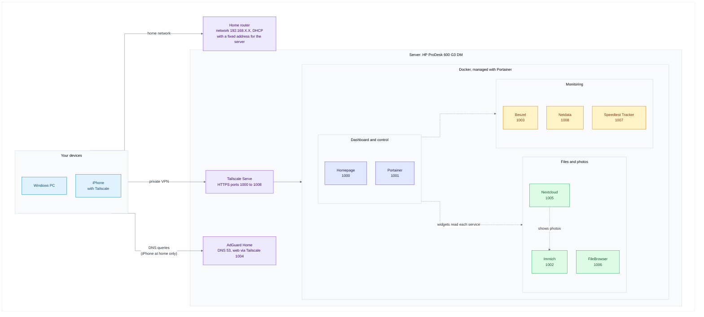
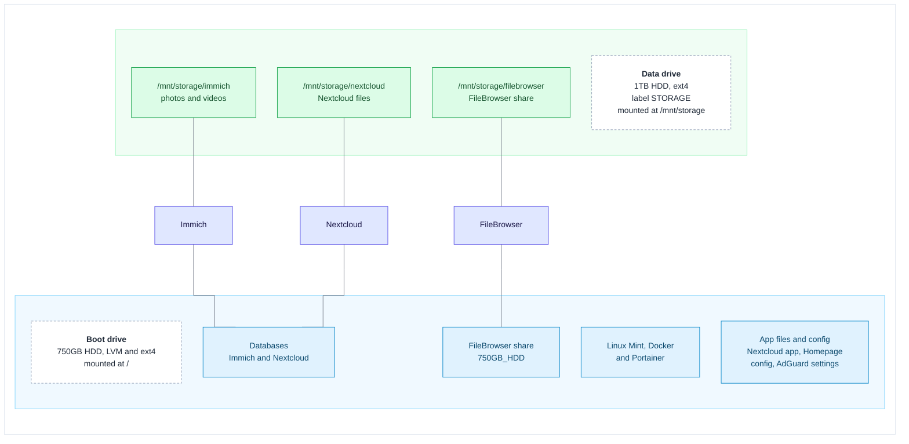

# My Home Lab

A self-hosted home lab running on a small HP mini PC: network-wide ad blocking, container management, system monitoring, file storage, photo backup, a personal cloud and a single dashboard that ties it all together. Everything is reachable from anywhere through a private Tailscale network, and nothing is exposed to the public internet.

> **About the placeholders.** Every address and name in this file is a placeholder: `your-username` (the Linux user), `192.168.X.X` (the server's address on your home network) and `your-tailnet.ts.net` (your Tailscale network name). Passwords, keys and tokens are written as `your-own-key`. Replace them with your own values and keep the real ones out of Git. The companion file [TROUBLESHOOTING.md](TROUBLESHOOTING.md) has the real values from my build, every problem I hit and how I fixed it, and the full migration from my previous server.


## Highlights

- **DNS-level ad and tracker blocking** for every device on the network, with AdGuard Home and 12 blocklists.
- **Nine services in Docker,** each deployed as a Portainer stack, so the whole setup can be rebuilt from text files.
- **Private remote access.** Tailscale gives every service its own trusted HTTPS address. There is no port forwarding and no public exposure.
- **A storage layout built to survive mistakes.** The data drive mounts by UUID at a fixed path, the empty mount point is locked so a missing drive can't fill the boot drive, Docker waits for the drive at boot, and a recovery script restores everything after a disconnect.
- **Photo backup and a personal cloud.** Immich backs up phone photos, Nextcloud stores files, and Nextcloud can show the Immich library.
- **Live monitoring.** Beszel, Netdata and Speedtest Tracker feed widgets on the Homepage dashboard.
- **A custom-built dashboard** with frosted-glass cards, status dots, live widgets and a layout that adapts from phones to large monitors.

## What this project demonstrates

| Skill | What I did |
| :--- | :--- |
| **Linux administration** | Installed and configured Linux Mint on LVM, managed services with `systemd`, wrote `fstab` entries, `cron` jobs and `bash` scripts, set up SSH and unattended remote desktop. |
| **Networking and DNS** | Ran a network-wide DNS filter, reserved a fixed address in the router, freed port 53 from `systemd-resolved`, pointed devices at the DNS server by hand when the router would not allow it, and tested resolution with `nslookup`. |
| **Containers** | Deployed nine services as Docker Compose stacks through Portainer, used bind mounts and named volumes, host networking, health checks, restart policies and environment variables for secrets. |
| **Storage reliability** | Chose ext4, mounted by UUID with `nofail`, locked the empty mount point with `chattr +i`, ordered Docker after the mount with a `systemd` drop-in, tuned drive power management with `hdparm`, checked drive health with SMART, and wrote a recovery script. |
| **Secure remote access** | Used a private mesh VPN with HTTPS certificates instead of opening ports, kept secrets out of files and out of Git, used separate least-privilege API keys, and handled a brute-force lockout correctly. |
| **Monitoring** | Combined Beszel, Netdata and Speedtest Tracker with live Homepage widgets, and used drive and container checks to prove each fix worked. |
| **Troubleshooting** | Diagnosed and fixed 58 real problems (drive paths, filesystem permissions, registry throttling, reverse-proxy settings, API errors) and wrote each one up as symptom, cause, fix and verification. |
| **Hardware** | Built a mini PC server: SATA boot drive, USB data drive, BIOS and Secure Boot changes, power adapter diagnosis, and a display emulator for headless remote desktop. |
| **Documentation and migration** | Planned and carried out a full server migration with a written runbook, and kept the documentation accurate by checking every step against the running system. |
| **Front-end customization** | Wrote the Homepage stylesheet: frosted-glass cards, per-service accent colors, responsive scaling for different screen widths. |

## Architecture

How devices reach the services:



Where the data lives:



## Hardware

| Part | Details |
| :--- | :--- |
| Computer | HP ProDesk 600 G3 Desktop Mini, Intel Core i5-7500T (4 cores) |
| Memory | 8GB DDR4-2400 (one SO-DIMM, one slot free) |
| Boot drive | 750GB 2.5-inch 5400 rpm hard drive in the internal bay (SATA) |
| Data drive | 1TB 2.5-inch 5400 rpm hard drive on a generic SATA to USB 3.0 adapter |
| Power | Genuine HP 65W adapter |
| Display | DisplayPort dummy plug (EDID emulator), so the headless machine behaves as if a monitor is attached |
| Network | Wired Ethernet, with a fixed address reserved in the router |
| Operating system | Linux Mint 22.3 XFCE on LVM, no disk encryption |

## Services

| Service | What it does | Local port | Tailscale address |
| :--- | :--- | :--- | :--- |
| Homepage | The dashboard that links to everything | 3001 | `https://pc.your-tailnet.ts.net:1000` |
| Portainer | Manages Docker containers and stacks | 9000 (HTTP), 9443 | `https://pc.your-tailnet.ts.net:1001` |
| Immich | Photo and video backup | 2283 | `https://pc.your-tailnet.ts.net:1002` |
| Beszel | Server health and resource graphs | 8090 | `https://pc.your-tailnet.ts.net:1003` |
| AdGuard Home | DNS filtering | 3000 (web), 53 (DNS) | `https://pc.your-tailnet.ts.net:1004` |
| Nextcloud | Personal cloud and file sync | 8082 | `https://pc.your-tailnet.ts.net:1005` |
| FileBrowser | Browser-based file manager | 8081 | `https://pc.your-tailnet.ts.net:1006` |
| Speedtest Tracker | Internet speed history | 8088 | `https://pc.your-tailnet.ts.net:1007` |
| Netdata | Live system metrics | 19999 | `https://pc.your-tailnet.ts.net:1008` |

Tested with: Linux Mint 22.3, Docker 29.9, Tailscale 1.104, Homepage 2.6, Immich 3.3, Nextcloud 35.0, Speedtest Tracker 1.15, FileBrowser 2.63, Beszel 0.21 and AdGuard Home 0.107.79.

## Table of Contents

1. [Hardware, BIOS and operating system](#1-hardware-bios-and-operating-system)
1. [Base system and remote access](#2-base-system-and-remote-access)
1. [Storage: the data drive](#3-storage-the-data-drive)
1. [Docker](#4-docker)
1. [Portainer](#5-portainer)
1. [Tailscale](#6-tailscale)
1. [AdGuard Home](#7-adguard-home)
1. [Beszel](#8-beszel)
1. [Netdata](#9-netdata)
1. [FileBrowser](#10-filebrowser)
1. [Immich](#11-immich)
1. [Nextcloud](#12-nextcloud)
1. [Nextcloud and Immich integration](#13-nextcloud-and-immich-integration)
   - [13A. Nextcloud: sync your devices automatically](#13a-nextcloud-sync-your-devices-automatically)
1. [Speedtest Tracker](#14-speedtest-tracker)
1. [Homepage dashboard](#15-homepage-dashboard)
1. [Maintenance](#16-maintenance)
1. [Roadmap](#17-roadmap)
1. [Security and credentials](#18-security-and-credentials)

---

## 1. Hardware, BIOS and operating system

### 1.1 Put the hardware together

1. Install the 750GB drive in the mini PC's internal 2.5-inch bay and connect it by SATA. This will be the boot drive.
1. Plug the genuine HP 65W power adapter into the mini PC. A third-party adapter with a converter tip did not work on this model (see [TROUBLESHOOTING.md](TROUBLESHOOTING.md)).
1. Connect the network cable to the router.
1. Keep the 1TB data drive disconnected until the operating system is installed, so the installer can't pick the wrong disk.
1. For the install, connect a monitor, keyboard and mouse. Afterwards the machine runs headless.

### 1.2 Make the installer USB stick

I used [Ventoy](https://www.ventoy.net/), which lets you copy ISO files onto a stick and choose which one to boot.

1. On a Windows PC, download Ventoy and run `Ventoy2Disk.exe`.
1. Select the USB stick and click **Install**. This erases the stick.
1. Copy the Linux Mint 22.3 XFCE ISO file onto the stick like any other file.

### 1.3 BIOS setting and booting the stick

1. Plug in the USB stick and power the mini PC on.
1. Press **F10** repeatedly at the HP logo to open the BIOS setup.
1. Turn **Secure Boot** off in the BIOS security settings. This was the only BIOS change I made.
1. Open **Boot Options** and choose the USB stick.
1. Ventoy loads. Select the Linux Mint XFCE ISO and choose to boot it in normal mode.

### 1.4 Install Linux Mint

From the live desktop, double-click **Install Linux Mint** and follow the installer:

1. Choose your language and keyboard layout.
1. Choose **Erase disk and install Linux Mint**, and pick the **750GB drive**. This erases that drive.
1. Open **Advanced features** and select **LVM**. Leave encryption off.
1. Set your time zone.
1. Enter your name, set the computer name to `pc`, choose a username (this guide uses `your-username`) and a strong password.
1. Let the install finish, then restart and remove the USB stick when asked.

### 1.5 First boot

Update the system and confirm the version:

```bash
sudo apt update && sudo apt upgrade -y
cat /etc/os-release | head -3
```

You should see `Linux Mint 22.3`. Then plug in the DisplayPort dummy plug if you want the machine to run without a monitor. It makes the graphics card believe a display is connected, which keeps the remote desktop smooth and lets the integrated graphics work.

**Verify:** `lsblk -f` shows the 750GB drive with an LVM partition and a `/` root, and `ip -br addr` shows your wired connection with an address.

---

## 2. Base system and remote access

### 2.1 Reserve a fixed address for the server

Every other setting in this guide depends on the server keeping the same address. Find the wired adapter's hardware (MAC) address:

```bash
ip -br link show
```

Look at the line for your wired adapter (mine is `eno1`) and note the `xx:xx:xx:xx:xx:xx` value. Then, in your router's settings, find the DHCP or address reservation page and reserve `192.168.X.X` for that hardware address. Restart the server or renew its address, and confirm:

```bash
ip -br addr
```

### 2.2 SSH server

SSH lets you control the server from another computer's terminal.

```bash
sudo apt update
sudo apt install openssh-server -y
sudo systemctl enable ssh
sudo systemctl start ssh
```

Connect from another machine:

```bash
ssh your-username@192.168.X.X
```

**Verify:** `sudo systemctl status ssh` shows `active (running)`, and the `ssh` command from your PC asks for your password.

### 2.3 Auto-login

So the desktop session starts without anyone sitting at the machine (needed for the remote desktop later), edit the login manager settings:

```bash
sudo nano /etc/lightdm/lightdm.conf
```

Under `[Seat:*]`, set:

```ini
[Seat:*]
autologin-guest=false
autologin-user=your-username
autologin-user-timeout=0
```

Save with `Ctrl+O`, `Enter`, `Ctrl+X`. The change applies at the next boot.

### 2.4 VS Code with Remote-SSH

For editing config files on the server from a Windows desktop, with proper syntax highlighting:

1. Install [VS Code](https://code.visualstudio.com/) on the Windows PC.
1. Install the **Remote - SSH** extension.
1. Press `Ctrl+Shift+P`, choose **Remote-SSH: Connect to Host**, and enter `your-username@192.168.X.X`.
1. Enter your password when asked.
1. Open a folder from the integrated terminal:

```bash
code -a ~/homepage-config/
```

> **Tip.** Files inside a Docker named volume (`/var/lib/docker/volumes/...`) are owned by root, so VS Code can't save them. The working approach is a bind mount, a normal folder in your home directory shared into the container. [Section 15](#15-homepage-dashboard) does this for Homepage's config.

### 2.5 AnyDesk (remote desktop)

AnyDesk gives full remote desktop access to the headless server, like a self-hosted TeamViewer.

```bash
sudo apt install gnupg2 -y
wget -qO - https://keys.anydesk.com/repos/DEB-GPG-KEY | sudo apt-key add -
echo "deb http://deb.anydesk.com/ all main" | sudo tee /etc/apt/sources.list.d/anydesk-stable.list
sudo apt update
sudo apt install anydesk -y
```

Get the ID you will connect to:

```bash
anydesk --get-id
```

Set a password for unattended access, so a connection doesn't need someone to click Accept on the server:

```bash
sudo anydesk --set-password
```

Start the service at boot:

```bash
sudo systemctl enable anydesk
sudo systemctl start anydesk
```

Start the AnyDesk window automatically after login (auto-login from section 2.3 makes this happen at boot):

```bash
mkdir -p ~/.config/autostart
cp /usr/share/applications/anydesk.desktop ~/.config/autostart/
```

From another device, install AnyDesk and connect with the ID and password. The DisplayPort dummy plug from section 1.5 keeps the screen resolution stable and the picture smooth.

**Verify:** `sudo systemctl is-active anydesk` prints `active`, and you can connect from your PC.

---

## 3. Storage: the data drive

The 1TB drive holds the Immich photos, the Nextcloud files and the FileBrowser share. The settings below make it keep the same label, format and path through reboots and disconnects.

**Why ext4:** it's a Linux filesystem, so Docker and databases get proper file permissions, and it isn't locked as "dirty" when the drive is unplugged the way NTFS can be.

### 3.1 Format the drive

Connect the 1TB drive and find its name:

```bash
lsblk -o NAME,SIZE,MODEL,TRAN,FSTYPE,LABEL,MOUNTPOINTS
sudo smartctl -i -d sat /dev/sdX | grep -E "Device Model|Serial"
```

(`sudo apt install smartmontools -y` first if `smartctl` isn't found.) It should be about 931G and show the model you expect. Replace `sdX` with its real letter, then wipe and format it. **This erases the whole drive:**

```bash
sudo umount /dev/sdX1 /dev/sdX2 2>/dev/null
sudo wipefs -a /dev/sdX
sudo parted /dev/sdX --script mklabel gpt mkpart storage ext4 1MiB 100%
sudo partprobe /dev/sdX; sleep 2
sudo wipefs -a /dev/sdX1
sudo mkfs.ext4 -L STORAGE -m 0 /dev/sdX1
```

`-L STORAGE` sets the permanent label. `-m 0` turns off the 5% of space ext4 reserves by default.

### 3.2 Mount it permanently

**1. Create the mount point and lock it.** Do this while the drive is not mounted:

```bash
sudo mkdir -p /mnt/storage
sudo chattr +i /mnt/storage
```

The lock means that if the drive is ever missing, nothing can write into the empty folder. Services fail with an error instead of silently filling the boot drive.

**2. Add the drive to `/etc/fstab` by its UUID:**

```bash
sudo cp /etc/fstab /etc/fstab.bak
NEWUUID=$(sudo blkid -s UUID -o value /dev/sdX1)
echo "UUID=$NEWUUID  /mnt/storage  ext4  defaults,noatime,nofail,x-systemd.device-timeout=10  0  2" | sudo tee -a /etc/fstab
sudo systemctl daemon-reload
sudo mount -a
findmnt /mnt/storage
```

`findmnt` should show your drive. `nofail` lets the computer boot even if the drive isn't plugged in. If `mount -a` prints an error, stop and fix it before continuing.

**3. Make Docker wait for the drive at boot:**

```bash
sudo mkdir -p /etc/systemd/system/docker.service.d
printf '[Unit]\nWants=mnt-storage.mount\nAfter=mnt-storage.mount\n' | sudo tee /etc/systemd/system/docker.service.d/wait-for-hdd.conf
sudo systemctl daemon-reload
```

(Docker is installed in [section 4](#4-docker). If it isn't installed yet, create this file after installing it.)

### 3.3 Create a folder for each service

```bash
sudo mkdir -p /mnt/storage/immich /mnt/storage/filebrowser
sudo chown -R your-username:your-username /mnt/storage
sudo mkdir -p /mnt/storage/nextcloud
sudo chown -R 33:33 /mnt/storage/nextcloud
mkdir -p /home/your-username/nextcloud/html /home/your-username/nextcloud/db
mkdir -p /home/your-username/immich/postgres
mkdir -p /home/your-username/homepage-config
mkdir -p /home/your-username/750GB_HDD
sudo mkdir -p /opt/adguard-docker/conf /opt/adguard-docker/work
```

UID 33 is the user Nextcloud runs as inside its container (it shows as `www-data` in `ls -la`). The databases and app files stay on the boot drive. Only the photos and files go on the data drive.

| Folder | Used by | Drive |
| :--- | :--- | :--- |
| `/mnt/storage/immich` | Immich photos and videos | Data |
| `/mnt/storage/nextcloud` | Nextcloud files | Data |
| `/mnt/storage/filebrowser` | FileBrowser share | Data |
| `/home/your-username/immich/postgres` | Immich database | Boot |
| `/home/your-username/nextcloud/db` and `html` | Nextcloud database and app files | Boot |
| `/home/your-username/750GB_HDD` | FileBrowser share on the boot drive | Boot |
| `/home/your-username/homepage-config` | Homepage config files | Boot |
| `/opt/adguard-docker` | AdGuard Home settings | Boot |

### 3.4 Drive power settings

Laptop-style drives park their heads aggressively at the default power setting, which wears them out when a server never sleeps. This sets a safer level on both drives. Check each drive's name with `lsblk` first. Drive letters can swap between boots. On my machine the data drive is now `sda` and the boot drive is `sdb` (it was the other way round at first), so these commands use those letters:

```bash
sudo hdparm -B 254 /dev/sda
sudo hdparm -B 254 /dev/sdb
sudo hdparm -B /dev/sda
sudo hdparm -B /dev/sdb
sudo crontab -e
```

Both `hdparm -B` checks should print `APM_level = 254`. The settings reset at every reboot, so add these two lines at the bottom of root's crontab. They find the data drive by its label and the boot drive by the partition mounted at `/boot/efi`, and re-apply the setting 60 seconds after boot:

```cron
@reboot sleep 60 && /usr/sbin/hdparm -S 0 -B 254 "/dev/$(lsblk -no pkname "$(readlink -f /dev/disk/by-label/STORAGE)")"
@reboot sleep 60 && /usr/sbin/hdparm -B 254 "/dev/$(lsblk -no pkname "$(findmnt -no SOURCE /boot/efi)")"
```

Don't type a drive letter such as `/dev/sdb` into these cron lines. If the letters swap after a reboot, the setting would be applied to the wrong drive. Both lines look the drive up instead, so they keep working.

`-S 0` means the data drive never spins down, which suits a drive that Immich and Nextcloud use all day. Some USB adapters ignore these commands and print `SG_IO: bad/missing sense data`. That message is harmless.

Optional: log the head-parking count every morning so you can watch it:

```cron
0 6 * * * echo "$(date +\%F) $(smartctl -A -d sat /dev/disk/by-label/STORAGE | awk '/Load_Cycle/ {print $10}')" >> /var/log/loadcycles.log
```

### 3.5 The recovery script

Containers keep the view of the drive they had when they started. If the drive is unplugged and plugged back in, they need a restart. This script stops the containers that use the data drive, remounts it, re-applies the power setting and starts them again. Create it after the services in sections 10 to 12 and 15 exist:

```bash
sudo tee /usr/local/bin/hdd-recover >/dev/null <<'EOT'
#!/bin/bash
docker stop immich_server filebrowser-filebrowser-1 homepage nextcloud nextcloud_cron
umount -l /mnt/storage 2>/dev/null; sleep 2
mount /mnt/storage || { echo "Drive not found. Check the cable."; exit 1; }
hdparm -S 0 -B 254 "/dev/$(lsblk -no pkname "$(readlink -f /dev/disk/by-label/STORAGE)")" 2>/dev/null
docker start immich_server filebrowser-filebrowser-1 homepage nextcloud nextcloud_cron
echo "Recovered."
EOT
sudo chmod +x /usr/local/bin/hdd-recover
```

After you reconnect the drive at any time, run `sudo hdd-recover`. If the drive isn't found, the script stops on purpose and leaves the containers stopped.

### 3.6 Verify the storage setup

Once the services exist, check that each one sees the data drive:

```bash
findmnt /mnt/storage
docker exec immich_server df -h /data
docker exec filebrowser-filebrowser-1 df -h /srv/hdd
docker exec nextcloud df -h /data
docker exec homepage df -h /mnt/storage
```

Every container should show the data drive (about 916G, `/dev/sda1` on my machine; the letter can differ on yours). Then run two tests:

- **Reboot:** run `sudo reboot`. After two minutes, `findmnt /mnt/storage` and `docker ps` should show the drive mounted and the containers up with no help from you.
- **Unplug:** with the stacks running, unplug the drive for ten seconds, plug it in, and run `sudo hdd-recover`. You should see `Recovered.`

> The weekly health check for both drives is in [section 16](#16-maintenance).

---

## 4. Docker

Installed from Docker's official apt repository. Linux Mint doesn't have its own entry in Docker's repository list, so use Mint's Ubuntu base name instead. For Mint 22 that is `noble` (Ubuntu 24.04). Using the wrong name makes the install fail with a "held broken packages" error.

```bash
sudo install -m 0755 -d /etc/apt/keyrings
sudo curl -fsSL https://download.docker.com/linux/ubuntu/gpg -o /etc/apt/keyrings/docker.asc
sudo chmod a+r /etc/apt/keyrings/docker.asc

echo "deb [arch=$(dpkg --print-architecture) signed-by=/etc/apt/keyrings/docker.asc] https://download.docker.com/linux/ubuntu noble stable" | sudo tee /etc/apt/sources.list.d/docker.list > /dev/null

sudo apt-get update
sudo apt-get install -y docker-ce docker-ce-cli containerd.io docker-compose-plugin docker-ce-rootless-extras docker-buildx-plugin
```

Allow running `docker` without `sudo`, then reboot so the group change applies:

```bash
sudo usermod -aG docker $USER
sudo reboot
```

**Verify:**

```bash
docker --version
docker run hello-world
```

`hello-world` should print `Hello from Docker!`. If you created the data drive in [section 3](#3-storage-the-data-drive) before installing Docker, add the wait rule from section 3.2 now.

---

## 5. Portainer

Portainer is a web dashboard for managing Docker. From here on, every service is deployed as a **stack** in Portainer: a Compose file pasted into a web page, which is easy to edit, redeploy and back up.

```bash
docker volume create portainer_data

docker run -d \
  -p 9443:9443 \
  -p 9000:9000 \
  --name portainer \
  --restart=always \
  -v /var/run/docker.sock:/var/run/docker.sock \
  -v portainer_data:/data \
  portainer/portainer-ce:latest
```

Open `http://192.168.X.X:9000` and create an admin account. Portainer closes its first-time setup after about five minutes. If the page says setup timed out, restart it and reload:

```bash
docker restart portainer
```

If it asks for a setup token, read it from the logs with `docker logs portainer`.

**How to deploy any stack below:**

1. In Portainer, go to **Stacks**, then **Add stack**.
1. Enter the stack name given in the section. The names matter, because container names are built from them.
1. Paste the YAML into the web editor.
1. If the section lists environment variables, open **Environment variables**, switch to advanced mode and paste them in, with your own values.
1. Click **Deploy the stack**.

Port 9000 is plain HTTP and is the one Tailscale will forward to. Portainer's own HTTPS port (9443) uses a self-signed certificate that Tailscale won't proxy.

**Verify:** `docker ps` lists `portainer`, and you can log in.

---

## 6. Tailscale

Tailscale builds a private network between your devices. Combined with Tailscale Serve, every service gets a trusted HTTPS address that only your devices can reach, with no port forwarding and no public exposure.

Install it on the server:

```bash
curl -fsSL https://tailscale.com/install.sh | sh
sudo tailscale up
```

Open the sign-in link it prints, in a browser that is signed in to your Tailscale account. The machine appears in the [admin console](https://login.tailscale.com/admin/machines) under its hostname (`pc`). Also install the Tailscale app on your PC and phone, and sign in to the same account.

**Publish each service over HTTPS** with Tailscale Serve. Each `--https` number becomes the port in the address. The address after it is where the service runs on the server. The numbers follow the order the services are listed in this guide:

```bash
sudo tailscale serve reset
sudo tailscale serve --bg --https=1000 http://192.168.X.X:3001
sudo tailscale serve --bg --https=1001 http://192.168.X.X:9000
sudo tailscale serve --bg --https=1002 http://192.168.X.X:2283
sudo tailscale serve --bg --https=1003 http://192.168.X.X:8090
sudo tailscale serve --bg --https=1004 http://192.168.X.X:3000
sudo tailscale serve --bg --https=1005 http://192.168.X.X:8082
sudo tailscale serve --bg --https=1006 http://192.168.X.X:8081
sudo tailscale serve --bg --https=1007 http://192.168.X.X:8088
sudo tailscale serve --bg --https=1008 http://192.168.X.X:19999
tailscale serve status
```

If the first command asks you to enable HTTPS certificates for your tailnet, follow the link it prints and enable them, then run the command again. Entries for services that aren't running yet show an error until those services are deployed.

| Service | Address |
| :--- | :--- |
| Homepage | `https://pc.your-tailnet.ts.net:1000` |
| Portainer | `https://pc.your-tailnet.ts.net:1001` |
| Immich | `https://pc.your-tailnet.ts.net:1002` |
| Beszel | `https://pc.your-tailnet.ts.net:1003` |
| AdGuard Home | `https://pc.your-tailnet.ts.net:1004` |
| Nextcloud | `https://pc.your-tailnet.ts.net:1005` |
| FileBrowser | `https://pc.your-tailnet.ts.net:1006` |
| Speedtest Tracker | `https://pc.your-tailnet.ts.net:1007` |
| Netdata | `https://pc.your-tailnet.ts.net:1008` |

To remove one entry: `sudo tailscale serve --https=1008 off`.

**Verify:** `tailscale serve status` lists nine entries, and `https://pc.your-tailnet.ts.net:1001` shows Portainer from a device that has Tailscale turned on.

---

## 7. AdGuard Home

Network-wide DNS filtering. It runs in Docker with host networking, so it answers DNS on the server's own port 53.

### 7.1 Free port 53

`systemd-resolved` listens on port 53 by default, which conflicts with AdGuard Home. Turn it off and let Tailscale manage `/etc/resolv.conf`. Do this over SSH on the **local network address** (`ssh your-username@192.168.X.X`), not the Tailscale one, because the last command restarts Tailscale and would cut off a session that goes through it. Download the AdGuard image first, while DNS still works:

```bash
docker pull adguard/adguardhome:v0.107.79

sudo systemctl disable systemd-resolved
sudo systemctl stop systemd-resolved
sudo rm /etc/resolv.conf
echo "nameserver 192.168.X.1" | sudo tee /etc/resolv.conf
sudo systemctl restart tailscaled
```

Replace `192.168.X.1` with your router's address. It keeps the server resolving names until AdGuard is running.

**Verify:**

```bash
sudo ss -tulpn | grep :53
cat /etc/resolv.conf
nslookup google.com
```

The first command should not list `systemd-resolve` on port 53. `resolv.conf` should either show your one line or a Tailscale header with `nameserver 100.100.100.100`, and the lookup should return an address.

### 7.2 Deploy the stack

Create a stack named `adguard`:

```yaml
services:
  adguard:
    image: adguard/adguardhome:v0.107.79
    container_name: adguardhome
    restart: unless-stopped
    network_mode: host
    volumes:
      - /opt/adguard-docker/work:/opt/adguardhome/work
      - /opt/adguard-docker/conf:/opt/adguardhome/conf
```

### 7.3 Setup wizard

Open `http://192.168.X.X:3000` and go through the wizard:

1. Set the admin web interface to listen on all interfaces, on port **3000**. The wizard proposes port 80, so change it. Everything else in this guide expects 3000.
1. Set the DNS server to listen on all interfaces, on port **53**.
1. Create an admin username and password.
1. Finish the wizard and log in.

My upstream servers are DNS-over-HTTPS from Quad9, Cloudflare and Google, with DNSSEC on. I enabled twelve blocklists: AdGuard DNS filter, AdAway Default Blocklist, AdGuard DNS Popup Hosts, HaGeZi's Pro, OISD Big, Peter Lowe's, Steven Black's, Dandelion Sprout's Game Console Adblock, HaGeZi's Allowlist Referral, HaGeZi's Apple Tracker, ShadowWhisperer's Dating List and Dandelion Sprout's Anti-Malware list. If a list ever blocks your upstream DNS providers, the fix is in [TROUBLESHOOTING.md](TROUBLESHOOTING.md).

**Verify:**

```bash
docker ps | grep adguard
sudo ss -tulpn | grep ':53 '
nslookup google.com 192.168.X.X
```

The container should be running, AdGuardHome should own port 53, and the lookup should answer.

### 7.4 Point your devices at it

My router wouldn't let me change its DNS setting, so I set the DNS server on each device by hand. Devices you don't change aren't filtered.

**Windows 11 (Ethernet):**

1. Open **Settings**, then **Network and internet**, then **Ethernet**.
1. Next to **DNS server assignment**, click **Edit**.
1. Choose **Manual**, switch **IPv4** on, and enter `192.168.X.X` as the preferred DNS and `8.8.8.8` as the alternate.
1. Click **Save**, then check with `nslookup google.com` in a terminal. The server shown should be `192.168.X.X`.

**iPhone (Wi-Fi):**

1. Open **Settings**, then **Wi-Fi**, then tap the **i** next to your network.
1. Tap **Configure DNS**, then **Manual**.
1. Remove any existing servers, then add `192.168.X.X` and `8.8.8.8`, and tap **Save**.

> The alternate DNS server `8.8.8.8` keeps the internet working if the server is off, but a device can use it at any time and skip AdGuard's filtering. Leave the alternate blank if you prefer strict filtering and don't mind losing internet when the server is down.

**Verify:** in AdGuard's dashboard, the **Top clients** list shows your devices' addresses, and the query count rises as you browse.

---

## 8. Beszel

Real-time CPU, memory, disk and network graphs. It has two parts: a **hub** (the dashboard) and an **agent** (which reports the stats).

### 8.1 Hub

Create a stack named `beszel`:

```yaml
services:
  beszel:
    image: henrygd/beszel:latest
    container_name: beszel
    restart: unless-stopped
    ports:
      - 8090:8090
    volumes:
      - beszel_data:/beszel_data

volumes:
  beszel_data:
```

Open `http://192.168.X.X:8090` and create an admin account.

### 8.2 Agent

1. In the hub, click **Add System** at the top right.
1. Enter a name (I used `ProDesk`) and the host `192.168.X.X`. Leave the port at `45876`.
1. Stay on the **Docker** tab. The window shows an agent file with your public key and a token already filled in. Keep this window open.
1. Click **Copy docker compose**.
1. In Portainer, create a stack named `beszel-agent` and paste what you copied. Check that `network_mode: host` is there and that `HUB_URL` is `http://192.168.X.X:8090`. It should look like this:

```yaml
services:
  beszel-agent:
    image: henrygd/beszel-agent
    container_name: beszel-agent
    restart: unless-stopped
    network_mode: host
    volumes:
      - /var/run/docker.sock:/var/run/docker.sock:ro
      - ./beszel_agent_data:/var/lib/beszel-agent
    environment:
      LISTEN: 45876
      KEY: 'your-own-key'
      TOKEN: your-own-key
      HUB_URL: http://192.168.X.X:8090
```

6. Deploy the stack, then go back to the hub window and click **Add system** at the bottom to finish.

**Verify:**

```bash
docker logs beszel-agent | tail -n 10
```

Look for a line like `WebSocket connected host=192.168.X.X:8090`. In the hub, the system turns green and starts showing graphs.

For the Homepage widget, Beszel needs a **superuser** login that is separate from your hub login. You will set it in [section 15](#15-homepage-dashboard).

---

## 9. Netdata

Live, second-by-second metrics for the whole system. Create a stack named `netdata`:

```yaml
version: '3'
services:
  netdata:
    image: netdata/netdata
    restart: always
    ports:
      - "19999:19999"
    cap_add:
      - SYS_PTRACE
    security_opt:
      - apparmor:unconfined
    volumes:
      - netdataconfig:/etc/netdata
      - netdatalib:/var/lib/netdata
      - netdatacache:/var/cache/netdata
      - /etc/passwd:/host/etc/passwd:ro
      - /etc/group:/host/etc/group:ro
      - /proc:/host/proc:ro
      - /sys:/host/sys:ro
      - /etc/os-release:/host/etc/os-release:ro

volumes:
  netdataconfig:
  netdatalib:
  netdatacache:
```

Open `http://192.168.X.X:19999`. The dashboard may offer to connect to Netdata Cloud. If it asks for a session ID, read it from the container (its name is built from the stack name, so it is `netdata-netdata-1`, not `netdata`):

```bash
docker exec netdata-netdata-1 cat /var/lib/netdata/netdata_random_session_id
```

If the page offers a way to continue without signing in, you can use the local dashboard as it is.

**Verify:** `docker ps` shows `netdata-netdata-1` as `healthy`, and the dashboard shows live charts.

---

## 10. FileBrowser

A web-based file manager for drag-and-drop access to the server's storage. It shares two folders: one on the boot drive and one on the data drive. The folders were created in [section 3.3](#33-create-a-folder-for-each-service).

Create a stack named `filebrowser`. The stack and service must both be named `filebrowser`, because the recovery script expects the container name `filebrowser-filebrowser-1`:

```yaml
version: '3'
services:
  filebrowser:
    image: filebrowser/filebrowser
    restart: always
    ports:
      - "8081:80"
    volumes:
      - "/home/your-username/750GB_HDD:/srv/750GB_HDD"
      - "/mnt/storage/filebrowser:/srv/hdd"
      - filebrowser_data:/database

volumes:
  filebrowser_data:
```

**First login.** This version creates the `admin` user with a random password the first time it starts, so `admin` / `admin` won't work. Read the password from the logs:

```bash
docker logs filebrowser-filebrowser-1 | grep -i password
```

Open `http://192.168.X.X:8081`, log in as `admin` with that password, and change it right away in your profile settings.

**Verify:**

```bash
docker ps
docker exec filebrowser-filebrowser-1 df -h /srv/hdd /srv/750GB_HDD
```

The container should be `healthy`. `/srv/hdd` should show the data drive (`/dev/sda1`, about 916G), and `/srv/750GB_HDD` should show the boot drive's `vgmint-root`.

---

## 11. Immich

Self-hosted photo and video backup with a phone app, albums, face grouping and search. The photos live on the data drive. The database stays on the boot drive, which is faster for a database than the USB-attached data drive.

> Immich changes often. Before you deploy, compare the file below with the `docker-compose.yml` in [Immich's current release](https://docs.immich.app/install/docker-compose), and use any newer image versions it pins.

### 11.1 Download the images first

Immich's images are on GitHub's container registry, which throttles many parallel downloads with a `toomanyrequests` error. Downloading them one at a time first avoids it:

```bash
docker pull ghcr.io/immich-app/immich-server:release
docker pull ghcr.io/immich-app/immich-machine-learning:release
docker pull ghcr.io/immich-app/postgres:14-vectorchord0.4.3-pgvectors0.2.0@sha256:bcf63357191b76a916ae5eb93464d65c07511da41e3bf7a8416db519b40b1c23
docker pull docker.io/valkey/valkey:9@sha256:c123e3715db63d06d4ad6964884037aa0d5d4d703939b9929954112889708e1d
```

If one prints `toomanyrequests`, wait a minute and run that line again.

### 11.2 Deploy the stack

Create a stack named `immich`:

```yaml
name: immich

services:
  immich-server:
    container_name: immich_server
    image: ghcr.io/immich-app/immich-server:${IMMICH_VERSION:-release}
    volumes:
      - ${UPLOAD_LOCATION}:/data
      - /etc/localtime:/etc/localtime:ro
    env_file:
      - stack.env
    ports:
      - '2283:2283'
    depends_on:
      - redis
      - database
    restart: always
    healthcheck:
      disable: false

  immich-machine-learning:
    container_name: immich_machine_learning
    image: ghcr.io/immich-app/immich-machine-learning:${IMMICH_VERSION:-release}
    volumes:
      - model-cache:/cache
    env_file:
      - stack.env
    restart: always
    healthcheck:
      disable: false

  redis:
    container_name: immich_redis
    image: docker.io/valkey/valkey:9@sha256:c123e3715db63d06d4ad6964884037aa0d5d4d703939b9929954112889708e1d
    healthcheck:
      test: redis-cli ping | grep -q PONG || exit 1
    restart: always

  database:
    container_name: immich_postgres
    image: ghcr.io/immich-app/postgres:14-vectorchord0.4.3-pgvectors0.2.0@sha256:bcf63357191b76a916ae5eb93464d65c07511da41e3bf7a8416db519b40b1c23
    environment:
      POSTGRES_PASSWORD: ${DB_PASSWORD}
      POSTGRES_USER: ${DB_USERNAME}
      POSTGRES_DB: ${DB_DATABASE_NAME}
      POSTGRES_INITDB_ARGS: '--data-checksums'
      DB_STORAGE_TYPE: 'HDD'
    volumes:
      - ${DB_DATA_LOCATION}:/var/lib/postgresql/data
    shm_size: 128mb
    restart: always
    healthcheck:
      disable: false

volumes:
  model-cache:
```

`DB_STORAGE_TYPE: 'HDD'` is Immich's own setting for a database that isn't on an SSD, which is the case here because the boot drive is a hard drive.

In **Environment variables**, paste these in advanced mode. Use letters and numbers only for the password, and use your own time zone:

```
UPLOAD_LOCATION=/mnt/storage/immich
DB_DATA_LOCATION=/home/your-username/immich/postgres
TZ=America/New_York
IMMICH_VERSION=release
DB_PASSWORD=your-own-key
DB_USERNAME=postgres
DB_DATABASE_NAME=immich
```

Deploy it. The first start takes a few minutes. On a hard-drive boot disk, wait for it to settle before deploying anything heavy, because Immich and Nextcloud starting together can overload the machine.

### 11.3 Verify and create your account

```bash
docker ps --format "table {{.Names}}\t{{.Status}}"
docker exec immich_server df -h /data
ls -a /mnt/storage/immich
```

All four Immich containers should be `healthy` or `Up`. `/data` should show the data drive (`/dev/sda1`, about 916G). After a minute, the folder should list `backups encoded-video library profile thumbs upload`. Open `http://192.168.X.X:2283` and create the admin account. The first account you create becomes the admin.

### 11.4 Phone app

1. Install the **Immich** app from the App Store or Google Play.
1. Enter the server address. At home use `http://192.168.X.X:2283`. Away from home, turn on the Tailscale app on the phone and use `https://pc.your-tailnet.ts.net:1002`.
1. Log in, then open the backup settings, choose which albums to back up, and turn backup on.

The first backup of a large library can take a long time and a lot of data, so start it on home Wi-Fi.

---

## 12. Nextcloud

A personal cloud: file sync, sharing, calendar and contacts. It runs as four containers: the app, a PostgreSQL database, Redis (file locking and caching) and a cron container for background jobs. The files live on the data drive. The database and app files stay on the boot drive.

### 12.1 Choose your passwords

You need three values. Use letters and numbers only, because symbols can break Portainer's parsing:

- `NC_ADMIN_USER`: the login name you will use in Nextcloud.
- `NC_ADMIN_PASSWORD`: the admin password. Make it strong.
- `NC_DB_PASSWORD`: a password that only Nextcloud and its database use to talk to each other. You never type it anywhere.

Nextcloud reads these once, at the first start. Changing them in Portainer afterwards does nothing, so choose them before you deploy and keep them somewhere safe.

### 12.2 Deploy the stack

Create a stack named `nextcloud`. The two addresses with `1005` must match the Tailscale port you gave Nextcloud in [section 6](#6-tailscale):

```yaml
services:
  db:
    image: postgres:16-alpine
    container_name: nextcloud_db
    restart: always
    environment:
      POSTGRES_DB: nextcloud
      POSTGRES_USER: nextcloud
      POSTGRES_PASSWORD: ${NC_DB_PASSWORD}
    volumes:
      - /home/your-username/nextcloud/db:/var/lib/postgresql/data

  redis:
    image: redis:alpine
    container_name: nextcloud_redis
    restart: always

  app:
    image: nextcloud:apache
    container_name: nextcloud
    restart: always
    depends_on:
      - db
      - redis
    ports:
      - "8082:80"
    environment:
      POSTGRES_HOST: db
      POSTGRES_DB: nextcloud
      POSTGRES_USER: nextcloud
      POSTGRES_PASSWORD: ${NC_DB_PASSWORD}
      REDIS_HOST: redis
      NEXTCLOUD_ADMIN_USER: ${NC_ADMIN_USER}
      NEXTCLOUD_ADMIN_PASSWORD: ${NC_ADMIN_PASSWORD}
      NEXTCLOUD_DATA_DIR: /data
      NEXTCLOUD_TRUSTED_DOMAINS: "192.168.X.X pc.your-tailnet.ts.net"
      OVERWRITEPROTOCOL: https
      OVERWRITEHOST: pc.your-tailnet.ts.net:1005
      OVERWRITECLIURL: https://pc.your-tailnet.ts.net:1005
      TRUSTED_PROXIES: "172.16.0.0/12 192.168.X.X"
      PHP_UPLOAD_LIMIT: 10G
    volumes:
      - /home/your-username/nextcloud/html:/var/www/html
      - /mnt/storage/nextcloud:/data

  cron:
    image: nextcloud:apache
    container_name: nextcloud_cron
    restart: always
    entrypoint: /cron.sh
    depends_on:
      - db
      - redis
    volumes:
      - /home/your-username/nextcloud/html:/var/www/html
      - /mnt/storage/nextcloud:/data
```

Environment variables:

```
NC_ADMIN_USER=your-admin-name
NC_ADMIN_PASSWORD=your-own-key
NC_DB_PASSWORD=your-own-key
```

What the settings do:

- `NEXTCLOUD_DATA_DIR: /data` puts the user files on the data drive. It can't be changed after the first install.
- `OVERWRITEHOST`, `OVERWRITEPROTOCOL` and `OVERWRITECLIURL` tell Nextcloud that it sits behind Tailscale's HTTPS address, so every link it builds is correct. Because of them, log in through the Tailscale address. The local address redirects to it.
- `TRUSTED_PROXIES` lets Nextcloud trust the forwarded requests from Docker's networks and the server itself.

### 12.3 Verify

The first start takes 2 to 10 minutes, longer on a hard-drive boot disk. Watch it, and press `Ctrl+C` when Apache is ready (that only stops the log view):

```bash
docker logs -f nextcloud
```

Then check the data folder. Nextcloud makes it private, so it needs `sudo`:

```bash
docker exec nextcloud df -h /data
sudo ls -a /mnt/storage/nextcloud
```

`/data` should show the data drive, and the folder should contain `.ncdata`, an `appdata_...` folder and a folder named for your login. Open `https://pc.your-tailnet.ts.net:1005` from a device with Tailscale on, and log in with your admin name and password. After you're in, change the admin password to one you haven't used anywhere else (your profile, then **Security**).

---

## 13. Nextcloud and Immich integration

The `integration_immich` app (version 1.5.1 in my setup) connects Nextcloud to Immich so that your Immich photos show through Nextcloud. It talks to Immich with an API key, so you never share your Immich login with Nextcloud.

### 13.1 Create an Immich API key

1. Open Immich at `http://192.168.X.X:2283` and log in.
1. Click your profile picture at the top right, then **Account Settings**, then **API Keys**, then **New API Key**.
1. Name it `nextcloud`, so you can recognize and revoke it later. For permissions, choose **All** for the first test. You can narrow them later using the app's documentation.
1. Copy the key when it appears. It's shown only once, so don't lose it and never paste it into a chat or a file in Git.

### 13.2 Let Nextcloud talk to a private address

Nextcloud blocks connections to local network addresses by default, which protects against a server being tricked into probing your network. Because Immich runs on the same machine, allow it:

```bash
docker exec -u www-data nextcloud php occ config:system:set allow_local_remote_servers --value=true --type=boolean
docker exec -u www-data nextcloud php occ config:system:get allow_local_remote_servers
```

The second command should print `true`.

### 13.3 Check that Nextcloud can reach Immich

Do this before involving the app, so a problem is easy to place. It uses PHP, which is always inside the Nextcloud container:

```bash
docker exec -u www-data nextcloud php -r 'echo file_get_contents("http://192.168.X.X:2283/api/server/ping");'
```

It should print `{"res":"pong"}`. If it doesn't, check that Immich is running (`docker ps`) and that the address is right before going on.

### 13.4 Install the app

1. In Nextcloud, click your avatar at the top right, then **Apps**.
1. Search for `Immich` and click **Download and enable** on the Immich integration.
1. Confirm it installed:

```bash
docker exec -u www-data nextcloud php occ app:list | grep -i immich
```

You should see `integration_immich` and its version. The app store only lists apps that work with your Nextcloud version. If nothing appears in the search, that is the usual reason.

### 13.5 Connect it

1. Click your avatar, then **Personal settings**, and open **Immich Integration** in the left menu.
1. For **Immich server URL**, enter `http://192.168.X.X:2283`. Use the local address, with no `/photos` and no `/api` on the end. Don't use the Tailscale name or `http://immich_server:2283`: Nextcloud and Immich are on different Docker networks, and a container can't reliably reach the server's own Tailscale address.
1. For **API key**, paste the key from step 13.1.
1. Click **Test connection**, then **Save**.

**Verify:** the test reports a successful connection, and your Immich photos show up through Nextcloud.

**If the test fails:**

- `local IP blocked` means step 13.2 wasn't applied.
- An authentication error means the key was pasted wrongly or lacks permissions. Create a new key and try again.
- A timeout or "could not connect" means step 13.3 should have failed. Fix that first.

To disconnect Nextcloud from Immich at any time, delete the `nextcloud` key in Immich's API Keys page.

---

## 13A. Nextcloud: sync your devices automatically

Nextcloud is only useful once your devices talk to it. This section installs the Nextcloud app on each kind of device, signs it in to the server from [section 12](#12-nextcloud), and sets up a folder that syncs by itself. On a computer, that folder is Documents. On a phone, it is a way to send files to the server. Photos and videos from phones are handled by Immich ([section 11](#11-immich)), so I leave photo upload off in the Nextcloud app.

### 13A.1 Before you begin

1. **Turn on Tailscale on the device.** The server has no public address. A device can only reach `https://pc.your-tailnet.ts.net:1005` while Tailscale is installed, signed in to the same account and connected (see [section 6](#6-tailscale)). If an app can't connect, this is the first thing to check.
1. **Know your server address and login.** The address is `https://pc.your-tailnet.ts.net:1005`. Use `https://`, keep the `:1005`, and add nothing after it. The login is the name and password from [section 12.1](#121-choose-your-passwords), or the password you changed it to.
1. **Sync is not a backup.** A synced folder is one set of files kept identical in several places. If you delete a file on one device, the deletion is copied to every other device. Right now the server holds one copy of its data on the data drive. The weekly backup to a second drive is still on the [roadmap](#17-roadmap), so keep another copy of anything you can't replace.

How much of each platform I tested:

| Platform | Status |
| :--- | :--- |
| Windows | Tested on my setup |
| iPhone | Install, sign-in and browsing tested. Uploading files follows Nextcloud's official instructions, not tested on my setup |
| Linux (Linux Mint and Ubuntu) | Follows Nextcloud's official instructions, not tested on my setup |
| macOS | Follows Nextcloud's official instructions, not tested on my setup |
| Android | Follows Nextcloud's official instructions, not tested on my setup |

Download links and system requirements come from [nextcloud.com/install](https://nextcloud.com/install/), checked on 20 October 2026. They change, so check that page if a version below doesn't match.

### 13A.2 Windows

**Requirements:** Windows 10 version 1809 or later, 64-bit. The installer is a `.msi` file.

**Step 1: check where your Documents folder really is.** On many Windows PCs, Documents is stored inside OneDrive, which means OneDrive is already syncing it. Two sync tools on one folder can fight each other and create duplicate or conflicting files.

1. Open File Explorer. In the left panel, right-click **Documents** and choose **Properties**.
1. Open the **Location** tab and read the path.
   - `C:\Users\your-windows-username\Documents` means it is a normal folder.
   - A path with `OneDrive` in it, such as `C:\Users\your-windows-username\OneDrive\Documents`, means OneDrive manages it.

If OneDrive manages it, choose one of these before you go on: turn off OneDrive's backup of Documents (in OneDrive's settings, under **Sync and backup**, then **Manage backup**, though the wording changes between versions), or sync a different folder with Nextcloud. My Documents folder was inside OneDrive and Nextcloud's sync worked with both turned on, but I did not test for long-term problems, and I don't know whether Nextcloud supports that combination.

**Step 2: download and install.**

1. On a device with a browser, open [nextcloud.com/install](https://nextcloud.com/install/) and download the Windows desktop client (the `.msi` file).
1. Double-click the file, accept the prompts and click **Yes** if Windows asks for permission. Finish the installer.
1. Start **Nextcloud** from the Start menu.

**Step 3: sign in.**

1. Enter the server address `https://pc.your-tailnet.ts.net:1005` and click **Next** (or **Log in**).
1. Your browser opens the Nextcloud login page. Log in, then click **Grant access**.
1. Return to the Nextcloud window. It shows the account and asks how to set up the local folder.

**Step 4: the first-run screen.** The screen offers **Virtual files**, **Synchronize everything** and **Choose what to sync**, and shows a local folder (`C:\Users\your-windows-username\Nextcloud` by default). I chose **Synchronize everything**, kept the default folder and clicked **Done**.


> **Heads up.** This first connection downloads the whole server into the `Nextcloud` folder. Any folder you add in step 5 will also appear there, which gives you a second copy of the same files. The note at the end of this subsection explains how to avoid or remove it. A cleaner order, which I haven't tested, is to click **Set up later** here and add only the folder you want in step 5.

**Step 5: add your Documents folder.**

1. Find the Nextcloud icon in the system tray at the bottom right of the screen. If you don't see it, click the small arrow to show hidden icons.
1. Click the icon, click your account name or avatar, then click **Settings**.
1. On your account's tab, click **Add Folder Sync Connection**.
1. Choose the local folder: your Documents folder, as shown by the Location tab in step 1. Click **Next**.
1. Choose the server folder. Create a new folder on the server and name it `Document sync`. Select it and continue.
1. The last screen has an option for **virtual files**. I left it on. With virtual files, your files show up in File Explorer but are only downloaded when you open them, which saves disk space. If you want every file stored on the PC at all times, turn it off. You can also right-click a file or folder and use **Always keep on this device**.
1. Click **Finish**.


**Step 6: start it with Windows.** In the same Settings window, open the **General** tab and look for the option to launch Nextcloud on system startup. Turn it on, so sync continues after a restart.

**Verify:** in the Settings window, the connection shows a green check and the words "Synchronizing" followed by your Documents folder. Open `https://pc.your-tailnet.ts.net:1005` in a browser. The **Files** page should list the `Document sync` folder with your files in it. For a live test, create a text file named `sync-test.txt` in Documents. Within a minute it should appear in the browser. Delete the test file afterwards.

**If you end up with a second copy.** Open `C:\Users\your-windows-username\Nextcloud`. If it contains a `Document sync` folder with files, you have two local copies of the same server folder. This was my situation.

- **Never delete the extra copy in File Explorer.** Both folders are the same server folder, so deleting files in one place sends the deletion to the server and then to your real Documents folder.
- To remove it safely, first confirm the files are visible on the server in your browser. Then open the Settings window, expand the main `Nextcloud` connection, untick `Document sync` and click **Apply**. The window warns that unchecked folders are removed from your local file system. Only the local copy in the `Nextcloud` folder is removed. The server and your real Documents folder stay as they are. I have not run this step on my setup yet.

### 13A.3 Linux (Linux Mint and Ubuntu)

**Not tested on my setup. This follows Nextcloud's official instructions.** There are two ways to install it. The AppImage is the one on Nextcloud's download page, so use it first. The Flatpak is a second option.

#### Option 1: the AppImage (from Nextcloud's download page)

An AppImage is a single program file. You don't install it with the package manager. You make it executable and run it.

1. Open [nextcloud.com/install](https://nextcloud.com/install/) and download the Linux desktop client. The file ends in `.AppImage` and goes to your `Downloads` folder.
1. Open a terminal and make the file executable. The `*` stands for the version in the file name:

   ```bash
   cd ~/Downloads
   chmod +x Nextcloud-*.AppImage
   ```

1. Run it:

   ```bash
   ./Nextcloud-*.AppImage
   ```

1. If it fails with an error that mentions FUSE, install the library AppImages need, then run it again. This is from my own knowledge, not from Nextcloud's page. On Linux Mint 22 and Ubuntu 24.04 the package is named `libfuse2t64`. On older releases (Linux Mint 21, Ubuntu 22.04) it is `libfuse2`:

   ```bash
   sudo apt install libfuse2t64
   ```

1. Move the file somewhere permanent, so you don't lose it in Downloads:

   ```bash
   mkdir -p ~/Applications
   mv ~/Downloads/Nextcloud-*.AppImage ~/Applications/
   ```

1. To start it at login, open **Startup Applications** (Linux Mint) or **Startup Applications Preferences** (Ubuntu), add a new entry and give it the full path to the file in `~/Applications`.

#### Option 2: the Flatpak (from Flathub)

Nextcloud GmbH publishes this client on Flathub as `com.nextcloud.desktopclient.nextcloud`. Nextcloud's own download page does not offer it for this client, so this is a second choice. Linux Mint comes with Flatpak and Flathub. On Ubuntu, install Flatpak and add the Flathub repository first (see [flathub.org/setup](https://flathub.org/setup)).

```bash
flatpak install flathub com.nextcloud.desktopclient.nextcloud
flatpak run com.nextcloud.desktopclient.nextcloud
```

Flatpak apps run in a sandbox, so the client may not be allowed to see your Documents folder. Check what it can access:

```bash
flatpak info --show-permissions com.nextcloud.desktopclient.nextcloud
```

If your Documents folder isn't covered, use a tool such as Flatseal to grant it, or use the AppImage.

#### Sign in and set up the sync (both options)

1. In the first window, enter `https://pc.your-tailnet.ts.net:1005` and continue. Log in in the browser and click **Grant access**.
1. On the local folder screen, keep the default (`~/Nextcloud`) and finish. The same second-copy warning from [13A.2](#13a2-windows) applies. If the screen lets you choose what to sync, untick everything. I haven't tested that.
1. Open the Nextcloud icon in the system tray, then **Settings**, then click **Add Folder Sync Connection**.
1. Choose your Documents folder (`~/Documents`), then create a server folder named `Document sync` and finish.
1. The client needs a password keyring (GNOME Keyring or KWallet) to remember your login. Most desktops include one. If it asks you to create or unlock a keyring, use your normal login password.

**Verify:** the connection shows a green check, and `https://pc.your-tailnet.ts.net:1005` lists the `Document sync` folder with your files.

### 13A.4 macOS

**Not tested on my setup. This follows Nextcloud's official instructions.**

**Requirements:** macOS 13 or later. The download page also lists an older build for macOS 11. The installer is a `.pkg` file.

1. Open [nextcloud.com/install](https://nextcloud.com/install/) and download the macOS desktop client.
1. Double-click the `.pkg` file, click **Continue** and **Install**, enter your Mac's password when asked, then click **Close**.
1. Open **Nextcloud** from the Applications folder or Launchpad.
1. Enter `https://pc.your-tailnet.ts.net:1005`, continue, log in in the browser and click **Grant access**.
1. On the local folder screen, keep the default folder and finish. The second-copy warning from [13A.2](#13a2-windows) applies here too.
1. Click the Nextcloud icon in the menu bar, then **Settings**, then **Add Folder Sync Connection**.
1. Choose your Documents folder. If macOS asks whether Nextcloud may access files in the Documents folder, click **Allow**.
1. Create a server folder named `Document sync` and finish.
1. In **General** settings, look for the option to launch Nextcloud at login, and turn it on.

**Check for iCloud first.** If iCloud Drive is set to store your Desktop and Documents folders (in System Settings, under your Apple Account, then iCloud, though the wording changes between macOS versions), Apple is already syncing Documents. Don't sync the same folder with two tools. This is the same problem as OneDrive on Windows.

**A note on virtual files.** Nextcloud publishes a macOS build with virtual files, which shows a **Nextcloud** location in Finder's sidebar under Locations. I didn't use it. The steps above use the classic sync folders, which still work in that build but have no Finder icons.

**Verify:** the connection shows a green check, and `https://pc.your-tailnet.ts.net:1005` lists the `Document sync` folder with your files.

### 13A.5 iPhone

**Install, sign-in and browsing are tested on my setup. Uploading files follows Nextcloud's official instructions, not tested on my setup.**

**Requirements:** iOS 17.0 or later.

1. Open the App Store, search for **Nextcloud** and install the app published by Nextcloud GmbH.
1. Turn on Tailscale on the iPhone and check that it is connected.
1. Open Nextcloud and enter the server address `https://pc.your-tailnet.ts.net:1005`.
1. Log in with your Nextcloud name and password, and allow access when the app asks.
1. The **Files** tab opens.

**Verify:** the **Files** tab lists the `Document sync` folder from your PC, with its size and when it last changed.


**Sending files from the phone.** Tap the **+** button at the bottom right of the Files tab and choose the option to upload files. Pick a file and it is sent to the folder you have open. I didn't test this, and I didn't write out the menu names, because I haven't seen them on my phone.

**Limits.** As far as I could check, the iPhone app does not keep a phone folder in sync with the server the way the desktop app does. Treat the phone as a way to browse files, open them and upload them by hand. Photos and videos go to Immich. If the Nextcloud app shows photo auto upload settings, leave them off so you don't store every photo twice.

### 13A.6 Android

**Not tested on my setup. This follows Nextcloud's official instructions.**

1. Install the Nextcloud app from Google Play (`com.nextcloud.client`), from F-Droid, or by downloading the APK from [nextcloud.com/install](https://nextcloud.com/install/).
1. Turn on Tailscale on the phone and check that it is connected.
1. Open the app, enter `https://pc.your-tailnet.ts.net:1005` and tap **Log in**. Log in in the browser and grant access.

**Verify:** the file list shows the `Document sync` folder from your PC.

**Sending files by hand.** Tap the **+** button and choose the option to upload files, then pick the files. The exact wording of the menu can differ between versions.

**Sending a folder automatically (auto upload).** The Android app can upload a folder from the phone on its own. The path below comes from a Nextcloud community forum thread, not from the official manual:

1. Open the app's **Settings**, then **Auto upload**.
1. Tap the three-dot menu and choose **Set up a custom folder**.
1. Pick the folder on the phone and the destination folder on the server.

Limits: it is one-way upload only. Files that change on the server are not copied back to the phone. It may only see photos and videos on some phones, because Android restricts which files an app may read. One user reported this on Android 14. If background uploads stop, check the phone's battery settings, since they can pause apps. I leave the camera folder out, because Immich backs up photos and videos.

### 13A.7 If it doesn't connect

- **The app says it can't reach the server.** Tailscale is off or disconnected on that device. Open Tailscale, connect, and try again.
- **The address is rejected.** It must start with `https://`, end with `:1005` and have nothing after it. Use the Tailscale address and not the local `192.168.X.X` one. The local address only redirects to it (see [section 12.2](#122-deploy-the-stack)).
- **The login fails several times.** Nextcloud blocks an address after repeated failed logins (see [section 18](#18-security-and-credentials)). Wait a few minutes before you try again.
- **Files don't appear in the browser.** In the desktop app, open Settings and look for an error message under the connection. It names the file or the problem.
- **A folder won't sync because of an overlap.** Nextcloud's documentation says a server folder can only sync to one local folder, and that the client can refuse a folder inside one that already syncs. In my setup the client accepted `Document sync` next to the main connection, but that is what produced the second copy described in [13A.2](#13a2-windows). Look at the connections list for the overlap and remove the connection you don't need, using **Remove folder sync connection** from the three-dot menu. That stops syncing that folder.

Remember that sync is not a backup. Deleting a file in a synced folder deletes it everywhere.

---

## 14. Speedtest Tracker

Runs internet speed tests on a schedule and keeps the history. The Homepage widget reads its results.

**1. Generate its app key.** The app uses this key to encrypt its data. The `base64:` at the start is part of the key and must stay:

```bash
echo "base64:$(openssl rand -base64 32 2>/dev/null)"
```

Copy the whole output.

**2. Download the image.** It comes from the same registry that throttles Immich's downloads:

```bash
docker pull lscr.io/linuxserver/speedtest-tracker:latest
```

**3. Deploy the stack.** Create a stack named `speedtest-tracker`, and replace the `APP_KEY` value with your key, quotes included:

```yaml
services:
  speedtest-tracker:
    image: lscr.io/linuxserver/speedtest-tracker:latest
    container_name: speedtest-tracker
    restart: unless-stopped
    ports:
      - "8088:80"
    environment:
      PUID: "1000"
      PGID: "1000"
      APP_KEY: "base64:your-own-key"
      APP_DEBUG: "false"
      APP_URL: "http://192.168.X.X:8088"
      DB_CONNECTION: sqlite
```

**4. Log in and change the default login.** Open `http://192.168.X.X:8088`. The default login is `admin@example.com` with the password `password`. Change both in your profile settings straight away.

**5. Create an API token for the Homepage widget.** Open `http://192.168.X.X:8088/admin/api-tokens`, create a token and give it the **Read Results** ability. Copy it, because it's shown once. Then run one speed test from the dashboard so there is a result for the widget to read.

**Verify:**

```bash
curl -s -H "Accept: application/json" -H "Authorization: Bearer your-own-key" http://192.168.X.X:8088/api/v1/results/latest | head -c 300
```

Put your real token in place of `your-own-key`. You should see JSON with your download and upload speeds. `Unauthenticated` means the token is wrong or lacks the Read Results ability.

---

## 15. Homepage dashboard

A single landing page that links to every service, with live widgets for system resources, container counts, DNS statistics and more. The configuration lives in the [`homepage-config/`](homepage-config/) folder of this repository.

| File | What it does |
| :--- | :--- |
| `services.yaml` | The service cards, their links, status dots and widgets |
| `widgets.yaml` | The top bar: CPU, memory and temperature, drives, date and time, weather, search |
| `settings.yaml` | Title, theme, background image and layout |
| `bookmarks.yaml` | A short generic example of bookmarks |
| `custom.css` | The frosted-glass look, per-service accent colors and responsive scaling |

### 15.1 Download the image and get the config

The image comes from GitHub's registry, so download it first:

```bash
docker pull ghcr.io/gethomepage/homepage:latest
```

Copy the config from this repository into the folder you created in section 3.3. Do this before Homepage's first start:

```bash
sudo apt install git -y
git clone https://github.com/IbrandonrtI/My-Home-Lab-.git ~/My-Home-Lab-
cp ~/My-Home-Lab-/homepage-config/* ~/homepage-config/
```

The files use placeholders for addresses. Replace them with your real ones (change `192.168.1.50` and `your-real-name.ts.net` to your own values):

```bash
cd ~/homepage-config
sed -i 's/192\.168\.X\.X/192.168.1.50/g; s/your-tailnet\.ts\.net/your-real-name.ts.net/g' services.yaml
```

### 15.2 Deploy the stack

Create a stack named `homepage`. Replace the two placeholders in `HOMEPAGE_ALLOWED_HOSTS` with your real address and Tailscale name. Homepage refuses requests from addresses that aren't on this list:

```yaml
services:
  homepage:
    image: ghcr.io/gethomepage/homepage:latest
    container_name: homepage
    restart: unless-stopped
    ports:
      - 3001:3000
    environment:
      HOMEPAGE_ALLOWED_HOSTS: 192.168.X.X:3001,pc.your-tailnet.ts.net:1000,localhost:3001
    volumes:
      - /home/your-username/homepage-config:/app/config
      - /var/run/docker.sock:/var/run/docker.sock:ro
      - /:/host:ro
      - /mnt/storage:/mnt/storage:ro
```

The config folder is a **bind mount** (a normal folder), so you can edit it from VS Code without permission errors. The last line shares the data drive so the drive widget can read its free space.

Open `http://192.168.X.X:3001`. You should see the cards and the styling. Cards with widgets show errors until you fill in their keys, which is expected.

### 15.3 Fill in the widget keys

Every `your-own-key` in `services.yaml` needs a real value. **Stop Homepage while you edit, then start it again.** A widget with a wrong login retries every few seconds, and Nextcloud treats that as an attack and blocks the address for a while:

```bash
docker stop homepage
nano ~/homepage-config/services.yaml
docker start homepage
```

| Card | What to put in and where to get it |
| :--- | :--- |
| AdGuard Home | `username` and `password`: the login you made in the AdGuard wizard |
| Tailscale | `deviceid`: your machine's ID in the admin console (open the machine, copy the ID that ends in `CNTRL`). `key`: an API access token from the admin console under **Settings**, then **Keys**. Copy the whole `tskey-api-...` text when it is shown |
| Beszel | `username` and `password`: the superuser login. Set it with `docker exec beszel /beszel superuser upsert your-email@example.com your-own-key`, then use the same email and password |
| Speedtest Tracker | `key`: the token from section 14, step 5 |
| Portainer | `key`: an access token from your Portainer profile (your name, then **My account**, then **Access tokens**). `env`: the environment number in Portainer's address bar when you click the local environment (it appears as `#!/<number>/` or `#!/endpoints/<number>`) |
| FileBrowser | `username` and `password`: `admin` and the password you set |
| Immich | `key`: an API key from Immich's account settings. Make a separate one for Homepage |
| Nextcloud | `key`: a token you create with the commands below |

For Nextcloud, generate a random token, store it in Nextcloud, and print it so you can paste it into `services.yaml`. Don't change the word `TOKEN` in these commands:

```bash
TOKEN=$(openssl rand -hex 24)
docker exec -u www-data nextcloud php occ config:app:set serverinfo token --value=$TOKEN
echo $TOKEN
```

### 15.4 What the config looks like

A card with a widget (the secret is replaced):

```yaml
- Network & DNS:
    - AdGuard Home:
        id: adguard-card
        href: https://pc.your-tailnet.ts.net:1004
        siteMonitor: http://192.168.X.X:3000
        icon: adguard-home.svg
        description: DNS ad blocking
        widget:
          type: adguard
          url: http://192.168.X.X:3000
          username: your-own-key
          password: your-own-key
```

The `id` (`adguard-card`) is what `custom.css` uses to give each card its own accent color. The top bar:

```yaml
- resources:
    label: ProDesk
    cpu: true
    memory: true
    cputemp: true
    uptime: true

- resources:
    label: Drives
    disk:
      - /
      - /mnt/storage
    network: true
```

`/` is the boot drive and `/mnt/storage` is the data drive, which is why Homepage needed the extra volume line above.

**Verify:**

```bash
docker logs homepage --tail 30
docker exec homepage df -h /mnt/storage
```

The cards should show green status dots and live widgets. The second command should show the data drive (about 916G). The Netdata card may leave a `Parse Error` line in the log even though the card is green. That is harmless, and the explanation is in [TROUBLESHOOTING.md](TROUBLESHOOTING.md).

---

## 16. Maintenance

### Quick health check

```bash
docker ps --format "table {{.Names}}\t{{.Status}}"
df -h / /mnt/storage
free -h
uptime
```

Every container should be `Up` or `healthy`, neither drive should be near full, and the load average should be low when the machine is idle.

### Drive health

```bash
sudo smartctl -H -A /dev/sdb | grep -E "overall-health|Reallocated_Sector|Current_Pending|Load_Cycle"
sudo smartctl -H -A -d sat /dev/disk/by-label/STORAGE | grep -E "overall-health|Reallocated_Sector|Current_Pending|Load_Cycle"
```

The first line is the boot drive (`sdb` on my machine). Check the letters with `lsblk` first, because they can swap after a reboot. The second line finds the data drive by its label, so it always reads the right drive.

`PASSED` and zeros for `Reallocated_Sector_Ct` and `Current_Pending_Sector` mean the drive is healthy. If either number starts to rise, replace the drive. The `Load_Cycle_Count` should climb slowly. Hundreds a day means the power setting from section 3.4 isn't applied.

### After a disconnect or power cut

```bash
sudo hdd-recover
```

If you unplug the data drive on purpose, stop the stacks first and run `sudo umount /mnt/storage` before you pull the cable.

### Updating

- **Containers:** in Portainer, open the stack, click **Editor**, then **Update the stack** with **Re-pull image** switched on. Don't skip major versions of Nextcloud: update one major version at a time.
- **System:** `sudo apt update && sudo apt upgrade -y`, then reboot and run the reboot test from section 3.6.

### Back up the databases

The databases are on the boot drive, so a backup of the data drive alone doesn't contain them. Save a copy of Nextcloud's database onto the data drive:

```bash
docker exec nextcloud_db pg_dump -U nextcloud nextcloud > /mnt/storage/nextcloud-db.sql
```

Immich also writes its own database backups into `/mnt/storage/immich/backups`.

---

## 17. Roadmap

A weekly backup of the data drive to a second drive is planned. Services I plan to add:

- **Uptime Kuma:** alerts when a service goes down.
- **Vaultwarden:** a self-hosted password manager.
- **Jellyfin:** a media server for movies and shows.
- **Paperless-ngx:** scanning and searching documents.
- **A backup tool:** for the weekly backup.
- **Home Assistant:** home automation.

---

## 18. Security and credentials

- **No public exposure.** There is no port forwarding. Every service is reached through Tailscale, and only devices signed in to my Tailscale account can reach the HTTPS addresses.
- **Secrets stay local.** Passwords, API keys and tokens live in Portainer's environment variables and in the local `homepage-config` files on the server. Every `your-own-key` in this repository is a placeholder. Never commit the real values.
- **Change every default.** FileBrowser creates a random first password, and Speedtest Tracker ships with `admin@example.com` and `password`. Change both on the first login.
- **Least privilege.** Each integration gets its own API key (one for Homepage, one for Nextcloud), so any of them can be revoked without affecting the others.
- **Throttling is a feature.** Nextcloud blocks an address after repeated failed logins. Stop Homepage while you edit its keys so a typo doesn't lock the server out.
- **Per-device DNS.** Only devices I configured use AdGuard Home, so a guest's phone isn't filtered.

### Repository layout

```
My-Home-Lab-/
├── README.md
├── TROUBLESHOOTING.md
├── homepage-config/
│   ├── services.yaml
│   ├── widgets.yaml
│   ├── settings.yaml
│   ├── bookmarks.yaml
│   └── custom.css
└── docs/
    └── images/
        ├── dashboard-desktop.png
        ├── dashboard-mobile.png
        ├── nextcloud-windows-1-first-run.png
        ├── nextcloud-windows-2-settings.png
        └── nextcloud-iphone-1-files.png
```

If something doesn't work, start with [TROUBLESHOOTING.md](TROUBLESHOOTING.md). It lists the problems I hit, with the symptom, cause, fix and a way to check each fix.
