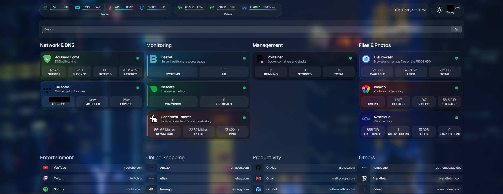
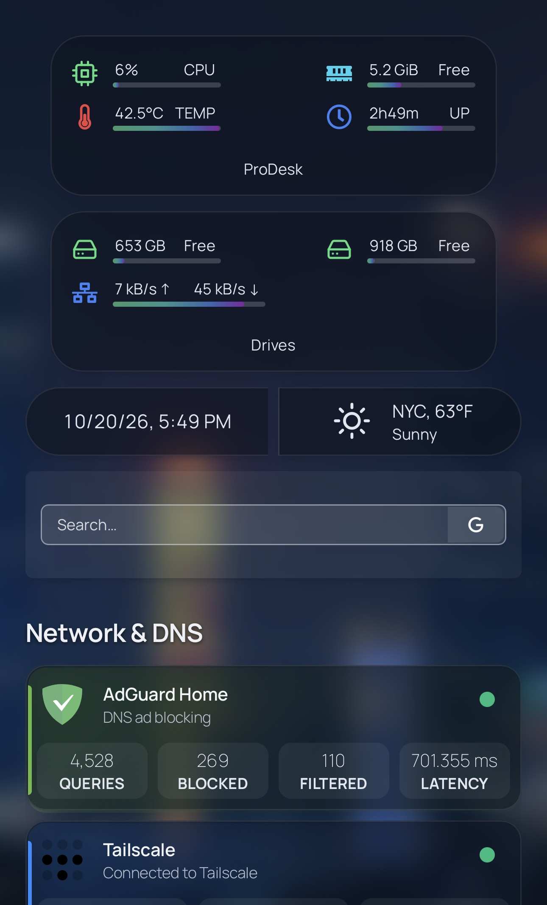
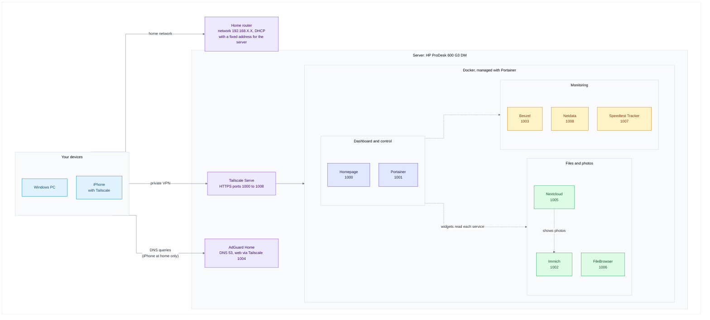
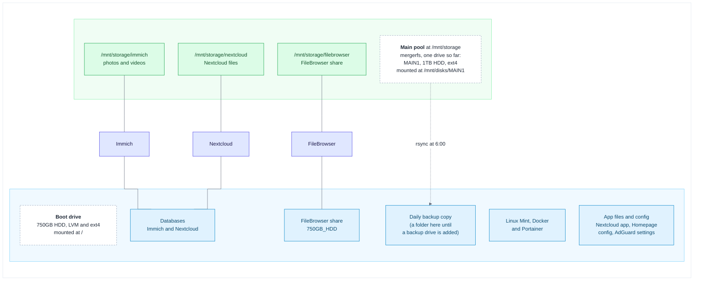

# My Home Lab

[](https://github.com/IbrandonrtI/My-Home-Lab-/actions/workflows/checks.yml)

This is my home lab. It runs on a small HP mini PC and does ad blocking for the whole network, runs my containers, monitors the machine, stores files and phone photos, and has one dashboard that links to everything. I reach all of it from anywhere through Tailscale, and nothing is open to the public internet.

I also wrote an installer that rebuilds the whole thing on a fresh Linux Mint or Ubuntu machine, and I wrote down every step in the guides, including the things that broke along the way.





## Try it

On a fresh Linux Mint 22 or Ubuntu 24.04 machine with internet (about 30 to 60 minutes and 10 GB of downloads):

```bash
sudo apt update && sudo apt install -y git
git clone https://github.com/IbrandonrtI/My-Home-Lab-.git
cd My-Home-Lab-
sudo bash setup.sh install --dry-run     # shows what it would do, changes nothing
sudo bash setup.sh install               # asks a few questions, then builds the lab
```

[INSTALL.md](INSTALL.md) shows what you'll see and what is left to do by hand afterwards. If you'd rather build it step by step, follow the [build guide](docs/build-guide.md).

> **About the placeholders.** Every name and address in this repo is a placeholder: `your-username` (the Linux user), `192.168.X.X` (the server's address at home) and `your-tailnet.ts.net` (your Tailscale network). Passwords and keys are written as `your-own-key`. The installer and the guides say where your own values go. Keep real values out of Git.

## What's in it

- **One-command rebuild.** `homelab-setup` installs Docker, Tailscale and Portainer, deploys the nine stacks through Portainer, fills in the values that are specific to the machine, and tests each Homepage widget against the live service before it saves the key. It never formats a drive, and `--dry-run` shows the plan first. I've tested it against a fake machine and on a real Linux Mint virtual machine.
- **Ad and tracker blocking** for every device on the network, with AdGuard Home and 12 blocklists.
- **Nine services in Docker.** Portainer manages Docker, and every other service is a Portainer stack from a Compose file in [`stacks/`](stacks/), with the image versions pinned. That makes nine stacks, because the Beszel agent has its own.
- **Private remote access.** Tailscale gives every service its own HTTPS address. No port forwarding, nothing public.
- **Storage that survives mistakes.** The data drives are pooled with mergerfs and mounted by UUID. The empty mount points are locked so a missing drive can't fill the boot drive, Docker waits for the pool at boot, and one command recovers after an unplug. A menu script connects, disconnects and moves drives, and undoes its own changes if a mount fails ([storage guide](docs/storage.md)).
- **A daily backup with a 30-day undo.** `rsync` copies the data and the boot drive's config files at 6:00 every morning. Files I delete or replace are kept in dated folders for 30 days, and the Nextcloud database is dumped every day.
- **Photos and files.** Immich backs up the phone photos, Nextcloud stores files, and Nextcloud can show the Immich library.
- **Monitoring.** Beszel, Netdata and Speedtest Tracker feed widgets on the dashboard.
- **A cheat sheet at every login.** A new terminal prints my commands, a few suggested commands for whatever needs attention, and a live status: pools, last backup, containers and free space.
- **A custom dashboard.** Frosted-glass cards, status dots, live widgets, and a layout that works from a phone to a big monitor. `homelab theme` changes the background and card colours, and `homelab bookmark` adds bookmarks with their logos ([build guide, section 14.5](docs/build-guide.md#145-change-the-look-and-add-bookmarks)).

## Architecture

How devices reach the services:



Where the data lives:



## Hardware

| Part | Details |
| :--- | :--- |
| Computer | HP ProDesk 600 G3 Desktop Mini, Intel Core i5-7500T (4 cores) |
| Memory | 8GB DDR4-2400 (one SO-DIMM, one slot free) |
| Boot drive | 750GB 2.5-inch 5400 rpm hard drive in the internal bay (SATA) |
| Data drive | 1TB 2.5-inch 5400 rpm hard drive on a generic SATA to USB 3.0 adapter. It is `MAIN1`, the first drive of the main pool |
| Power | Genuine HP 65W adapter |
| Display | DisplayPort dummy plug (EDID emulator), so the headless machine behaves as if a monitor is attached |
| Network | Wired Ethernet, with a fixed address reserved in the router |
| Operating system | Linux Mint 22.3 XFCE on LVM, no disk encryption |

## Services

| Service | What it does | Local port | Tailscale address |
| :--- | :--- | :--- | :--- |
| Homepage | The dashboard that links to everything | 3001 | `https://pc.your-tailnet.ts.net:1000` |
| Portainer | Manages Docker containers and stacks | 9000 (HTTP), 9443 | `https://pc.your-tailnet.ts.net:1001` |
| Immich | Photo and video backup | 2283 | `https://pc.your-tailnet.ts.net:1002` |
| Beszel | Server health and resource graphs | 8090 | `https://pc.your-tailnet.ts.net:1003` |
| AdGuard Home | DNS filtering | 3000 (web), 53 (DNS) | `https://pc.your-tailnet.ts.net:1004` |
| Nextcloud | Personal cloud and file sync | 8082 | `https://pc.your-tailnet.ts.net:1005` |
| FileBrowser | Browser-based file manager | 8081 | `https://pc.your-tailnet.ts.net:1006` |
| Speedtest Tracker | Internet speed history | 8088 | `https://pc.your-tailnet.ts.net:1007` |
| Netdata | Live system metrics | 19999 | `https://pc.your-tailnet.ts.net:1008` |

Tested with: Linux Mint 22.3, mergerfs 2.33.5, Docker 29.9, Tailscale 1.104, Homepage 2.6, Immich 3.3, Nextcloud 35.0, Speedtest Tracker 1.15, FileBrowser 2.63, Beszel 0.21 and AdGuard Home 0.107.79.

## Guides

| Guide | What's in it |
| :--- | :--- |
| [INSTALL.md](INSTALL.md) | Install the whole lab with the installer, and how the installer works |
| [Build guide](docs/build-guide.md) | The same lab built by hand, one service at a time |
| [Storage guide](docs/storage.md) | Drive pools, the daily backup, recovery, replacing a dead drive |
| [Nextcloud clients](docs/nextcloud-clients.md) | Syncing Windows, Linux, macOS, iPhone and Android with Nextcloud |
| [Maintenance](docs/maintenance.md) | Health checks, power cuts, rebuilding after the boot drive dies |
| [Updating](docs/updating.md) | How I update each service and the system, and how to roll back |
| [Troubleshooting](docs/troubleshooting.md) | 67 problems I ran into, each with the symptom, cause, fix and a check |
| [Security](docs/security.md) | What protects the lab and where the weak spots are |
| [Secrets checklist](docs/secrets-checklist.md) | Every password and key, where it lives and how to get it back |
| [VM test guide](docs/vm-test-guide.md) | Testing the installer on a throw-away virtual machine |
| [History](docs/history/lenovo-migration.md) | How I first built it and moved it off an old laptop |

On the server, `homelab docs` lists the sections of these guides, and `homelab` prints the cheat sheet.

## What I learned

Mostly Linux, Docker and networking the hard way. I set up a DNS filter and freed port 53 from `systemd-resolved`. I pooled drives with mergerfs, mounted them by UUID and wrote scripts that can undo themselves. I learned why a daily `rsync` backup needs a test restore, and how Tailscale replaces opening ports. I wrote a Python installer and a fake machine to test it on, and I wrote up 67 problems so I don't have to solve them twice.

## What's next

- **A backup drive.** A second 1TB drive becomes `BACKUP1`, so the daily backup leaves the boot drive ([storage guide](docs/storage.md#12-adding-the-backup-drive)).
- **Replacing a dead drive.** `sudo drives replace` is built and tested with fake drives and once with a USB stick. I haven't had to do it for real, and I hope I never do.
- **A faster boot drive.** Move the system to a small NVMe SSD and keep the 750GB drive as a spare.
- **More services I might add:** Uptime Kuma, Vaultwarden, Jellyfin, Paperless-ngx and Home Assistant.

## Security

No port is forwarded, secrets stay out of Git, and each integration has its own key. The weak spots (the `docker` group, the Docker socket, unencrypted backups, FileBrowser being abandoned) are listed in [Security](docs/security.md).

## What's where

```text
README.md, INSTALL.md   front page and install guide
setup.sh                starts the installer
installer/              homelab-setup, the installer (built from src/)
src/                    the pieces of the installer
stacks/                 one Compose file per Portainer stack
homepage-config/        Homepage settings, widgets and styles
scripts/                server commands: drives, homelab-backup, hdd-recover, homelab, ...
tests/                  tests that run against a fake machine
tools/                  build script for the installer
docs/                   the guides and screenshots
.github/                the automatic checks
```

If something doesn't work, start with [Troubleshooting](docs/troubleshooting.md).
