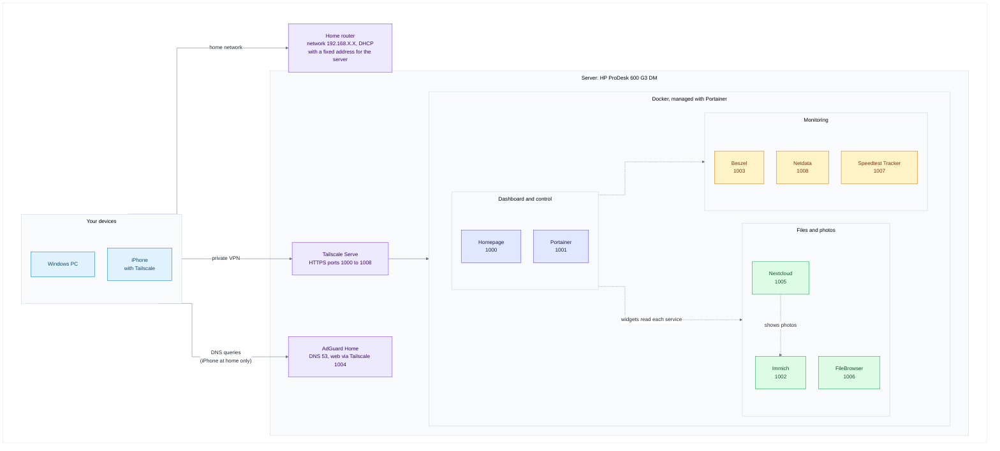
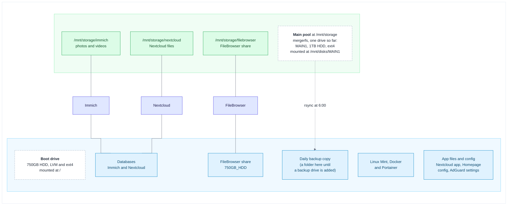

# My Home Lab

[](https://github.com/IbrandonrtI/My-Home-Lab-/actions/workflows/checks.yml)

A self-hosted home lab on a small HP mini PC: network-wide ad blocking, container management, system monitoring, file storage, photo backup, a personal cloud and one dashboard that ties it all together. Everything is reachable from anywhere through a private Tailscale network, and nothing is exposed to the public internet.

It is also reproducible: a one-file installer rebuilds the whole lab on a fresh Linux Mint or Ubuntu machine, and every step it takes is written down in the guides.


## Quick start

On a fresh Linux Mint 22 or Ubuntu 24.04 machine with internet access (about 30 to 60 minutes, 10 GB of downloads):

```bash
sudo apt update && sudo apt install -y git
git clone https://github.com/IbrandonrtI/My-Home-Lab-.git
cd My-Home-Lab-
sudo bash setup.sh install --dry-run     # shows what would be done, changes nothing
sudo bash setup.sh install               # asks a few questions, then builds the lab
```

[INSTALL.md](INSTALL.md) walks through what you will see and what is left to do by hand afterwards. If you prefer to build it step by step, or want to understand what the installer does, follow the [build guide](docs/build-guide.md).

> **About the placeholders.** Every address and name in this repository is a placeholder: `your-username` (the Linux user), `192.168.X.X` (the server's address on your home network) and `your-tailnet.ts.net` (your Tailscale network name). Passwords, keys and tokens are written as `your-own-key`. The installer and the guides tell you where to put your own values. Keep real values out of Git.

## Highlights

- **One-command rebuild.** `homelab-setup` installs Docker, Tailscale and Portainer, deploys the nine stacks through the Portainer API, fills in every machine-specific value and tests each Homepage widget against the live service before it writes the key. It never formats or changes a drive, and `--dry-run` shows the plan without changing anything. It has been tested against a simulated machine and on a real Linux Mint virtual machine ([installer design](docs/installer-design.md)).
- **DNS-level ad and tracker blocking** for every device on the network, with AdGuard Home and 12 blocklists.
- **Nine services in Docker.** Portainer manages Docker, and every other service is a Portainer stack defined by a version-pinned Compose file in [`stacks/`](stacks/) (nine stacks, because Beszel's agent has a stack of its own), so the setup can be rebuilt from text files.
- **Private remote access.** Tailscale gives every service its own trusted HTTPS address. There is no port forwarding and no public exposure.
- **A storage layout built to survive mistakes.** The data drives are joined into a pool with mergerfs and mounted by UUID, the empty mount points are locked so a missing drive can't fill the boot drive, Docker waits for the pool at boot, and one recovery command restores everything after a disconnect. A menu script connects, disconnects and moves drives, and undoes its own changes if a mount fails ([storage guide](docs/storage.md)).
- **A daily backup with a 30-day undo.** `rsync` copies the data and the boot drive's config files every morning at 6:00. Files I delete or replace are kept in dated folders for 30 days, and the Nextcloud database is dumped every day.
- **Photo backup and a personal cloud.** Immich backs up phone photos, Nextcloud stores files, and Nextcloud can show the Immich library.
- **Live monitoring.** Beszel, Netdata and Speedtest Tracker feed widgets on the Homepage dashboard.
- **A cheat sheet at every login.** Every new terminal, over SSH or in VS Code, prints the commands I use, a few suggested commands for what needs attention now, and a live status: pools, last backup, containers and free space.
- **A custom-built dashboard** with frosted-glass cards, status dots, live widgets and a layout that adapts from phones to large monitors. The background, the card colours and the bookmarks (with logos from Brandfetch) can be changed with two short commands ([build guide, section 14.5](docs/build-guide.md#145-change-the-look-and-add-bookmarks)).

## Architecture

How devices reach the services:



Where the data lives:



## Hardware

| Part | Details |
| :--- | :--- |
| Computer | HP ProDesk 600 G3 Desktop Mini, Intel Core i5-7500T (4 cores) |
| Memory | 8GB DDR4-2400 (one SO-DIMM, one slot free) |
| Boot drive | 750GB 2.5-inch 5400 rpm hard drive in the internal bay (SATA) |
| Data drive | 1TB 2.5-inch 5400 rpm hard drive on a generic SATA to USB 3.0 adapter. It is `MAIN1`, the first drive of the main pool |
| Power | Genuine HP 65W adapter |
| Display | DisplayPort dummy plug (EDID emulator), so the headless machine behaves as if a monitor is attached |
| Network | Wired Ethernet, with a fixed address reserved in the router |
| Operating system | Linux Mint 22.3 XFCE on LVM, no disk encryption |

## Services

| Service | What it does | Local port | Tailscale address |
| :--- | :--- | :--- | :--- |
| Homepage | The dashboard that links to everything | 3001 | `https://pc.your-tailnet.ts.net:1000` |
| Portainer | Manages Docker containers and stacks | 9000 (HTTP), 9443 | `https://pc.your-tailnet.ts.net:1001` |
| Immich | Photo and video backup | 2283 | `https://pc.your-tailnet.ts.net:1002` |
| Beszel | Server health and resource graphs | 8090 | `https://pc.your-tailnet.ts.net:1003` |
| AdGuard Home | DNS filtering | 3000 (web), 53 (DNS) | `https://pc.your-tailnet.ts.net:1004` |
| Nextcloud | Personal cloud and file sync | 8082 | `https://pc.your-tailnet.ts.net:1005` |
| FileBrowser | Browser-based file manager | 8081 | `https://pc.your-tailnet.ts.net:1006` |
| Speedtest Tracker | Internet speed history | 8088 | `https://pc.your-tailnet.ts.net:1007` |
| Netdata | Live system metrics | 19999 | `https://pc.your-tailnet.ts.net:1008` |

Tested with: Linux Mint 22.3, mergerfs 2.33.5, Docker 29.9, Tailscale 1.104, Homepage 2.6, Immich 3.3, Nextcloud 35.0, Speedtest Tracker 1.15, FileBrowser 2.63, Beszel 0.21 and AdGuard Home 0.107.79.

## Documentation

| Guide | What is in it |
| :--- | :--- |
| [INSTALL.md](INSTALL.md) | Install the whole lab with the installer |
| [Build guide](docs/build-guide.md) | The same lab built by hand, one service at a time |
| [Storage guide](docs/storage.md) | Drive pools, the daily backup, the recovery command, replacing a dead drive |
| [Nextcloud clients](docs/nextcloud-clients.md) | Sync Windows, Linux, macOS, iPhone and Android with Nextcloud |
| [Maintenance and recovery](docs/maintenance.md) | Health checks, power cuts, rebuilding after the boot drive dies |
| [Updating services](docs/updating.md) | How to update each service and the system, and how to go back |
| [Troubleshooting](docs/troubleshooting.md) | 67 problems I hit, each with symptom, cause, fix and a check |
| [Security and credentials](docs/security.md) | What protects the lab and where the weak spots are |
| [Secrets checklist](docs/secrets-checklist.md) | Every password and key, where it lives and how to recover it |
| [Installer design](docs/installer-design.md) | How the installer works, its safety rules and what is unverified |
| [VM test guide](docs/vm-test-guide.md) | Test the installer on a throw-away virtual machine |
| [History](docs/history/lenovo-migration.md) | How the lab was first built and moved from an old laptop |
| [CHANGELOG.md](CHANGELOG.md), [CONTRIBUTING.md](CONTRIBUTING.md) | What changed, and how to change it |

On the server, `homelab docs` lists the sections of these guides and `homelab` prints a cheat sheet of every command.

## What this project demonstrates

| Skill | What I did |
| :--- | :--- |
| **Linux administration** | Installed and configured Linux Mint on LVM, managed services with `systemd`, wrote `fstab` entries, `cron` jobs and `bash` scripts, set up SSH and unattended remote desktop. |
| **Networking and DNS** | Ran a network-wide DNS filter, reserved a fixed address in the router, freed port 53 from `systemd-resolved`, pointed devices at the DNS server by hand when the router would not allow it, and tested resolution with `nslookup`. |
| **Containers** | Deployed nine services as Docker Compose stacks through Portainer, used bind mounts and named volumes, host networking, health checks, restart policies and environment variables for secrets. |
| **Storage reliability** | Pooled drives with mergerfs, mounted ext4 drives by UUID with `nofail`, locked the empty mount points with `chattr +i`, ordered Docker after the mount with a `systemd` drop-in, tuned drive power management with `hdparm`, checked drive health with SMART, wrote a `bash` menu tool and recovery command that snapshot and roll back `fstab`, and scheduled a daily `rsync` backup that keeps deleted files for 30 days. |
| **Automation** | Wrote a Python installer with a checklist, a dry run, a restore mode and a pinned progress bar, and tested it with a simulated machine (fake `apt`, Docker, Tailscale and web services) and on a virtual machine. |
| **Secure remote access** | Used a private mesh VPN with HTTPS certificates instead of opening ports, kept secrets out of files and out of Git, used separate least-privilege API keys, and handled a brute-force lockout correctly. |
| **Monitoring** | Combined Beszel, Netdata and Speedtest Tracker with live Homepage widgets, and used drive and container checks to prove each fix worked. |
| **Troubleshooting** | Diagnosed and fixed 67 real problems (drive paths, filesystem permissions, registry throttling, reverse-proxy settings, API errors) and wrote each one up as symptom, cause, fix and verification. |
| **Hardware** | Built a mini PC server: SATA boot drive, USB data drive, BIOS and Secure Boot changes, power adapter diagnosis, and a display emulator for headless remote desktop. |
| **Documentation and migration** | Planned and carried out a full server migration with a written runbook, and kept the documentation accurate by checking every step against the running system. |
| **Front-end customization** | Wrote the Homepage stylesheet: frosted-glass cards, per-service accent colors, responsive scaling for different screen widths. |

## Roadmap

Storage plans, in the order I expect to do them:

- **A backup drive.** A second 1TB hard drive becomes `BACKUP1`, so the daily backup leaves the boot drive ([storage guide](docs/storage.md#12-adding-the-backup-drive)).
- **Replace a dead drive:** built as `sudo drives replace` ([storage guide](docs/storage.md#15-replace-a-dead-drive)), tested with fake drives and rehearsed once with a USB stick. A real replacement is still to do (I hope never).
- **A faster boot drive.** Move the operating system to a 128GB NVMe SSD, and keep the 750GB drive as a bootable spare that is refreshed on a schedule.

Services I plan to add: Uptime Kuma (alerts when a service goes down), Vaultwarden (a self-hosted password manager), Jellyfin (a media server), Paperless-ngx (scanning and searching documents) and Home Assistant (home automation).

## Security

No port is forwarded to the internet, secrets live outside Git, and each integration has its own key. The weak spots (the `docker` group, the Docker socket, unencrypted backups, an unmaintained FileBrowser) are listed with advice in [Security and credentials](docs/security.md).

## Repository layout

```text
README.md, INSTALL.md   front page and quick start
CHANGELOG.md            what changed in each version
CONTRIBUTING.md         how to change and test the project
SECURITY.md             how to report a problem (the guide is docs/security.md)
setup.sh                starts the installer
installer/              homelab-setup, the installer (built from src/)
src/                    the parts of the installer
stacks/                 one Compose file per Portainer stack
homepage-config/        Homepage settings, widgets and styles
scripts/                server commands: drives, homelab-backup, hdd-recover, homelab, ...
tests/                  simulation tests (no real machine needed)
tools/                  build script for the installer
docs/                   the guides and the screenshots
.github/                automatic checks, issue forms and Dependabot
```

If something doesn't work, start with [Troubleshooting](docs/troubleshooting.md). It lists the problems I hit, with the symptom, cause, fix and a way to check each fix.
