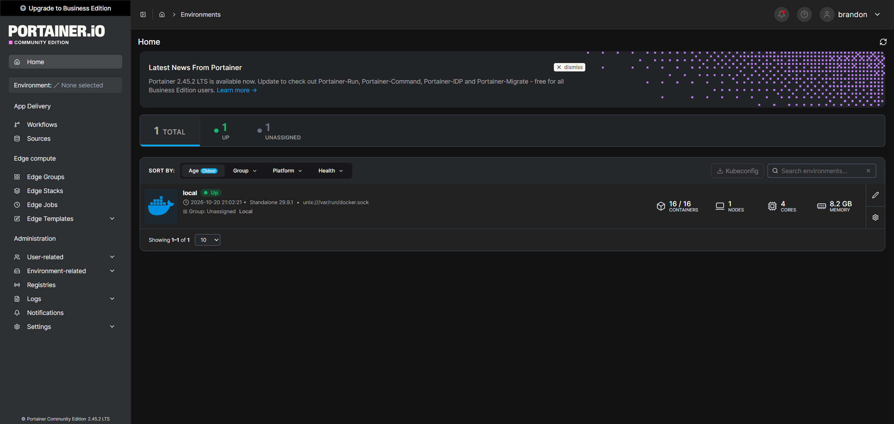
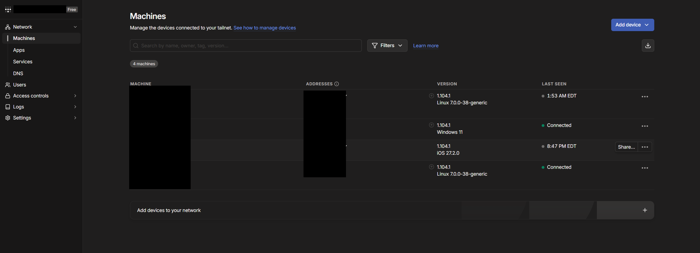
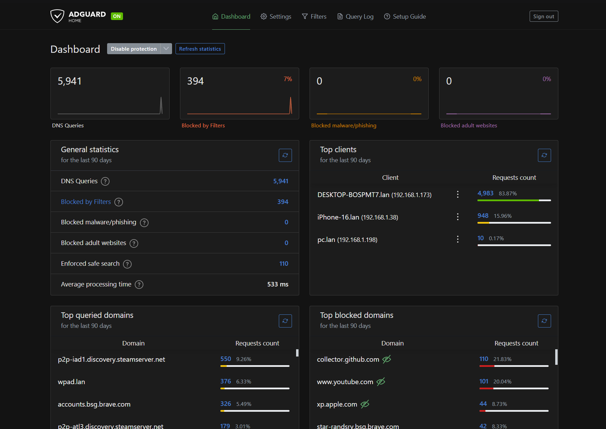
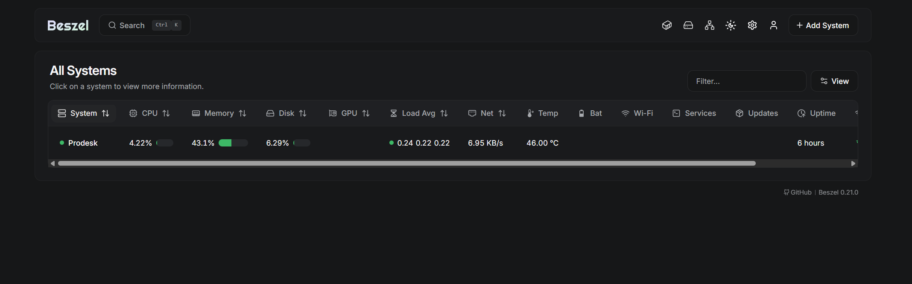
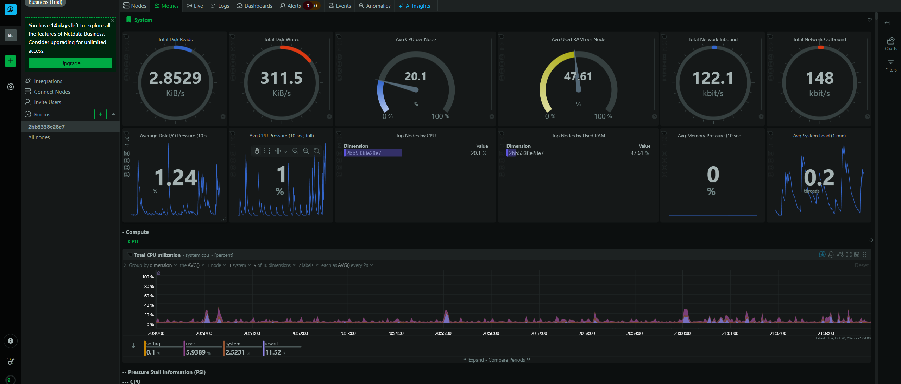
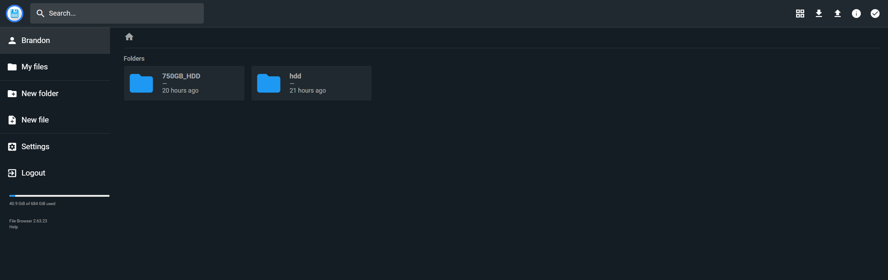
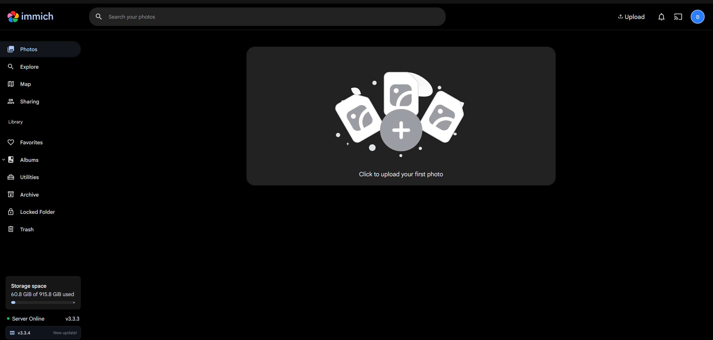
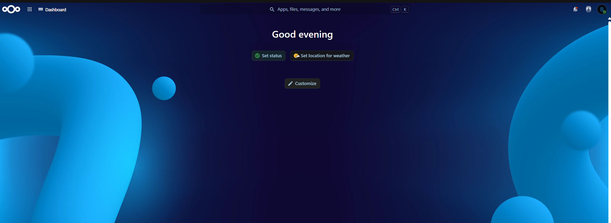
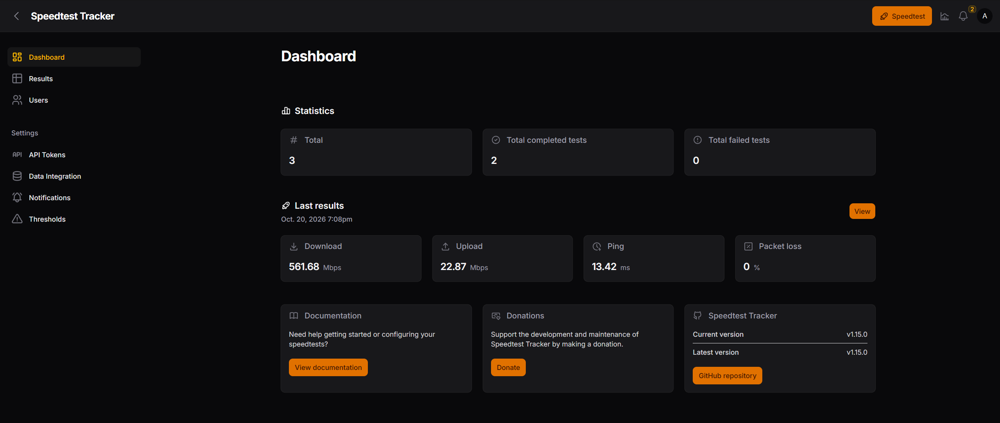

# Build guide for my hardware

This is how I built the lab, one service at a time, in the order that worked for me. The installer (`setup.sh`, see [INSTALL.md](../INSTALL.md)) does the same steps for you. Use this guide if you want to see what the installer does, build only part of the lab, or fix something yourself.

> **About the placeholders.** Every address and name here is a placeholder: `your-username` (the Linux user), `192.168.X.X` (the server's address on your home network) and `your-tailnet.ts.net` (your Tailscale network name). Passwords, keys and tokens are written as `your-own-key`. Swap in your own values, and keep the real ones out of Git.

<!-- toc -->

## Using the stack files

Every service except Portainer is a **stack**: a Compose file in the [`stacks/`](../stacks/) folder of this repository. Each file starts with comments that say which folders it needs, which port it uses and which environment variables to set. To deploy one:

1. Open the file on GitHub and click **Copy raw file**, or copy it from your clone of the repository (`~/My-Home-Lab-/stacks/`).
1. In Portainer, go to **Stacks**, then **Add stack**. Enter the stack name given in the section. The names matter, because container names are built from them.
1. Paste the file into the web editor and replace the placeholders (`192.168.X.X`, `your-tailnet`, `your-username`, `your-own-key`) with your own values.
1. If the section lists environment variables, open **Environment variables**, switch to advanced mode and paste them in, with your own values.
1. Click **Deploy the stack**.

The files pin the version of each image, so a stack doesn't change by itself. [Updating services](updating.md) explains how to move to a newer version.

## 1. Hardware, BIOS and operating system

### 1.1 Put the hardware together

1. Install the 750GB drive in the mini PC's internal 2.5-inch bay and connect it by SATA. This will be the boot drive.
1. Plug the genuine HP 65W power adapter into the mini PC. A third-party adapter with a converter tip didn't work on this model (see [I1](troubleshooting.md#i1-the-mini-pc-wont-start-and-the-light-by-the-power-jack-flickers)).
1. Connect the network cable to the router.
1. Keep the 1TB data drive disconnected until the operating system is installed, so the installer can't pick the wrong disk.
1. For the install, connect a monitor, keyboard and mouse. Afterwards the machine runs headless.

### 1.2 Make the installer USB stick

I used [Ventoy](https://www.ventoy.net/), which lets you copy ISO files onto a stick and choose which one to boot.

1. On a Windows PC, download Ventoy and run `Ventoy2Disk.exe`.
1. Select the USB stick and click **Install**. This erases the stick.
1. Copy the Linux Mint 22.3 XFCE ISO file onto the stick like any other file.

### 1.3 BIOS setting and booting the stick

1. Plug in the USB stick and power the mini PC on.
1. Press **F10** repeatedly at the HP logo to open the BIOS setup.
1. Turn **Secure Boot** off in the BIOS security settings. This was the only BIOS change I made.
1. Open **Boot Options** and choose the USB stick.
1. Ventoy loads. Select the Linux Mint XFCE ISO and choose to boot it in normal mode.

### 1.4 Install Linux Mint

From the live desktop, double-click **Install Linux Mint** and follow the installer:

1. Choose your language and keyboard layout.
1. Choose **Erase disk and install Linux Mint**, and pick the **750GB drive**. This erases that drive.
1. Open **Advanced features** and select **LVM**. Leave encryption off.
1. Set your time zone.
1. Enter your name, set the computer name to `pc`, choose a username (this guide uses `your-username`) and a strong password.
1. Let the install finish, then restart and remove the USB stick when asked.

### 1.5 First boot

Update the system and confirm the version:

```bash
sudo apt update && sudo apt upgrade -y
cat /etc/os-release | head -3
```

You should see `Linux Mint 22.3`. Then plug in the DisplayPort dummy plug if you want the machine to run without a monitor. It makes the graphics card believe a display is connected, which keeps the remote desktop smooth and lets the integrated graphics work.

**Check it:** `lsblk -f` shows the 750GB drive with an LVM partition and a `/` root, and `ip -br addr` shows your wired connection with an address.

---

## 2. Base system and remote access

### 2.1 Reserve a fixed address for the server

Every other setting in this guide depends on the server keeping the same address. Find the wired adapter's hardware (MAC) address:

```bash
ip -br link show
```

Look at the line for your wired adapter (mine is `eno1`) and note the `xx:xx:xx:xx:xx:xx` value. Then, in your router's settings, find the DHCP or address reservation page and reserve `192.168.X.X` for that hardware address. Restart the server or renew its address, and confirm:

```bash
ip -br addr
```

### 2.2 SSH server

SSH lets you control the server from another computer's terminal.

```bash
sudo apt update
sudo apt install openssh-server -y
sudo systemctl enable ssh
sudo systemctl start ssh
```

Connect from another machine:

```bash
ssh your-username@192.168.X.X
```

**Check it:** `sudo systemctl status ssh` shows `active (running)`, and the `ssh` command from your PC asks for your password.

### 2.3 Auto-login

So the desktop session starts without anyone sitting at the machine (needed for the remote desktop later), edit the login manager settings:

```bash
sudo nano /etc/lightdm/lightdm.conf
```

Under `[Seat:*]`, set:

```ini
[Seat:*]
autologin-guest=false
autologin-user=your-username
autologin-user-timeout=0
```

Save with `Ctrl+O`, `Enter`, `Ctrl+X`. The change applies at the next boot.

### 2.4 VS Code with Remote-SSH

For editing config files on the server from a Windows desktop, with proper syntax highlighting:

1. Install [VS Code](https://code.visualstudio.com/) on the Windows PC.
1. Install the **Remote - SSH** extension.
1. Press `Ctrl+Shift+P`, choose **Remote-SSH: Connect to Host**, and enter `your-username@192.168.X.X`.
1. Enter your password when asked.
1. Open a folder from the integrated terminal:

```bash
code -a ~/homepage-config/
```

> **Tip.** Files inside a Docker named volume (`/var/lib/docker/volumes/...`) are owned by root, so VS Code can't save them. The working approach is a bind mount, a normal folder in your home directory shared into the container. [Section 14](#14-homepage-dashboard) does this for Homepage's config.

### 2.5 AnyDesk (remote desktop)

AnyDesk gives full remote desktop access to the headless server, like a self-hosted TeamViewer.

```bash
sudo apt install gnupg2 -y
sudo install -m 0755 -d /etc/apt/keyrings
wget -qO - https://keys.anydesk.com/repos/DEB-GPG-KEY | sudo gpg --dearmor -o /etc/apt/keyrings/anydesk.gpg
echo "deb [signed-by=/etc/apt/keyrings/anydesk.gpg] http://deb.anydesk.com/ all main" | sudo tee /etc/apt/sources.list.d/anydesk-stable.list
sudo apt update
sudo apt install anydesk -y
```

The key is stored in its own file and only used for this one repository. (The older `apt-key add` command is deprecated, because it trusted the key for every repository.)

Get the ID you'll connect to:

```bash
anydesk --get-id
```

Set a password for unattended access, so a connection doesn't need someone to click Accept on the server:

```bash
sudo anydesk --set-password
```

Start the service at boot:

```bash
sudo systemctl enable anydesk
sudo systemctl start anydesk
```

Start the AnyDesk window automatically after login (auto-login from [section 2.3](#23-auto-login) makes this happen at boot):

```bash
mkdir -p ~/.config/autostart
cp /usr/share/applications/anydesk.desktop ~/.config/autostart/
```

From another device, install AnyDesk and connect with the ID and password. The DisplayPort dummy plug from [section 1.5](#15-first-boot) keeps the screen resolution stable and the picture smooth.

**Check it:** `sudo systemctl is-active anydesk` prints `active`, and you can connect from your PC.

## 3. Docker

I installed Docker from Docker's own apt repository. Its list has no entry for Linux Mint, so use the name of the Ubuntu release Mint is based on. For Mint 22 that's `noble` (Ubuntu 24.04). The wrong name makes the install fail with a "held broken packages" error.

```bash
sudo install -m 0755 -d /etc/apt/keyrings
sudo curl -fsSL https://download.docker.com/linux/ubuntu/gpg -o /etc/apt/keyrings/docker.asc
sudo chmod a+r /etc/apt/keyrings/docker.asc

echo "deb [arch=$(dpkg --print-architecture) signed-by=/etc/apt/keyrings/docker.asc] https://download.docker.com/linux/ubuntu noble stable" | sudo tee /etc/apt/sources.list.d/docker.list > /dev/null

sudo apt-get update
sudo apt-get install -y docker-ce docker-ce-cli containerd.io docker-compose-plugin docker-ce-rootless-extras docker-buildx-plugin
```

Add yourself to the `docker` group so you can run `docker` without `sudo`, then reboot so it takes effect:

```bash
sudo usermod -aG docker "$USER"
sudo reboot
```

> **Heads up.** Being in the `docker` group is the same as being root on this machine: anyone who can run `docker` can start a container that mounts the whole disk. Only add accounts you trust, and keep SSH protected (a strong password or, better, keys).

**Check it:**

```bash
docker --version
docker run hello-world
```

`hello-world` should print `Hello from Docker!`. If you created the storage pool in [Storage: drive pools and backups](storage.md#storage-drive-pools-and-backups) before installing Docker, add the wait rule from [storage guide, step 6](storage.md#6-make-docker-wait-for-the-pool) now.

---

## 4. Portainer

Portainer is a web dashboard for managing Docker. From here on, every service is deployed as a **stack** in Portainer: a Compose file pasted into a web page, which is easy to edit, redeploy and back up.

```bash
docker volume create portainer_data

docker run -d \
  -p 9443:9443 \
  -p 9000:9000 \
  --name portainer \
  --restart=always \
  -v /var/run/docker.sock:/var/run/docker.sock \
  -v portainer_data:/data \
  portainer/portainer-ce:latest
```

Portainer is the one thing here that isn't a stack and isn't pinned: it runs from the `latest` tag so that security fixes reach it. [Updating services](updating.md#portainer) shows how to update it, and how to go back to an older version.

Open `http://192.168.X.X:9000` and create an admin account. Portainer closes its first-time setup after about five minutes. If the page says setup timed out, restart it and reload:

```bash
docker restart portainer
```

If it asks for a setup token, read it from the logs with `docker logs portainer`.

**How to deploy any stack below:**

1. In Portainer, go to **Stacks**, then **Add stack**.
1. Enter the stack name given in the section. The names matter, because container names are built from them.
1. Paste the YAML into the web editor.
1. If the section lists environment variables, open **Environment variables**, switch to advanced mode and paste them in, with your own values.
1. Click **Deploy the stack**.

Port 9000 is plain HTTP and is the one Tailscale will forward to. Portainer's own HTTPS port (9443) uses a self-signed certificate that Tailscale won't proxy.

**Check it:** `docker ps` lists `portainer`, and you can log in.



---

## 5. Tailscale

Tailscale builds a private network between your devices. With Tailscale Serve on top, every service gets its own HTTPS address that only your devices can reach. There's no port forwarding and nothing is public.

Install it on the server:

```bash
curl -fsSL https://tailscale.com/install.sh -o tailscale-install.sh
less tailscale-install.sh        # read it first if you like; press q to leave
sudo sh tailscale-install.sh
sudo tailscale up
```

Tailscale's own instructions pipe the script straight into `sh`. Downloading it first lets you read what you're about to run as root.

Open the sign-in link it prints, in a browser that is signed in to your Tailscale account. The machine appears in the [admin console](https://login.tailscale.com/admin/machines) under its hostname (`pc`). Also install the Tailscale app on your PC and phone, and sign in to the same account.

**Publish each service over HTTPS** with Tailscale Serve. Each `--https` number becomes the port in the address. The address after it is where the service runs on the server. The numbers follow the order the services are listed in this guide:

```bash
sudo tailscale serve reset
sudo tailscale serve --bg --https=1000 http://192.168.X.X:3001
sudo tailscale serve --bg --https=1001 http://192.168.X.X:9000
sudo tailscale serve --bg --https=1002 http://192.168.X.X:2283
sudo tailscale serve --bg --https=1003 http://192.168.X.X:8090
sudo tailscale serve --bg --https=1004 http://192.168.X.X:3000
sudo tailscale serve --bg --https=1005 http://192.168.X.X:8082
sudo tailscale serve --bg --https=1006 http://192.168.X.X:8081
sudo tailscale serve --bg --https=1007 http://192.168.X.X:8088
sudo tailscale serve --bg --https=1008 http://192.168.X.X:19999
tailscale serve status
```

If the first command asks you to enable HTTPS certificates for your tailnet, follow the link it prints and enable them, then run the command again. Entries for services that aren't running yet show an error until those services are deployed.

| Service | Address |
| :--- | :--- |
| Homepage | `https://pc.your-tailnet.ts.net:1000` |
| Portainer | `https://pc.your-tailnet.ts.net:1001` |
| Immich | `https://pc.your-tailnet.ts.net:1002` |
| Beszel | `https://pc.your-tailnet.ts.net:1003` |
| AdGuard Home | `https://pc.your-tailnet.ts.net:1004` |
| Nextcloud | `https://pc.your-tailnet.ts.net:1005` |
| FileBrowser | `https://pc.your-tailnet.ts.net:1006` |
| Speedtest Tracker | `https://pc.your-tailnet.ts.net:1007` |
| Netdata | `https://pc.your-tailnet.ts.net:1008` |

To remove one entry: `sudo tailscale serve --https=1008 off`.

**Check it:** `tailscale serve status` lists nine entries, and `https://pc.your-tailnet.ts.net:1001` shows Portainer from a device that has Tailscale turned on.



---

## 6. AdGuard Home

Network-wide DNS filtering. It runs in Docker with host networking, so it answers DNS on the server's own port 53.

### 6.1 Free port 53

`systemd-resolved` listens on port 53 by default, which conflicts with AdGuard Home. Turn it off and let Tailscale manage `/etc/resolv.conf`. Do this over SSH on the **local network address** (`ssh your-username@192.168.X.X`), not the Tailscale one, because the last command restarts Tailscale and would cut off a session that goes through it. Download the AdGuard image first, while DNS still works:

```bash
docker pull adguard/adguardhome:v0.107.79

sudo systemctl disable systemd-resolved
sudo systemctl stop systemd-resolved
sudo rm /etc/resolv.conf
echo "nameserver 192.168.X.1" | sudo tee /etc/resolv.conf
sudo systemctl restart tailscaled
```

Replace `192.168.X.1` with your router's address. It keeps the server resolving names until AdGuard is running.

**Check it:**

```bash
sudo ss -tulpn | grep :53
cat /etc/resolv.conf
nslookup google.com
```

The first command shouldn't list `systemd-resolve` on port 53. `resolv.conf` should either show your one line or a Tailscale header with `nameserver 100.100.100.100`, and the lookup should return an address.

> **Heads up for later.** When Tailscale updates itself, the server can lose name resolution while Tailscale owns `/etc/resolv.conf`: lookups fail with `SERVFAIL` and `git clone` says `Could not resolve host`. The fix is two commands, in [F6 in the troubleshooting guide](troubleshooting.md#f6-the-server-cannot-look-up-names-after-a-tailscale-update). It happened to me on 2026-10-23.

### 6.2 Deploy the stack

Create a stack named `adguard` from [`stacks/adguard.yaml`](../stacks/adguard.yaml). It runs on the host network so that it can answer DNS on port 53.

### 6.3 Setup wizard

Open `http://192.168.X.X:3000` and go through the wizard:

1. Set the admin web interface to listen on all interfaces, on port **3000**. The wizard proposes port 80, so change it. Everything else in this guide expects 3000.
1. Set the DNS server to listen on all interfaces, on port **53**.
1. Create an admin username and password.
1. Finish the wizard and log in.

My upstream servers are DNS-over-HTTPS from Quad9, Cloudflare and Google, with DNSSEC on. I enabled twelve blocklists: AdGuard DNS filter, AdAway Default Blocklist, AdGuard DNS Popup Hosts, HaGeZi's Pro, OISD Big, Peter Lowe's, Steven Black's, Dandelion Sprout's Game Console Adblock, HaGeZi's Allowlist Referral, HaGeZi's Apple Tracker, ShadowWhisperer's Dating List and Dandelion Sprout's Anti-Malware list. If a list ever blocks your upstream DNS providers, look in the [troubleshooting guide](troubleshooting.md).

**Check it:**

```bash
docker ps | grep adguard
sudo ss -tulpn | grep ':53 '
nslookup google.com 192.168.X.X
```

The container should be running, AdGuardHome should own port 53, and the lookup should answer.

### 6.4 Point your devices at it

My router wouldn't let me change its DNS setting, so I set the DNS server on each device myself. Devices you don't change aren't filtered.

**Windows 11 (Ethernet):**

1. Open **Settings**, then **Network and internet**, then **Ethernet**.
1. Next to **DNS server assignment**, click **Edit**.
1. Choose **Manual**, switch **IPv4** on, and enter `192.168.X.X` as the preferred DNS and `8.8.8.8` as the alternate.
1. Click **Save**, then check with `nslookup google.com` in a terminal. The server shown should be `192.168.X.X`.

**iPhone (Wi-Fi):**

1. Open **Settings**, then **Wi-Fi**, then tap the **i** next to your network.
1. Tap **Configure DNS**, then **Manual**.
1. Remove any existing servers, then add `192.168.X.X` and `8.8.8.8`, and tap **Save**.

> The alternate DNS server `8.8.8.8` keeps the internet working if the server is off, but a device can use it at any time and skip AdGuard's filtering. Leave the alternate blank if you prefer strict filtering and don't mind losing internet when the server is down.

**Check it:** in AdGuard's dashboard, the **Top clients** list shows your devices' addresses, and the query count rises as you browse.



---

## 7. Beszel

Real-time CPU, memory, disk and network graphs. It has two parts: a **hub** (the dashboard) and an **agent** (which reports the stats).

### 7.1 Hub

Create a stack named `beszel` from [`stacks/beszel.yaml`](../stacks/beszel.yaml).

Open `http://192.168.X.X:8090` and create an admin account.

### 7.2 Agent

1. In the hub, click **Add System** at the top right.
1. Enter a name (I used `ProDesk`) and the host `192.168.X.X`. Leave the port at `45876`.
1. Stay on the **Docker** tab. The window shows an agent file with your public key and a token already filled in. Keep this window open.
1. Click **Copy docker compose**.
1. In Portainer, create a stack named `beszel-agent` and paste what you copied. Check that `network_mode: host` is there and that `HUB_URL` is `http://192.168.X.X:8090`. It should match [`stacks/beszel-agent.yaml`](../stacks/beszel-agent.yaml) apart from your own `KEY` and `TOKEN`. The one difference: the hub's copy button writes the agent's data folder as `./beszel_agent_data`, and the file uses the named volume `beszel_agent_data` instead, because a relative folder in a Portainer stack ends up in a place that is easy to lose track of. Use the named volume.

<!-- markdownlint-disable-next-line MD029 -->
6. Deploy the stack, then go back to the hub window and click **Add system** at the bottom to finish.

**Check it:**

```bash
docker logs beszel-agent | tail -n 10
```

Look for a line like `WebSocket connected host=192.168.X.X:8090`. In the hub, the system turns green and starts showing graphs.

For the Homepage widget, Beszel needs a **superuser** login that is separate from your hub login. You'll set it in [section 14](#14-homepage-dashboard).



---

## 8. Netdata

Live, second-by-second metrics for the whole system. Create a stack named `netdata` from [`stacks/netdata.yaml`](../stacks/netdata.yaml). The file explains why the container needs the extra permissions it asks for.

Open `http://192.168.X.X:19999`. The dashboard may offer to connect to Netdata Cloud. If it asks for a session ID, read it from the container (its name is built from the stack name, so it is `netdata-netdata-1`, not `netdata`):

```bash
docker exec netdata-netdata-1 cat /var/lib/netdata/netdata_random_session_id
```

If the page offers a way to continue without signing in, you can just use the local dashboard.

**Check it:** `docker ps` shows `netdata-netdata-1` as `healthy`, and the dashboard shows live charts.



---

## 9. FileBrowser

A web-based file manager for drag-and-drop access to the server's storage. It shares two folders: one on the boot drive and one on the data drive. The folders were created in [storage guide, step 5](storage.md#5-create-a-folder-for-each-service).

Create a stack named `filebrowser` from [`stacks/filebrowser.yaml`](../stacks/filebrowser.yaml). The stack and the service must both be named `filebrowser`, because the recovery script expects the container name `filebrowser-filebrowser-1`. Change the two folders on the left of the `volumes:` lines if your drives are mounted elsewhere.

**First login.** This version creates the `admin` user with a random password the first time it starts, so `admin` / `admin` won't work. Read the password from the logs:

```bash
docker logs filebrowser-filebrowser-1 | grep -i password
```

Open `http://192.168.X.X:8081`, log in as `admin` with that password, and change it right away in your profile settings.

**Check it:**

```bash
docker ps
docker exec filebrowser-filebrowser-1 df -h /srv/hdd /srv/750GB_HDD
```

The container should be `healthy`. `/srv/hdd` should show the data drive (`/dev/sda1`, about 916G), and `/srv/750GB_HDD` should show the boot drive's `vgmint-root`.



The two folders above are how the original server was set up. On a machine built with the installer, FileBrowser instead shows one folder named after the system drive and, for data and backup drives, `main-storage` and `backup-storage` with one folder per drive inside. See [storage](storage.md) for how the names are chosen.

---

## 10. Immich

Self-hosted photo and video backup with a phone app, albums, face grouping and search. The photos live on the data drive. The database stays on the boot drive, which is faster for a database than the USB-attached data drive.

> Immich changes often. Before you deploy, compare the file below with the `docker-compose.yml` in [Immich's current release](https://docs.immich.app/install/docker-compose), and use any newer image versions it pins.

### 10.1 Download the images first

Immich's images are on GitHub's container registry, which throttles many parallel downloads with a `toomanyrequests` error. Downloading them one at a time first avoids it. This command pulls every image named in the stack file, one after the other (clone the repository first, as in [the storage guide](storage.md#2-install-the-scripts)):

```bash
awk '$1 == "image:" {print $2}' ~/My-Home-Lab-/stacks/immich.yaml | sed 's/\${IMMICH_VERSION:-release}/release/' | xargs -n1 docker pull
```

If one prints `toomanyrequests`, wait a minute and run that line again.

### 10.2 Deploy the stack

Create a stack named `immich` from [`stacks/immich.yaml`](../stacks/immich.yaml). The file lists the variables it needs at the end; the values to use are below.

`DB_STORAGE_TYPE: 'HDD'` is Immich's own setting for a database that isn't on an SSD, which is the case here because the boot drive is a hard drive.

In **Environment variables**, paste these in advanced mode. Use letters and numbers only for the password, and use your own time zone:

```text
UPLOAD_LOCATION=/mnt/storage/immich
DB_DATA_LOCATION=/home/your-username/immich/postgres
TZ=America/New_York
IMMICH_VERSION=release
DB_PASSWORD=your-own-key
DB_USERNAME=postgres
DB_DATABASE_NAME=immich
```

Deploy it. The first start takes a few minutes. On a hard-drive boot disk, wait for it to settle before deploying anything heavy, because Immich and Nextcloud starting together can overload the machine.



### 10.3 Verify and create your account

```bash
docker ps --format "table {{.Names}}\t{{.Status}}"
docker exec immich_server df -h /data
ls -a /mnt/storage/immich
```

All four Immich containers should be `healthy` or `Up`. `/data` should show the data drive (`/dev/sda1`, about 916G). After a minute, the folder should list `backups encoded-video library profile thumbs upload`. Open `http://192.168.X.X:2283` and create the admin account. The first account you create becomes the admin.

### 10.4 Phone app

1. Install the **Immich** app from the App Store or Google Play.
1. Enter the server address. At home use `http://192.168.X.X:2283`. Away from home, turn on the Tailscale app on the phone and use `https://pc.your-tailnet.ts.net:1002`.
1. Log in, then open the backup settings, choose which albums to back up, and turn backup on.

The first backup of a large library can take a long time and a lot of data, so start it on home Wi-Fi.

---

## 11. Nextcloud

A personal cloud: file sync, sharing, calendar and contacts. It runs as four containers: the app, a PostgreSQL database, Redis (file locking and caching) and a cron container for background jobs. The files live on the data drive. The database and app files stay on the boot drive.

### 11.1 Choose your passwords

You need three values. Use letters and numbers only, because symbols can break Portainer's parsing:

- `NC_ADMIN_USER`: the login name you'll use in Nextcloud.
- `NC_ADMIN_PASSWORD`: the admin password. Make it strong.
- `NC_DB_PASSWORD`: a password that only Nextcloud and its database use to talk to each other. You never type it anywhere.

Nextcloud reads these once, at the first start. Changing them in Portainer afterwards does nothing, so choose them before you deploy and keep them somewhere safe.

### 11.2 Deploy the stack

Create a stack named `nextcloud` from [`stacks/nextcloud.yaml`](../stacks/nextcloud.yaml). The two addresses with `1005` in it must match the Tailscale port you gave Nextcloud in [section 5](#5-tailscale), so put your own Tailscale name in them.

Environment variables:

```text
NC_ADMIN_USER=your-admin-name
NC_ADMIN_PASSWORD=your-own-key
NC_DB_PASSWORD=your-own-key
```

What the settings do:

- `NEXTCLOUD_DATA_DIR: /data` puts the user files on the data drive. It can't be changed after the first install.
- `TRUSTED_PROXIES` lets Nextcloud trust the forwarded requests from Docker's networks and the server itself. Tailscale Serve adds the original address and `https` to each request it forwards, and Nextcloud believes those headers only when they come from a trusted proxy. So the Tailscale link (`https://pc.your-tailnet.ts.net:1005`) builds correct `https` links, and the local link (`http://192.168.X.X:8082`) works as plain `http` on your own network. The local link is for devices at home. It isn't encrypted, so don't use it on a Wi-Fi you don't trust.
- `OVERWRITECLIURL` is the address Nextcloud puts in links that it builds without a browser (the background job). Don't add `OVERWRITEHOST` or `OVERWRITEPROTOCOL`: they force every request, the local ones too, to the Tailscale address.

### 11.3 Verify

The first start takes 2 to 10 minutes, longer on a hard-drive boot disk. Watch it, and press `Ctrl+C` when Apache is ready (that only stops the log view):

```bash
docker logs -f nextcloud
```

Then check the data folder. Nextcloud makes it private, so it needs `sudo`:

```bash
docker exec nextcloud df -h /data
sudo ls -a /mnt/storage/nextcloud
```

`/data` should show the data drive, and the folder should contain `.ncdata`, an `appdata_...` folder and a folder named for your login. Open `https://pc.your-tailnet.ts.net:1005` from a device with Tailscale on, and log in with your admin name and password. After you're in, change the admin password to one you haven't used anywhere else (your profile, then **Security**).



---

## 12. Nextcloud and Immich integration

The `integration_immich` app (version 1.5.1 in my setup) connects Nextcloud to Immich so that your Immich photos show through Nextcloud. It talks to Immich with an API key, so you never share your Immich login with Nextcloud.

### 12.1 Create an Immich API key

1. Open Immich at `http://192.168.X.X:2283` and log in.
1. Click your profile picture at the top right, then **Account Settings**, then **API Keys**, then **New API Key**.
1. Name it `nextcloud`, so you can recognize and revoke it later. For permissions, choose **All** for the first test. You can narrow them later using the app's documentation.
1. Copy the key when it appears. It's shown only once, so don't lose it and never paste it into a chat or a file in Git.

### 12.2 Let Nextcloud talk to a private address

Nextcloud blocks connections to local network addresses by default, which protects against a server being tricked into probing your network. Because Immich runs on the same machine, allow it:

```bash
docker exec -u www-data nextcloud php occ config:system:set allow_local_remote_servers --value=true --type=boolean
docker exec -u www-data nextcloud php occ config:system:get allow_local_remote_servers
```

The second command should print `true`.

### 12.3 Check that Nextcloud can reach Immich

Do this before you touch the app, so you know where any problem is. It uses PHP, which is always inside the Nextcloud container:

```bash
docker exec -u www-data nextcloud php -r 'echo file_get_contents("http://192.168.X.X:2283/api/server/ping");'
```

It should print `{"res":"pong"}`. If it doesn't, check that Immich is running (`docker ps`) and that the address is right before going on.

### 12.4 Install the app

1. In Nextcloud, click your avatar at the top right, then **Apps**.
1. Search for `Immich` and click **Download and enable** on the Immich integration.
1. Confirm it installed:

```bash
docker exec -u www-data nextcloud php occ app:list | grep -i immich
```

You should see `integration_immich` and its version. The app store only lists apps that work with your Nextcloud version. If nothing appears in the search, that is the usual reason.

### 12.5 Connect it

1. Click your avatar, then **Personal settings**, and open **Immich Integration** in the left menu.
1. For **Immich server URL**, enter `http://192.168.X.X:2283`. Use the local address, with no `/photos` and no `/api` on the end. Don't use the Tailscale name or `http://immich_server:2283`: Nextcloud and Immich are on different Docker networks, and a container can't reliably reach the server's own Tailscale address.
1. For **API key**, paste the key from step 12.1.
1. Click **Test connection**, then **Save**.

**Check it:** the test reports a successful connection, and your Immich photos show up through Nextcloud.

**If the test fails:**

- `local IP blocked` means step 12.2 wasn't applied.
- An authentication error means the key was pasted wrongly or lacks permissions. Create a new key and try again.
- A timeout or "could not connect" means step 12.3 should have failed. Fix that first.

To disconnect Nextcloud from Immich at any time, delete the `nextcloud` key in Immich's API Keys page.

## 13. Speedtest Tracker

Runs internet speed tests on a schedule and keeps the history. The Homepage widget reads its results.

**1. Generate its app key.** The app uses this key to encrypt its data. The `base64:` at the start is part of the key and must stay:

```bash
echo "base64:$(openssl rand -base64 32 2>/dev/null)"
```

Copy the whole output.

**2. Download the image.** It comes from the same registry that throttles Immich's downloads:

```bash
awk '$1 == "image:" {print $2}' ~/My-Home-Lab-/stacks/speedtest-tracker.yaml | xargs -n1 docker pull
```

**3. Create its data folder.** Speedtest Tracker keeps its database and settings in `/config`. Give that a folder on the server, not an anonymous Docker volume, because an anonymous volume can come back empty after **Update the stack** (see [B6 in the troubleshooting guide](troubleshooting.md#b6-a-container-starts-empty-after-update-the-stack)):

```bash
mkdir -p ~/speedtest-tracker
ls -ld ~/speedtest-tracker
```

The owner should be your user, because `PUID: "1000"` below runs the container as the first normal user.

**4. Deploy the stack.** Create a stack named `speedtest-tracker` from [`stacks/speedtest-tracker.yaml`](../stacks/speedtest-tracker.yaml), and replace the `APP_KEY` value with your key, quotes included.

**5. Log in and change the default login.** Open `http://192.168.X.X:8088`. The default login is `admin@example.com` with the password `password`. Change both in your profile settings straight away.

**6. Create an API token for the Homepage widget.** Open `http://192.168.X.X:8088/admin/api-tokens`, create a token and give it the **Read Results** ability. Copy it, because it's shown once. Then run one speed test from the dashboard so there is a result for the widget to read.

**Check it:**

```bash
curl -s -H "Accept: application/json" -H "Authorization: Bearer your-own-key" http://192.168.X.X:8088/api/v1/results/latest | head -c 300
```

Put your real token in place of `your-own-key`. You should see JSON with your download and upload speeds. `Unauthenticated` means the token is wrong or lacks the Read Results ability.

The folder isn't in the daily backup by default. Add it as shown in [storage guide, step 9](storage.md#9-the-daily-backup).



---

## 14. Homepage dashboard

A single landing page that links to every service, with live widgets for system resources, container counts, DNS statistics and more. The configuration lives in the [`homepage-config/`](../homepage-config/) folder of this repository.

| File | What it does |
| :--- | :--- |
| `services.yaml` | The service cards, their links, status dots and widgets |
| `widgets.yaml` | The top bar: CPU, memory and temperature, drives, date and time, weather, search |
| `settings.yaml` | Title, theme, background image and layout |
| `bookmarks.yaml` | A short generic example of bookmarks |
| `custom.css` | The frosted-glass look, per-service accent colors and responsive scaling |

### 14.1 Download the image and get the config

The image comes from GitHub's registry, so download it first:

```bash
awk '$1 == "image:" {print $2}' ~/My-Home-Lab-/stacks/homepage.yaml | xargs -n1 docker pull
```

Copy the config from this repository into the folder you created in [storage guide, step 5](storage.md#5-create-a-folder-for-each-service). Do this before Homepage's first start. If you already cloned the repository in [storage guide, step 2](storage.md#2-install-the-scripts), skip the `git clone` line:

```bash
sudo apt install git -y
git clone https://github.com/IbrandonrtI/My-Home-Lab-.git ~/My-Home-Lab-
cp ~/My-Home-Lab-/homepage-config/* ~/homepage-config/
```

The files use placeholders for addresses. Replace them with your real ones (change `192.168.1.50` and `your-real-name.ts.net` to your own values):

```bash
cd ~/homepage-config
sed -i 's/192\.168\.X\.X/192.168.1.50/g; s/your-tailnet\.ts\.net/your-real-name.ts.net/g' services.yaml
```

### 14.2 Deploy the stack

Create a stack named `homepage` from [`stacks/homepage.yaml`](../stacks/homepage.yaml) ([how to use the stack files](#using-the-stack-files)). Replace the two placeholders in `HOMEPAGE_ALLOWED_HOSTS` with your real address and Tailscale name. Homepage refuses requests from addresses that aren't on this list.

The config folder is a **bind mount** (a normal folder), so you can edit it from VS Code without permission errors. The last line shares the data drive so the drive widget can read its free space.

Open `http://192.168.X.X:3001`. You should see the cards and the styling. Cards with widgets show errors until you fill in their keys, which is expected.

### 14.3 Fill in the widget keys

Every `your-own-key` in `services.yaml` needs a real value. **Stop Homepage while you edit, then start it again.** A widget with a wrong login retries every few seconds, and Nextcloud treats that as an attack and blocks the address for a while:

```bash
docker stop homepage
nano ~/homepage-config/services.yaml
docker start homepage
```

| Card | What to put in and where to get it |
| :--- | :--- |
| AdGuard Home | `username` and `password`: the login you made in the AdGuard wizard |
| Tailscale | `deviceid`: your machine's ID in the admin console (open the machine, copy the ID that ends in `CNTRL`). `key`: an API access token from the admin console under **Settings**, then **Keys**. Copy the whole `tskey-api-...` text when it is shown |
| Beszel | `username` and `password`: the superuser login. Set it with `docker exec beszel /beszel superuser upsert your-email@example.com your-own-key`, then use the same email and password |
| Speedtest Tracker | `key`: the token from [section 13](#13-speedtest-tracker), step 6 |
| Portainer | `key`: an access token from your Portainer profile (your name, then **My account**, then **Access tokens**). `env`: the environment number in Portainer's address bar when you click the local environment (it appears as `#!/<number>/` or `#!/endpoints/<number>`) |
| FileBrowser | `username` and `password`: `admin` and the password you set |
| Immich | `key`: an API key from Immich's account settings. Make a separate one for Homepage |
| Nextcloud | `key`: a token you create with the commands below |

For Nextcloud, generate a random token, store it in Nextcloud, and print it so you can paste it into `services.yaml`. Don't change the word `TOKEN` in these commands:

```bash
TOKEN=$(openssl rand -hex 24)
docker exec -u www-data nextcloud php occ config:app:set serverinfo token --value=$TOKEN
echo $TOKEN
```

### 14.4 What the config looks like

A card with a widget (the secret is replaced):

```yaml
- Network & DNS:
    - AdGuard Home:
        id: adguard-card
        href: https://pc.your-tailnet.ts.net:1004
        siteMonitor: http://192.168.X.X:3000
        icon: adguard-home.svg
        description: DNS ad blocking
        widget:
          type: adguard
          url: http://192.168.X.X:3000
          username: your-own-key
          password: your-own-key
```

The `id` (`adguard-card`) is what `custom.css` uses to give each card its own accent color. The top bar:

```yaml
- resources:
    label: ProDesk
    cpu: true
    memory: true
    cputemp: true
    uptime: true

- resources:
    label: Drives
    disk:
      - /
      - /mnt/storage
    network: true
```

`/` is the boot drive and `/mnt/storage` is the data drive, which is why Homepage needed the extra volume line above.

**Check it:**

```bash
docker logs homepage --tail 30
docker exec homepage df -h /mnt/storage
```

The cards should show green status dots and live widgets. The second command should show the data drive (about 916G). The Netdata card may leave a `Parse Error` line in the log even though the card is green. That's harmless, and the explanation is in the [troubleshooting guide](troubleshooting.md).

### 14.5 Change the look and add bookmarks

Homepage has no settings page for this, so I made two terminal commands for it. Run them as your normal user, **without `sudo`** (they refuse to run as root, so the files don't become root's). They change the files in `~/homepage-config`; the previous `settings.yaml` and `custom.css` are saved as `*.before-theme` the first time.

```bash
homelab theme                         # shows the current look and the options
homelab theme background https://example.com/picture.jpg   # or a file on this machine
homelab theme brightness 50           # how dark the picture is (0 to 100)
homelab theme cards blue 40           # card colour (name or #hex) and how solid it is (0 to 100)
homelab theme accent adguard blue     # one service's glow and edge colour (or: all)
homelab theme reset                   # back to the original look
```

A picture from the web is downloaded once and kept in `~/homepage-config/images`, so the dashboard works without the internet. The colour settings are written into a marked block at the end of `custom.css`; `homelab theme reset` removes exactly that block and nothing else.

```bash
homelab bookmark brandfetch YOUR-CLIENT-ID   # once: your own free key from brandfetch.com
homelab bookmark add Proton https://proton.me   # a group name can follow: ... Proton https://proton.me News
homelab bookmark list
homelab bookmark remove Proton
```

A bookmark's logo is downloaded as an SVG file from [Brandfetch](https://brandfetch.com)'s logo service, which needs a free client ID (get one from Brandfetch's developer pages, under the Logo API). The ID is saved in `~/homepage-config/.brandfetch-client-id`, readable only by you, and is never sent anywhere except to Brandfetch. Without an ID, or when Brandfetch has no logo for a site, the bookmark is still added, without a logo. After either command, refresh the dashboard page in the browser (a hard refresh, `Ctrl+Shift+R`) to see the change. Both commands show up as suggestions when a terminal opens.
